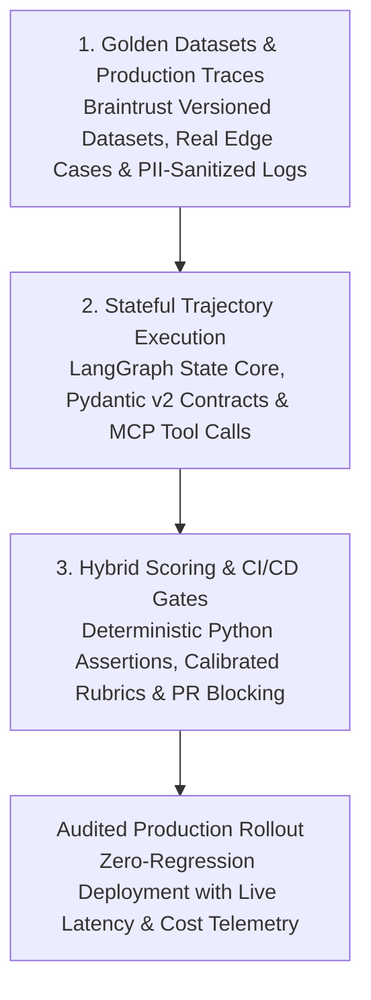

*Reading time: 8 minutes. Author: Hugo S. Nascimento.*

<!-- more -->

*Context: Enterprise engineering teams spend months connecting autonomous agents to corporate ERPs, CRMs, and data platforms. Yet when it comes time to update a system prompt, swap a foundation model, or add a new tool schema, ninety percent of teams still rely on manual vibe checks: typing five sample questions into a chat window and hoping nothing broke. Within days of deployment, silent regressions corrupt downstream records. Here is the reference architecture we deploy at hsnlabs to bind Braintrust evaluation suites and automated CI/CD gates directly to LangGraph state machines.*

> **Executive Summary for Technology Leaders:** Probabilistic models cannot be governed by manual spot-checking. Every prompt adjustment, model upgrade, or retrieval change alters the probability distribution of agent trajectories across hundreds of edge cases. By integrating Braintrust as the continuous evaluation and observability layer over LangGraph state machines and Pydantic v2 data contracts, engineering leaders turn subjective AI testing into deterministic software CI/CD: blocking regressions before code merges and converting production anomalies into permanent golden test cases.

---

## Diligence Note and Technical Specifications

The architectural patterns and evaluation workflows detailed in this post align with official technical documentation and open engineering standards:

* **Braintrust AI Evaluation and Observability Platform:** detailing dataset versioning, deterministic and rubric-based scorers, CI/CD pull-request gates, and production trace logging, available at <a href="https://www.braintrust.dev/docs">Braintrust Technical Documentation</a>.
* **LangGraph Stateful Orchestration Specification:** detailing cyclic state graphs, node-level state inspection, and durable checkpointing, available at <a href="https://langchain-ai.github.io/langgraph/">LangGraph Technical Documentation</a>.
* **hsnlabs Braintrust Evals Practice:** reference specifications and deployment methodology, available at <a href="https://hsnlabs.ai/en/braintrust/">hsnlabs Braintrust Evals & CI/CD Practice</a>.

---

## 1. Why Manual "Vibe Checks" Collapse in Enterprise Production

In traditional deterministic software, a unit test asserts that input `X` produces output `Y`. In agentic systems, a single user request can trigger multi-hop tool calls, schema parsing, and conditional state transitions.

When teams rely on ad-hoc manual testing or naive single-prompt LLM-as-a-Judge scripts, deployments fail across four predictable vectors:

| Failure Vector | Manual "Vibe Checks" & Ad-Hoc Scripts | Governed ADLC with Braintrust Evals & LangGraph |
| :--- | :--- | :--- |
| **Regression Blindness** | Fixing a prompt for one edge case silently breaks three previously working workflows | Runs every pull request against hundreds of versioned golden dataset scenarios before merge |
| **Trajectory Opacity** | Evaluates only the final text string, missing invalid intermediate tool calls or redundant loops | Scores individual LangGraph node transitions, tool arguments, and Pydantic schema compliance |
| **Subjective Scoring Drift** | Uncalibrated LLM judges give inconsistent 1-to-5 scores across identical runs | Combines deterministic Python code assertions with binary rubric scorers anchored to ground truth |
| **Production Disconnect** | Test datasets stay static and synthetic while real user traffic evolves | Converts failed production traces into permanent golden test cases in a single workflow loop |

---

## 2. The Three-Layer Evaluation Architecture: Braintrust + LangGraph + ADLC

To achieve production reliability, evaluation cannot be an afterthought bolted onto the UI. It must operate as a continuous loop spanning **Dataset Curation**, **Node-Level Scoring**, and **Automated CI/CD Gates**.

### Layer 1: Versioned Golden Datasets from Real Operations
Synthetic test questions invented by developers rarely reflect how enterprise operations fail.

* **Bootstrapping from Historical Tickets & ERP Logs:** During our initial architecture sprint, we extract real historical transactions, edge-case exceptions, and compliance boundaries to form the baseline golden dataset in Braintrust.
* **Continuous Trace Harvesting:** When a live agent encounters an unexpected schema state or triggers a Human-in-the-Loop escalation in production, the exact trace is sanitized and appended to the Braintrust dataset so the system never repeats the same mistake twice.

### Layer 2: Node-Level Inspection Over LangGraph State Machines
Evaluating an agent as a black box hides architectural rot. Because hsnlabs builds agents as explicit **LangGraph** state machines, every intermediate state is exposed to Braintrust:

1. **Router & Intent Precision:** Deterministic scorers verify that the entry node classifies the business intent and selects the exact required MCP toolset with 100% precision.
2. **Schema & Argument Fidelity:** Before any tool executes against Snowflake, Databricks, or SAP, Python assertion scorers validate that the generated payload strictly matches the expected Pydantic v2 contract.
3. **Invariant & Guardrail Compliance:** Negative test suites verify that unauthorized requests, prompt injections, or out-of-bounds financial amounts reliably trigger the deterministic error boundary rather than hallucinating a bypass.

### Layer 3: Automated CI/CD Pull-Request Gates
Every modification to a prompt template, model version, or state graph edge triggers an automated evaluation run in CI/CD:

* **Diff-Based Scorecards:** Engineers see immediately in their pull request whether accuracy, tool-calling precision, token cost, or p95 latency regressed on any subset of the golden dataset.
* **Hard Deployment Thresholds:** If critical compliance or schema-validity scorers drop below 100%, the deployment pipeline halts automatically.

---

## 3. From PoC to Production in 4 Steps

At hsnlabs, we embed Braintrust evaluation pipelines directly into our clients' engineering workflows with full code and IP handover:

1. **Step 01 · Failure Mode Audit:** We map your target business workflow, identify high-risk operational failure modes, and define hard acceptance thresholds before writing agent code.
2. **Step 02 · Golden Dataset & Scorer Engineering:** We curate real enterprise edge cases into versioned Braintrust datasets and write deterministic Python scorers paired with calibrated domain rubrics.
3. **Step 03 · CI/CD & Telemetry Integration:** We wire Braintrust into your LangGraph state machines and GitHub Actions pipelines, establishing live production tracing for latency, token burn, and accuracy.
4. **Step 04 · Team Handover:** We deliver the complete evaluation harness, golden datasets, and operational playbooks so your internal engineering team can iterate on models and prompts with mathematical confidence.

---

## Strategic Resources and Related Reading
- <a href="https://hsnlabs.ai/en/braintrust/">hsnlabs Braintrust Evals & CI/CD Architecture Practice</a>
- <a href="https://hsnlabs.ai/en/langchain/">hsnlabs LangChain & LangGraph Production Engineering</a>
- <a href="https://hsnlabs.ai/en/snowflake/">hsnlabs Snowflake AI Data Cloud Architecture Practice</a>
- <a href="../llm-as-judge-fallacy/">The LLM-as-a-Judge Fallacy: Why Probabilistic Evaluators Fail in Regulated Operations</a>
- <a href="../the-poc-graveyard/">The PoC Graveyard: Why 90% of Enterprise Pilots Collapse Under Dirty Data</a>
