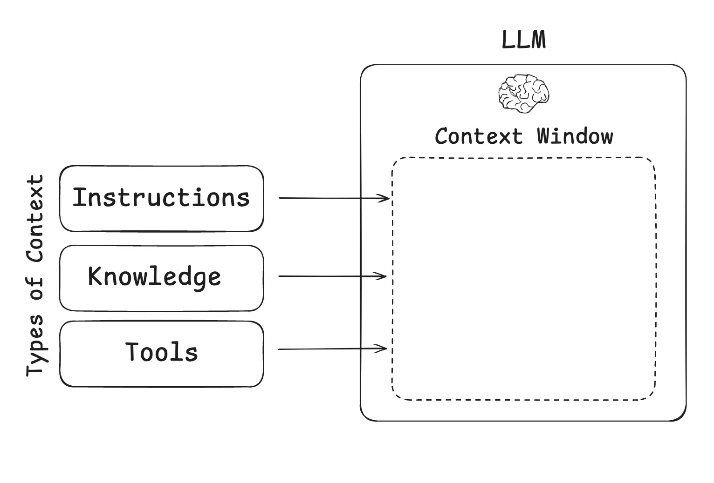
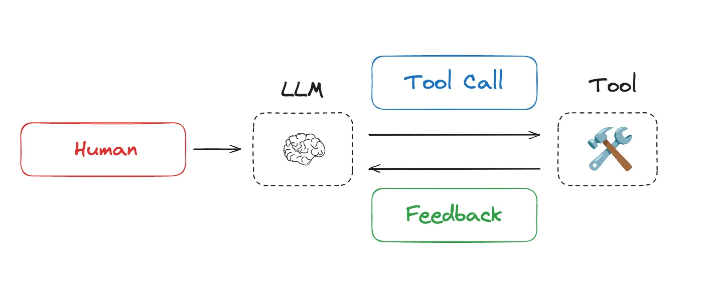
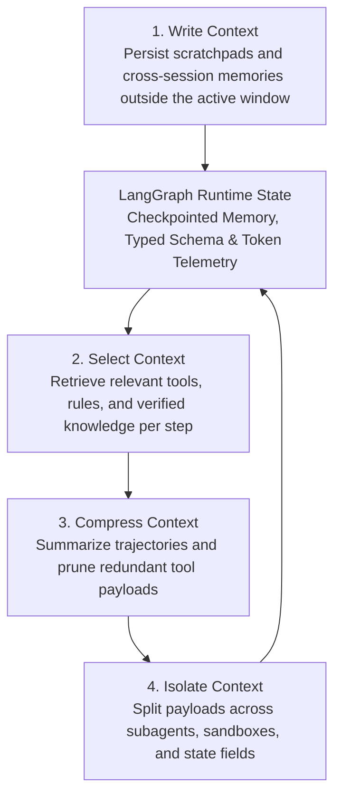

*Reading time: 8 minutes. Author: Hugo S. Nascimento.*

<!-- more -->

*Context: Most enterprise AI pilots work cleanly on turn one and collapse by turn twelve. As autonomous agents call ERP APIs, inspect SQL schemas, and accumulate multi-turn tool outputs, bloated context windows inflate latency, burn token budgets, and trigger silent reasoning failures. Building on LangChain's primary analysis of context engineering for agents, here is how we structure production context pipelines in LangGraph at hsnlabs.*

> **Executive Summary for Technology Leaders:** An LLM operates like a CPU whose working memory is its context window. When engineering teams dump uncurated instructions, sprawling vector chunks, and raw API payloads into that finite window, accuracy collapses even on frontier models. By treating context as a managed runtime resource across four disciplines: **Write**, **Select**, **Compress**, and **Isolate**, implemented natively in **LangGraph** and verified with **LangSmith**, organizations cut token waste, enforce compliance boundaries, and stabilize multi-step agent execution.

---

## Diligence Note and Technical Specifications

The architectural patterns and context management strategies detailed in this post build on primary industry research and official framework specifications:

* **LangChain Primary Study on Context Engineering:** taxonomy of write, select, compress, and isolate patterns across production agents and research systems, published at <a href="https://www.langchain.com/blog/context-engineering-for-agents">Context Engineering for Agents by LangChain</a>.
* **LangGraph Stateful Orchestration Specification:** checkpointed short-term state, cross-thread memory stores, and multi-agent isolation primitives, documented at <a href="https://langchain-ai.github.io/langgraph/">LangGraph Technical Documentation</a>.
* **LangSmith Observability and Evaluation Platform:** token-level trace attribution and regression scoring for context changes, documented at <a href="https://docs.smith.langchain.com/">LangSmith Technical Documentation</a>.
* **hsnlabs Production LangChain Practice:** enterprise architecture standards and deployment methodology, available at <a href="https://hsnlabs.ai/en/langchain/">hsnlabs LangChain & LangGraph Engineering</a>.

---

## 1. Why the Context Window Is the Production Bottleneck

Andrej Karpathy framed modern LLMs as a new kind of operating system: the model acts as the CPU, and the context window acts as RAM, serving as finite working memory. Just as an operating system kernel decides what stays in RAM and what is paged out, **context engineering** is the discipline of filling the context window with strictly the right information for the next execution step.

In enterprise applications, that working memory must juggle three distinct classes of payload:

* **Instructions:** system prompts, compliance guardrails, few-shot examples, and tool schemas.
* **Knowledge:** verified business facts, policy rules, and retrieved operational records.
* **Tools:** intermediate parameters and raw feedback returned by external APIs and databases.

<figure class="article-editorial-figure">
  
  <figcaption class="editorial-caption">Context taxonomy from LangChain: Instructions, Knowledge, and Tools compete for finite working memory inside the LLM context window.</figcaption>
</figure>

Single-turn chat interfaces hide this constraint. Autonomous agents, by contrast, run in multi-step loops that interleave LLM reasoning with external tool calls, accumulating every intermediate JSON payload and search output into the active trajectory.

<figure class="article-editorial-figure">
  
  <figcaption class="editorial-caption">Agent execution loop from LangChain: every tool call injects raw feedback back into the LLM context window on subsequent turns.</figcaption>
</figure>

As trajectories span dozens of turns, uncurated accumulation breaks enterprise workflows across four failure modes identified by Drew Breunig and observed across client audits:

| Failure Mode | Mechanism Inside the Context Window | Enterprise Production Consequence |
| :--- | :--- | :--- |
| **Context Poisoning** | An early hallucination or malformed tool output enters working memory and persists across turns | Subsequent ERP lookups and financial calculations compound the initial error into corrupted ledger actions |
| **Context Distraction** | Oversized history overwhelms the model's learned reasoning patterns | Agents ignore explicit compliance rules buried early in the system prompt and repeat stale actions |
| **Context Confusion** | Superfluous tool schemas or irrelevant retrieved passages bias token generation | Models invoke wrong mutating endpoints or blend unrelated vendor policies into a single decision |
| **Context Clash** | Contradictory facts from different retrieval chunks or stale turns coexist in the prompt | Approval agents receive conflicting credit limits or policy versions and stall in non-deterministic loops |

This is why dumping raw invoices or database exports into a vector store fails in real operations, a failure pattern we documented in <a href="/blog/post/why-rag-breaks-on-erp/">Why I Never Use Normal RAG on Financial ERPs</a>. Longer context windows do not fix sloppy curation; they merely make bad context more expensive.

---

## 2. The Four Strategies of Context Engineering: Write, Select, Compress, and Isolate

To prevent bloated windows from degrading reliability, production engineering teams organize context management into four complementary operations around a stateful runtime.

### Write Context Outside the Window with Scratchpads and Memories

Writing context persists intermediate artifacts outside the LLM window so the model does not have to keep every detail active in working memory:

* **In-Session Scratchpads:** When an agent executes a multi-step investigation, it writes plans, intermediate totals, or unresolved IDs to a file or a dedicated runtime state field. Anthropic's multi-agent researcher, for instance, persists its research plan to memory immediately so a 200,000-token truncation never erases the overall objective.
* **Cross-Session Memories:** Inspired by Reflexion and Generative Agents, systems like ChatGPT, Cursor, and Windsurf synthesize durable memories from past runs. In enterprise workflows, writing verified user preferences, cost-center mappings, and post-correction rules across threads prevents teams from repeating the same onboarding instructions daily.

### Select Context Without Overloading Tools or Retrieval

Saving context only pays off if the agent retrieves the right slice at each step without flooding the window:

* **Scoped Scratchpad Reads:** When scratchpads live inside typed runtime state rather than raw text logs, developers control exactly which fields are exposed to the LLM at each graph node.
* **Procedural, Episodic, and Semantic Memory Retrieval:** Coding agents rely on deterministic rule files like `CLAUDE.md` or workspace rules for procedural guidance, while semantic facts require indexed retrieval via embeddings or knowledge graphs. Poor selection breaks trust fast: Simon Willison documented how ChatGPT pulled his stored home location into an unrelated image prompt, making users feel the context window no longer belongs to them.
* **Tool Description RAG:** Giving an agent fifty overlapping tools causes immediate tool-selection confusion. Applying semantic retrieval over tool descriptions to surface only the relevant subset has been shown in recent research to triple tool-selection accuracy.
* **Beyond Naive Code and Document RAG:** As Windsurf's Varun noted, indexing code or enterprise records is not the same as retrieving working context. At scale, pure embedding similarity becomes unreliable and must combine structural parsing, exact keyword or grep lookup, knowledge-graph traversal, and re-ranking—the same discipline behind our <a href="/blog/post/how-to-build-operational-ontology-python-mcp/">Operational Business Ontology in Python with Pydantic and MCP</a>.

### Compress Context Through Summarization and Deterministic Pruning

Long-running investigations and verbose API responses inevitably consume thousands of unnecessary tokens. Compression retains only decision-relevant signal:

* **Trajectory and Boundary Summarization:** Tools like Claude Code run automatic compaction once a session crosses ninety-five percent of the context limit, summarizing prior turns recursively. Equally effective is placing summarization directly at tool boundaries or agent-to-agent handoffs, where Cognition uses fine-tuned models to distill decisions without dropping critical exceptions.
* **Heuristic and Trained Trimming:** Unlike LLM summarization, trimming deterministically prunes older message arrays or low-value metadata fields via rules or trained pruners such as Provence, cutting latency and inference cost with zero extra model calls.

### Isolate Context Across Subagents, Sandboxes, and State Schemas

Isolation splits context physically so noisy payloads never compete for attention in a single prompt:

* **Multi-Agent Separation of Concerns:** Frameworks such as OpenAI Swarm and Anthropic's parallel subagent researcher assign each specialist agent its own narrow tools, instructions, and private context window. Anthropic showed parallel isolated subagents outperform single-agent baselines, though teams must budget for coordination complexity and up to fifteen times higher token consumption across parallel branches.
* **Execution Sandboxes:** HuggingFace's CodeAgent runs generated tool code inside a sandbox and returns only concise return values to the LLM, keeping bulky JSON blobs, binary files, or tabular exports inside environment variables rather than the prompt.
* **Typed Runtime State Isolation:** Even in a single-agent graph, a structured state schema can expose conversational messages to the LLM while holding heavy ERP payloads, audit tokens, or raw document chunks in isolated state fields accessed strictly by deterministic nodes.

---

## 3. Implementing Context Engineering with LangGraph and LangSmith

  
  Low-level stateful orchestration for write, select, compress, and isolate context control.

Theory fails when engineers cannot inspect token burn or test whether a context change actually improved accuracy. Before refactoring prompts, teams need two foundations in **LangSmith**: trace-level token telemetry to spot bloated turns, and automated evaluation datasets to verify that compression or pruning never causes silent regressions.

Because **LangGraph** models agents as explicit cyclic graphs passing a typed state object between nodes, every context engineering strategy maps directly to a native architectural primitive:

| Strategy | LangGraph & Ecosystem Primitive | Operational Effect in Production |
| :--- | :--- | :--- |
| **Write** | Thread-scoped checkpointing for scratchpads; cross-thread Store and **LangMem** for durable memory | Persists plans, intermediate validations, and operational learnings outside the LLM prompt window |
| **Select** | Node-level state projection; Store file/vector retrieval; **LangGraph Bigtool** semantic tool filtering | Exposes strictly the state fields, policies, and MCP tools needed at the current graph step |
| **Compress** | Built-in message trimming utilities, dedicated summarization nodes, and tool-output post-processors | Shrinks verbose ERP or search outputs before they accumulate across multi-turn trajectories |
| **Isolate** | Typed state field partitioning, E2B or Pyodide execution sandboxes, and Supervisor or Swarm subgraphs | Keeps raw records and parallel research noise isolated from the primary decision window |

---

## 4. From Token Audit to Production in 4 Steps

At hsnlabs, we structure context engineering rollouts so engineering leaders gain measurable cost and accuracy improvements without rewriting core systems:

1. **Step 01 · Token and Trajectory Audit:** We instrument existing agent traces in LangSmith to quantify token distribution across instructions, retrieval chunks, and tool responses, pinpointing where distraction or clash occurs.
2. **Step 02 · State Schema and Isolation Design:** We partition raw payloads into typed LangGraph state fields and sandboxed execution boundaries, removing bulky intermediate outputs from the LLM message history.
3. **Step 03 · Selective Retrieval and Compression Gates:** We deploy semantic tool filtering, hybrid ontology-backed retrieval, and deterministic trimming or boundary summarization nodes with strict compliance invariants.
4. **Step 04 · Eval-Backed Production Handover:** Every context change is verified against golden regression suites in CI/CD before deployment, delivering full ownership of graphs, memory policies, and telemetry dashboards to your team.

---

## Strategic Resources and Related Reading
- <a href="https://hsnlabs.ai/en/langchain/">hsnlabs LangChain & LangGraph Production Engineering</a>
- <a href="https://www.langchain.com/blog/context-engineering-for-agents">Context Engineering for Agents — LangChain Primary Article</a>
- <a href="/blog/post/braintrust-evals-cicd-langgraph-agent-architecture/">Braintrust Evals & LangGraph: Replacing Vibe Checks with Deterministic CI/CD</a>
- <a href="/blog/post/why-rag-breaks-on-erp/">Why I Never Use Normal RAG on Financial ERPs</a>
- <a href="/blog/post/how-to-build-operational-ontology-python-mcp/">How to Build an Operational Business Ontology in Python with Pydantic and MCP</a>
