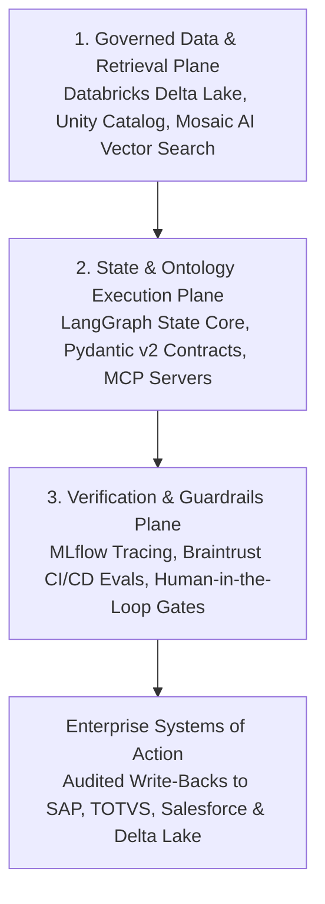

*Reading time: 8 minutes. Author: Hugo S. Nascimento.*

<!-- more -->

*Context: Enterprise technology leaders standardize on the Databricks Data Intelligence Platform to unify Delta Lake pipelines, govern data and models through Unity Catalog, and scale vector retrieval with Mosaic AI. Yet when engineering teams connect probabilistic language models directly to Lakehouse tables via unconstrained text-to-SQL or naive RAG, ninety percent of agent pilots stall before reaching production. Here is the reference architecture we deploy at hsnlabs to bind deterministic LangGraph state machines and executable business ontologies directly over the Databricks Lakehouse.*

> **Executive Summary for Technology Leaders:** The Databricks Data Intelligence Platform provides a unified foundation for enterprise analytics, Delta Lake storage, Mosaic AI retrieval, and centralized Unity Catalog governance. However, governing analytical data artifacts does not automatically govern multi-step transactional agent execution. Giving an autonomous agent unrestricted SQL generation over hundreds of Delta tables causes schema hallucinations, unbounded DBU compute consumption, and unvalidated mutations in upstream ERPs. By pairing Databricks Unity Catalog and Mosaic AI with an open Agentic Development Life Cycle layer built on LangGraph, Pydantic v2 data contracts, Model Context Protocol servers, and MLflow evaluation suites, enterprises achieve governed grounding and deterministic execution without vendor lock-in.

---

## Diligence Note and Technical Specifications

The architectural patterns and platform capabilities detailed in this post align with official technical documentation and open engineering standards:

* **Databricks Data Intelligence Platform and Unity Catalog Governance:** detailing centralized access control across Delta tables, unstructured volumes, functions, and AI models, available at <a href="https://docs.databricks.com/en/data-governance/unity-catalog/index.html">Databricks Unity Catalog Documentation</a>.
* **Databricks Mosaic AI Vector Search and Agent Framework:** detailing hybrid vector indexing synchronized with Delta tables and MLflow tracing, available at <a href="https://docs.databricks.com/en/generative-ai/generative-ai.html">Databricks Mosaic AI Documentation</a>.
* **LangGraph Stateful Orchestration Specification:** detailing cyclic state graphs, durable checkpointing, and human-in-the-loop interrupts, available at <a href="https://langchain-ai.github.io/langgraph/">LangGraph Technical Documentation</a>.
* **hsnlabs Databricks Architecture Practice:** reference specifications and deployment methodology, available at <a href="https://hsnlabs.ai/en/databricks/">hsnlabs Databricks Lakehouse & Mosaic AI Practice</a>.

---

## 1. Why Raw Text-to-SQL Fails Over Enterprise Lakehouse Schemas

When organizations attempt to build operational agents over their Databricks Lakehouse, the initial instinct is connecting a language model directly to a SQL Warehouse endpoint and prompting it to write queries dynamically.

In a mission-critical production environment, this approach collapses across four predictable vectors:

| Failure Vector | Raw LLM + Unconstrained SQL Over Delta Tables | Governed ADLC Over Databricks & Unity Catalog |
| :--- | :--- | :--- |
| **Medallion Schema Sprawl** | Hallucinates joins across raw Bronze ingestion tables, intermediate Silver views, and denormalized Gold aggregates | Queries curated Gold semantic contracts and Unity Catalog functions bound to strict Pydantic v2 schemas |
| **State & Multi-Step Logic** | Loses context across multi-turn investigations; triggers repeated full-table scans that burn DBUs | Maintains durable state in LangGraph checkpoints, caching intermediate context and minimizing warehouse compute |
| **Security & Lineage** | Executes under a single over-privileged service principal, bypassing user-level boundaries | Inherits native Unity Catalog row filters, column masks, and lineage scoped to the invoking identity |
| **Transactional Write-Back** | Attempts direct mutations without validating cross-system invariants in SAP, TOTVS, or Salesforce | Enforces code-level finite state guards and human-in-the-loop checkpoints before committing actions via MCP |

The Databricks platform solves the hardest data engineering problem in enterprise AI: unifying structured Delta Lake tables, unstructured volumes, and vector indexes under a single governance perimeter.

However, a Delta table schema only defines *how historical and analytical data is stored*. It does not define *which real-time business transitions are legal*.

---

## 2. The Three-Layer Reference Architecture: Databricks + LangGraph + ADLC

To move autonomous agents from fragile proofs of concept into mission-critical operations, engineering leaders must connect the **Governed Lakehouse Plane** to a **Deterministic State & Ontology Plane**.

### Layer 1: Direct Grounding on Delta Lake, Unity Catalog, and Mosaic AI
Instead of exporting sensitive Lakehouse tables into disconnected third-party vector databases via fragile synchronization scripts, all analytical and semantic grounding stays inside your existing Databricks security perimeter.

* **Governed Analytical Ground Truth:** Customer histories, financial ledgers, and supply chain telemetry remain in curated Delta Lake tables governed by Unity Catalog.
* **Synchronized Hybrid Retrieval:** Unstructured contracts, technical manuals, and policy documents stored in Unity Catalog Volumes are indexed via Mosaic AI Vector Search, keeping embeddings automatically synchronized with underlying Delta changes and permissions.

### Layer 2: LangGraph State Core & Executable Business Ontology
Above the Databricks platform, we deploy an explicit finite state machine orchestrated in **LangGraph**.

Rather than letting a probabilistic model improvise its own workflow, the agent traverses a deterministic graph where every node represents a verified engineering step:

1. **Identity & Unity Catalog Scope Resolution:** The state graph validates the user's operational role and passes scoped credentials to the Databricks session so Unity Catalog row filters and column masks apply automatically.
2. **Typed Context Hydration via MCP:** Using the Model Context Protocol, the agent invokes deterministic read tools and registered Unity Catalog functions rather than arbitrary SQL strings. Each tool returns strongly-typed Pydantic objects representing core domain entities such as `CustomerAccount`, `SupplyOrder`, or `ClaimDossier`.
3. **Kinetic Invariant Validation:** Before proposing any transactional mutation, such as approving a credit limit expansion or reallocating logistics inventory, deterministic Python guards verify margin thresholds, regulatory limits, and SLA rules.

### Layer 3: Verification, MLflow Tracing, and Continuous Evaluation
No enterprise agent should enter production without an automated audit trail and continuous regression harness.

* **Pre-Commit Human-in-the-Loop Interception:** High-value or irreversible state transitions pause automatically at a durable LangGraph checkpoint, routing a structured approval payload to a human supervisor before executing against SAP or Salesforce.
* **End-to-End Telemetry & CI/CD Gates:** Every retrieval span, latency metric, token cost, and state transition is logged across MLflow and Braintrust evaluation suites, ensuring schema evolution never causes silent behavioral regression.

---

## 3. From PoC to Production in 4 Steps

At hsnlabs, we operationalize this architecture directly inside our clients' cloud environments with full code and IP handover in two-month production cycles:

1. **Step 01 · Architectural Validation:** We audit your target workflow, map the required data domains inside your Databricks workspace, and calculate the unit-economic business case before writing production code.
2. **Step 02 · Ontology & Unity Catalog Setup:** We map your governed Gold schemas in Unity Catalog into executable Pydantic contracts and configure Mosaic AI retrieval pipelines.
3. **Step 03 · Agentic Integration:** We build the LangGraph state machines, wire audited MCP tool servers to your Databricks Lakehouse and core ERPs, and enforce deterministic guardrails.
4. **Step 04 · Team Handover:** We deliver the complete repository, automated evaluation suites, and architecture documentation so your internal engineering team owns and operates the system with zero recurring consultancy dependency.

---

## About Databricks

Databricks is the Data and AI company. More than 10,000 organizations worldwide — including Comcast, Condé Nast, Grammarly, and over 60% of the Fortune 500 — rely on the Databricks Data Intelligence Platform to unify and democratize data, analytics, and AI. Learn more at <a href="https://www.databricks.com">databricks.com</a>.

---

## Strategic Resources and Related Reading
- <a href="https://hsnlabs.ai/en/databricks/">hsnlabs Databricks Lakehouse & Mosaic AI Architecture Practice</a>
- <a href="https://hsnlabs.ai/en/langchain/">hsnlabs LangChain & LangGraph Production Engineering</a>
- <a href="../palantir-vs-databricks-agent-architecture/">Palantir vs Databricks: Why Analytical Lakehouses Need an Operational Ontology</a>
- <a href="../what-is-an-ontology-for-ai-agents/">What Is an Ontology for AI Agents? The Definitive Guide</a>
- <a href="../ontology-vs-database-schema/">Ontology versus Database Schema: Why Tables Alone Cannot Define Business Transitions</a>
