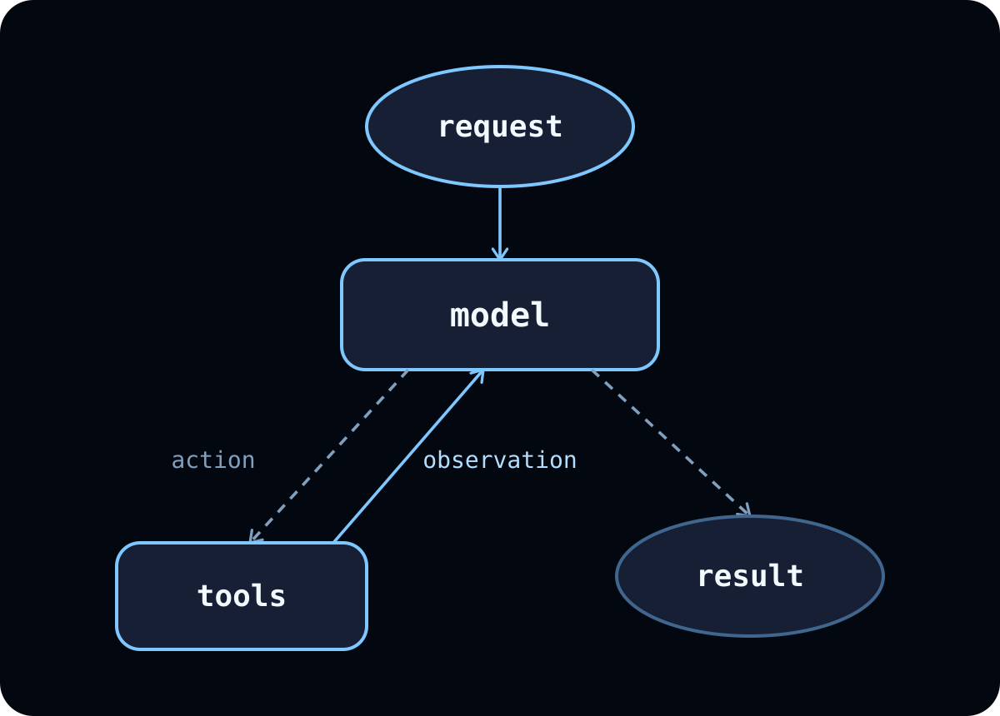
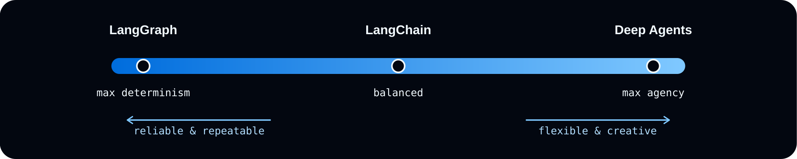
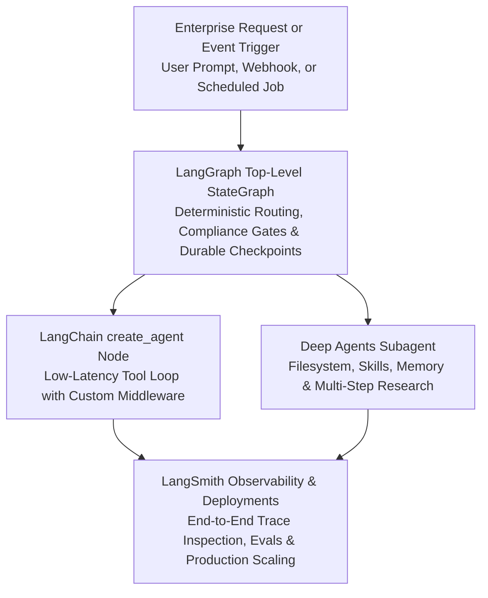

*Reading time: 8 minutes. Author: Hugo S. Nascimento.*

<!-- more -->

*Context: Engineering teams adopting the post-1.0 LangChain ecosystem often treat LangChain, LangGraph, and Deep Agents as competing frameworks. In practice, they are three stacked architectural layers, each trading abstraction for fine-grained control. Drawing on LangChain's official architectural guide and our enterprise deployments at hsnlabs, here is how to choose the right layer for production.*

> **Executive Summary for Technology Leaders:** LangGraph, LangChain, and Deep Agents are not mutually exclusive alternatives. **LangGraph** is the durable agent runtime that gives engineering teams maximal determinism over state transitions and approvals. **LangChain** is the un-opinionated framework exposing the core tool-calling loop and middleware hooks. **Deep Agents** is an opinionated, batteries-included agent harness built on that same loop with filesystem offloading, subagents, skills, and memory enabled out of the box. Selecting the wrong layer either wastes engineering months rebuilding context management from scratch or forces probabilistic autonomy into deterministic financial workflows where it does not belong.

---

## Diligence Note and Technical Specifications

The architectural boundaries, benchmark figures, and product definitions analyzed in this post align with official LangChain engineering documentation and primary sources:

* **LangChain Official Stack Comparison:** detailing the design philosophy, GTM agent telemetry, and tradeoff spectrum across all three packages, available in <a href="https://www.langchain.com/blog/deep-agents-vs-langchain-vs-langgraph">Deep Agents, LangChain, and LangGraph</a>.
* **LangGraph Stateful Runtime Documentation:** detailing durable execution, graph topologies, fault tolerance, and human-in-the-loop interrupts, available at <a href="https://langchain-ai.github.io/langgraph/">LangGraph Technical Documentation</a>.
* **LangChain Core Agent & Middleware Reference:** detailing `create_agent`, tool integrations, and lifecycle hooks, available at <a href="https://docs.langchain.com/">LangChain Documentation</a>.
* **hsnlabs LangChain & LangGraph Engineering Practice:** enterprise deployment standards for stateful agents and operational ontologies, available at <a href="https://hsnlabs.ai/en/langchain/">hsnlabs LangChain & LangGraph Production Engineering</a>.

---

## 1. The Three-Layer Stack: Runtime, Framework, and Harness

In the post-1.0 ecosystem, LangChain's open-source stack shares a single design premise: engineering teams must own every part of their agent, including the model, the context window, and the execution harness. Instead of forcing one monolithic pattern, the stack separates concerns into three composable layers:

| Architectural Layer | Role in Stack | Primary Entry Point | Context & Control Model | Best Enterprise Fit |
| :--- | :--- | :--- | :--- | :--- |
| **LangGraph** | Agent Runtime | Custom `StateGraph` | Maximum control, minimum abstraction; domain rules encoded directly into graph nodes and conditional edges | Regulated pipelines, ERP write-backs, and workflows mixing fixed code with bounded LLM steps |
| **LangChain** | Agent Framework | `create_agent` + middleware | Minimal, un-opinionated loop; engineers select exact tools, prompts, and deterministic hooks | Ultra latency-sensitive assistants, custom harnesses, and bounded retrieval Q&A bots |
| **Deep Agents** | Agent Harness | `create_deep_agent` | Maximum agency, built-in context engineering via filesystem, subagents, skills, memory, and summarization | Open-ended research, GTM account intelligence, coding assistants, and long-horizon ambient tasks |

Beneath the surface, the dependency hierarchy is strict. **LangGraph** is the foundational execution engine providing durable persistence, streaming, fault tolerance, and human-in-the-loop checkpoints. Both LangChain's `create_agent` and Deep Agents' `create_deep_agent` compile down to LangGraph graphs under the hood.

<figure class="article-editorial-figure">
  
  <figcaption class="editorial-caption">LangChain's core agent loop: an incoming request enters the model, iterates across tool actions and observations, and emits a final result over LangGraph's runtime.</figcaption>
</figure>

Notice how minimal that core loop is. The model receives a request, chooses an action against attached tools, inspects the observation, and repeats until it decides to return a result. **Deep Agents** is built on this exact same loop, augmented with an opinionated bundle of middleware components designed for long-horizon context engineering:

* **Filesystem Offloading:** Reads and writes large intermediate artifacts to storage rather than bloating the model's active context window.
* **Subagents:** Spawns specialized worker loops for isolated research or execution without polluting the main conversation state.
* **Skills:** Loads domain instructions and procedural scripts on demand rather than stuffing every possible instruction into the system prompt.
* **Persistent Memory:** Retains preferences, relationships, and learned context across separate execution runs.

  
  Durable graph runtime powering LangGraph custom workflows, LangChain create_agent loops, and Deep Agents harnesses.

---

## 2. Balancing Determinism and Agency in Production

Every production agent architecture resolves a fundamental tension: **autonomy versus reliability**. Giving a model greater freedom to plan, branch, and invoke tools unlocks creative problem-solving on ambiguous tasks, yet every unconstrained decision adds latency, token burn, and operational variance.

<figure class="article-editorial-figure">
  
  <figcaption class="editorial-caption">The determinism-to-agency spectrum: LangGraph delivers reliable, repeatable execution; LangChain balances loop control; Deep Agents maximizes flexible agency.</figcaption>
</figure>

The practical engineering question is where your workflow needs deterministic guarantees and where probabilistic reasoning actually adds value:

1. **Pure Graph Determinism with LangGraph:** When an operation follows mandatory business rules, compliance checks, or multi-system sequencing, encoding those transitions into a `StateGraph` removes model guesswork entirely. The model cannot skip an approval step because the graph topology forbids that transition.
2. **Bounded Loop Governance with LangChain Middleware:** Many workflows operate well inside the standard tool-calling loop, provided specific invariants are enforced around the model. **LangChain middleware** exposes lifecycle hooks to summarize context before overflow, validate outputs with a deterministic verifier, redact sensitive fields, or pause for human sign-off.
3. **High-Autonomy Fan-Out with Deep Agents:** When a task cannot be pre-scripted, such as synthesizing disparate corporate intelligence or navigating an unfamiliar codebase, **Deep Agents** lets the model manage its own research horizon through subagents and filesystem scratchpads.

| Governance Vector | LangGraph Custom Graph | LangChain Core + Middleware | Deep Agents Harness |
| :--- | :--- | :--- | :--- |
| **Control Surface** | Explicit graph nodes, conditional edges, and typed state schemas | Standard agent loop wrapped with pre- and post-step middleware hooks | Opinionated context harness managing files, memory, skills, and subagents |
| **Token Cost Predictability** | High; LLM calls are isolated to strictly scoped nodes | Moderate; bounded by loop depth and middleware summarization | Variable; subagent fan-out and multi-step planning increase token volume |
| **Latency Profile** | Predictable and low when deterministic code handles routing | Tunable for latency-sensitive endpoints via lean tool selection | Optimized for thoroughness and asynchronous ambient runs over sub-second speed |
| **Compliance & Auditability** | Enforced by code-level state transitions and schema contracts | Enforced via middleware guardrails and human-in-the-loop pauses | Governed via sandboxed filesystem boundaries, skill rules, and LangSmith traces |

---

## 3. When to Use Each Layer, and How They Compose

LangChain's official engineering rule of thumb is straightforward: **start with Deep Agents** when building a general-purpose autonomous agent, drop down to **LangChain** when you need a lean loop or bespoke harness, and reach for **LangGraph** when the workflow itself requires custom deterministic topology.

### Deep Agents: Out-of-the-Box Harness for Open-Ended Work

Reach for `create_deep_agent` when your primary challenge is context engineering across complex, multi-step investigations. In LangChain's own production deployment, their internal GTM agent runs on `deepagents` with per-rep memory for email style and account relationships, skills for QBR preparation, and subagents researching call transcripts, news, and CRM history.

That internal deployment handles nearly 10,000 requests per week across more than 150 active users. Notably, only 26 percent of traffic is user-initiated chat; the remaining 74 percent consists of ambient runs triggered by schedules and operational events on LangSmith deployments. LangChain applies the same harness pattern to internal coding and documentation agents.

### LangChain: Lean Loop and Fine-Grained Context Control

Reach for `create_agent` when built-in filesystem offloading and subagent spawning add unnecessary overhead. Ultra latency-sensitive interfaces and tightly scoped assistants often perform better when engineering teams control every token and tool schema passed to the model at each turn.

A canonical example is a retrieval-augmented documentation Q&A bot. The agent queries a vector store, evaluates whether the retrieved evidence answers the question, and stops. It does not need persistent cross-session memory or subagent delegation. Equally important, if a workflow does not even require an iterative tool loop, teams should avoid over-engineering an agent altogether, a boundary we dissect in <a href="/blog/post/chatbot-vs-agent/">Chatbot vs. Agent: When Deterministic Workflows Beat Autonomous Loops</a>.

### LangGraph: Deterministic Topologies for Regulated Workflows

Reach for LangGraph when your system mixes fixed business logic with targeted LLM reasoning, or when you already run a custom graph whose topology encodes domain expertise. LangChain illustrates this with a rental application pipeline:

* **Step 1:** An LLM extracts structured income, credit, and rental history from raw applicant documents, without access to action tools.
* **Step 2:** Deterministic application code scores the extracted record against strict underwriting thresholds.
* **Step 3:** Fixed routing logic auto-approves clear qualifiers, rejects clear non-qualifiers, and escalates borderline applications to human underwriters.

Only the first step touches a language model; the decision boundary stays deterministic and auditable. In enterprise systems connected to ERPs, CRMs, and transactional databases, this pattern pairs directly with strongly typed action boundaries, as detailed in <a href="/blog/post/how-to-build-operational-ontology-python-mcp/">How to Build an Operational Ontology in Python and MCP</a>.

### Composability Across All Three Layers

You never have to lock an entire platform into a single abstraction. All three packages compose natively, and all three deploy and trace through **LangSmith**:

A production `StateGraph` can invoke a `create_agent` node for fast customer triage while delegating deep account synthesis to a `create_deep_agent` subagent, all under unified state persistence and trace observability.

| Production Scenario | Recommended Layer | Architectural Rationale |
| :--- | :--- | :--- |
| **Account research, QBR prep, or coding assistant** | Deep Agents | Benefits immediately from subagents, on-demand skills, memory, and context offloading |
| **Customer-facing RAG assistant with strict latency SLA** | LangChain | Minimal harness overhead with direct control over tool selection and context budget |
| **Credit underwriting, ERP reconciliation, or approval routing** | LangGraph | Separates LLM extraction from deterministic scoring, compliance rules, and human escalation |
| **End-to-end enterprise platform combining rigid gates and open research** | Composed Stack | LangGraph governs outer state and write-backs while delegating bounded sub-tasks to LangChain or Deep Agents |

---

## 4. Evolution Timeline and Migration Playbook

Understanding why these three layers exist clarifies how to evolve existing systems without rewriting working infrastructure:

1. **October 2022 · LangChain:** Launched to wire models, prompts, and chains into production applications quickly.
2. **January 2024 · LangGraph:** Introduced as a graph-based runtime providing durable execution, streaming, and first-class human-in-the-loop primitives as workflows outgrew linear chains.
3. **Post-1.0 Standardization · `create_agent`:** Standardized the core model-tool loop as a minimal, middleware-extensible LangChain abstraction built directly on top of LangGraph's runtime.
4. **July 2025 · Deep Agents:** Inspired by Claude Code and Manus, packaged context engineering best practices directly atop the core loop so teams could deploy high-agency systems without hand-rolling context harnesses.

For teams running legacy or custom LangGraph pipelines today, the migration decision is pragmatic. **Stay on LangGraph** if your competitive edge and reliability live inside the graph's deterministic structure and fixed code transitions. **Adopt Deep Agents** if your custom graph has devolved into a manually maintained ReAct loop where engineers are constantly patching context-window overflow, prompt bloat, and ad-hoc subagent routing. Across every layer, instrument traces and regression suites in **LangSmith** before shipping changes to production.

---

## Strategic Resources and Related Reading
- <a href="https://hsnlabs.ai/en/langchain/">hsnlabs LangChain & LangGraph Production Engineering</a>
- <a href="/blog/post/chatbot-vs-agent/">Chatbot vs. Agent: Architectural Boundaries in Production</a>
- <a href="/blog/post/how-to-build-operational-ontology-python-mcp/">How to Build an Operational Ontology in Python and MCP</a>
- <a href="/blog/post/braintrust-evals-cicd-langgraph-agent-architecture/">Braintrust Evals & LangGraph: Replacing Vibe Checks with Deterministic CI/CD</a>
