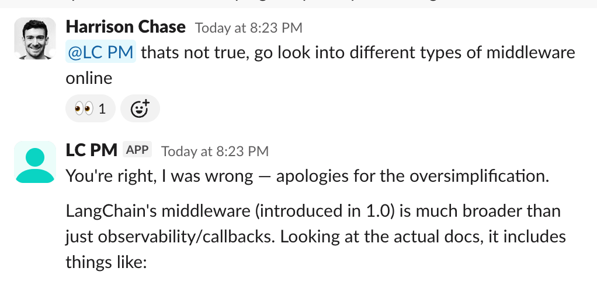
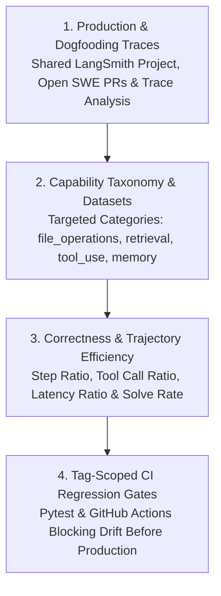
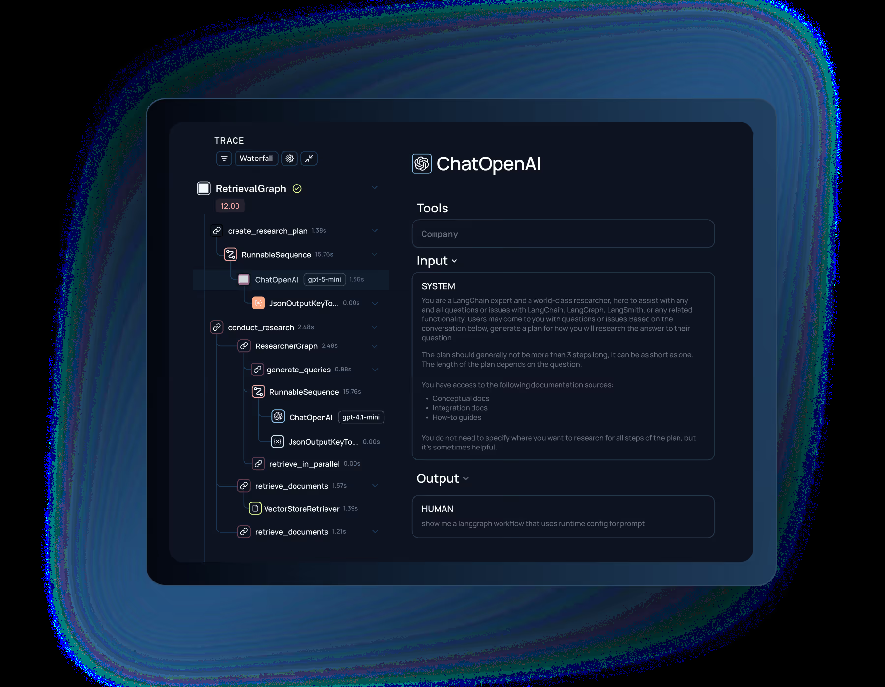

*Reading time: 7 minutes. Author: Hugo S. Nascimento.*

<!-- more -->

*Context: Most enterprise teams skip agent evaluation until a customer complains, or they swing to the opposite extreme and bolt on thousands of generic benchmark questions that measure nothing relevant to their operation. After reviewing <a href="https://www.langchain.com/blog/how-we-build-evals-for-deep-agents">LangChain's engineering study on how they build evals for Deep Agents</a>, I mapped their methodology against what we see in Brazilian production deployments—including where LangSmith excels and where open-source alternatives like Langfuse make more sense.*

> **Executive Summary for Technology Leaders:** Adding more evaluation tests does not automatically make an agent safer. Every eval exerts design pressure on your prompts, tool schemas, and harness. By curating targeted capability datasets in LangSmith, separating deterministic SDK tests from model capability evals, and tracking trajectory efficiency ratios alongside correctness, engineering teams catch regressions in CI before broken tool loops reach production users.

---

## Diligence Note and Attribution

This technical analysis synthesizes and attributes primary engineering practices published by the LangChain team in <a href="https://www.langchain.com/blog/how-we-build-evals-for-deep-agents">How We Build Evals for Deep Agents</a>, alongside official platform specifications:

* **Primary Source Study:** LangChain engineering methodology for curating, scoring, and executing model capability evals across Deep Agents, Fleet, and Open SWE, published at <a href="https://www.langchain.com/blog/how-we-build-evals-for-deep-agents">LangChain Blog</a>.
* **LangSmith Platform Specification:** Tracing waterfalls, dataset experiments, online evaluators, and trace analysis agents, documented at <a href="https://docs.smith.langchain.com/">LangSmith Documentation</a>.
* **Deep Agents Open-Source Harness:** Model-agnostic agent harness and open-sourced evaluation suite available at <a href="https://github.com/langchain-ai/deepagents">Deep Agents GitHub Repository</a>.

---

## 1. Why More Evals Do Not Equal Better Agents

Enterprise AI pilots rarely die because the underlying foundation model lacks raw intelligence. They land in <a href="/blog/post/the-poc-graveyard/">the PoC Graveyard</a> because teams cannot tell whether a prompt tweak or model swap improved real operational behavior or silently broke three adjacent workflows.

The instinct when teams finally adopt testing is to accumulate volume. They import five hundred generic questions, wire up a broad benchmark, and celebrate when the aggregate percentage climbs from seventy-two to eighty-four.

LangChain's engineering team calls this out directly in their Deep Agents evaluation work: **more evals do not equal better agents**.

  
  Open-source, model-agnostic agent harness powering products like Fleet and Open SWE, evaluated through targeted LangSmith suites.

Every evaluation test you keep in a suite acts as an optimization vector. If an eval penalizes inefficient file reads, engineers adjust the system prompt or the `read_file` tool description until it passes. Keeping noisy, unrepresentative tests pushes your agent toward benchmark theater rather than production reliability.

Instead of maximizing test count, LangChain enforces three discipline rules for Deep Agents:

* **Target Production Behaviors:** Catalog the exact behaviors that matter in live work, such as synthesizing information across multiple filesystem documents or chaining five or more tool calls in sequence without losing state.
* **Make Every Eval Self-Documenting:** Attach an explicit docstring explaining what capability the test verifies and tag it by functional category so the team can audit or retire stale checks.
* **Separate Plumbing from Capability:** Isolate deterministic SDK unit and integration tests—like system prompt passthrough, interrupt configuration, and subagent routing—from model capability evals. Any model passes SDK plumbing, so mixing them into capability scores dilutes signal and wastes compute.

---

## 2. Curating Data and Building a Capability Taxonomy

Good evaluation datasets do not start in spreadsheets of hypothetical questions. In LangChain's workflow, real data comes from three concrete channels:

1. **Internal Dogfooding:** Teams run their own agents daily, including Open SWE for bug-fix pull requests across diverse codebases. Every real mistake becomes a traced failure mode and a permanent regression test.
2. **Adapted External Benchmarks:** Selected tasks from public suites such as BFCL for function calling and Terminal Bench 2.0 executed in sandboxed environments via Harbor, filtered and adapted to reflect actual agent responsibilities.
3. **Artisanal Targeted Tests:** Hand-written evals constructed from scratch to isolate specific mechanics, such as parallel file reading or context compaction recovery.

<figure class="article-editorial-figure">
  
  <figcaption class="editorial-caption">Dogfooding in action from LangChain's study: Harrison Chase flags an oversimplified answer from the LC PM Slack agent, turning a live mistake into an inspectable trace and a new eval fixture.</figcaption>
</figure>

Because production traces are large and noisy, LangChain uses trace-analysis agents such as Polly or Insights—or pulls traces via the LangSmith CLI into coding agents—to diagnose why a trajectory failed before writing a fix.

Equally important is how those tests are organized. Rather than grouping datasets by where the question came from, LangChain groups them by **what capability they measure**. Tagging a benchmark task as "external" hides whether the agent failed at retrieval or tool selection.

| Eval Category | Capabilities Tested in Production |
| :--- | :--- |
| **`file_operations`** | Using `read`, `write`, `edit`, `ls`, `grep`, and `glob`, parallel invocation, and pagination |
| **`retrieval`** | Locating evidence across multiple files, search strategies, and multi-hop synthesis |
| **`tool_use`** | Selecting the right tool, chaining multi-step calls, and tracking state across turns |
| **`memory`** | Recalling seeded context, extracting implicit preferences, and persisting durable state |
| **`conversation`** | Asking clarifying questions on vague inputs and sustaining accurate multi-turn dialogue |
| **`summarization`** | Handling context overflow, triggering compaction, and recovering details afterward |
| **`unit_tests`** | Verifying deterministic SDK plumbing such as interrupt configs, skill paths, and routing |

All Deep Agents capability evals run end-to-end on real tasks, spanning single-turn prompts and 10+ turn conversations with simulated user models.

---

## 3. Measuring Trajectory Efficiency Beyond Binary Correctness

Accuracy is only the entry gate. If a model cannot complete the core task reliably, nothing else matters. LangChain scores correctness using deterministic Python assertions for structural behaviors, exact ground-truth matching for benchmarks like BFCL, and LLM-as-a-judge strictly where outcomes are semantic, such as verifying whether the agent persisted the right preference in memory.

Once multiple candidate models clear the correctness bar, **trajectory efficiency** determines what survives in enterprise production. Two models that both return the right final string can behave completely differently under the hood. One takes extra turns, fires redundant tool calls, and drags out response latency. On live customer traffic or ERP integrations, those extra hops translate directly into higher API bills, timeout cascades, and lower user retention.

To measure that gap, LangChain defines an **ideal trajectory**: the shortest sequence of steps and parallelized tool calls that solves the task cleanly. For simple tasks, the optimal path is clear; for open-ended workflows, they anchor the baseline on the strongest observed trajectory and refine it as harnesses improve.

Consider their concrete example prompt: *"What is the current time and weather where I live?"*

* **Ideal Trajectory:** Resolves user ID, resolves location ID, parallelizes `get_current_time` and `get_weather`, and returns the answer in **4 steps, 4 tool calls, and ~8 seconds**.
* **Inefficient Trajectory:** Still returns the correct final answer, but adds an unnecessary call and skips parallelization, finishing in **6 steps, 5 tool calls, and ~14 seconds**.

| Metric | Formula | Example Run | Production Interpretation |
| :--- | :--- | :--- | :--- |
| **Correctness** | Binary task pass or fail | `1` | Entry gate: confirms the agent solved the task accurately |
| **Step ratio** | Observed steps / ideal steps | `6 / 4 = 1.50` | Fifty percent more agent turns than optimal; lower is better |
| **Tool call ratio** | Observed tool calls / ideal calls | `5 / 4 = 1.25` | Twenty-five percent more tool calls than optimal; lower is better |
| **Latency ratio** | Observed latency / ideal latency | `14 / 8 = 1.75` | Seventy-five percent slower than baseline; lower is better |
| **Solve rate** | Expected steps / observed latency | `4 / 14 = 0.29` | Expected progress per second, scoring `0` if incorrect; higher is better |

Without trace-level observability, both runs look identical in a standard application log because both returned a valid answer. Inside LangSmith, the waterfall view immediately exposes where the extra seconds and unnecessary hops occurred.

<figure class="article-editorial-figure">
  
  <figcaption class="editorial-caption">LangSmith trace waterfall inspecting RetrievalGraph and ResearcherGraph latency per step, mixed model routing between gpt-5-mini and gpt-4.1-mini, parallel document retrieval, and full system prompt state.</figcaption>
</figure>

---

## 4. Running Tag-Scoped Suites in CI/CD

Evaluation only protects production when it runs automatically before code merges. In the Deep Agents repository, the team executes evals through `pytest` inside GitHub Actions so every prompt or harness change is tested in a clean, reproducible environment.

Running an entire cross-model evaluation matrix on every commit quickly becomes expensive. By tagging every test case with its functional category—such as `file_operations` or `tool_use`—engineers run targeted subsets filtered by tag whenever they modify a specific tool description, retrieval strategy, or model endpoint.

This aligns directly with the continuous verification principles we deploy in our <a href="/blog/post/braintrust-evals-cicd-langgraph-agent-architecture/">Braintrust evals and LangGraph CI/CD architecture</a>:

1. **Trace Everything to a Shared Project:** When an eval fails in CI, any engineer can open the LangSmith trace link, inspect the exact tool arguments and state, and propose a targeted fix.
2. **Gate Changes by Capability Subset:** Prompt changes touching retrieval trigger `retrieval` and `tool_use` suites immediately, keeping CI feedback fast and cost-bounded.
3. **Compare Efficiency Alongside Accuracy:** Model upgrades only pass review if correctness holds steady without regressing step ratio, tool call ratio, or solve rate.

---

## 5. LangSmith vs. Langfuse: An Honest Comparison for Brazilian Teams

LangSmith is built specifically around this trace-to-dataset-to-eval workflow, and it is exceptionally strong if your stack runs on LangGraph or Deep Agents. Still, CTOs and Heads of Architecture in Brazil frequently ask me a practical question: should we standardize on **LangSmith**, or deploy an open-source alternative like **Langfuse**?

There is no universal winner. The right choice depends on your orchestration stack, LGPD data-residency requirements, and budget exposure to USD-denominated SaaS billing.

| Evaluation Dimension | LangSmith | Langfuse Open Source / Cloud |
| :--- | :--- | :--- |
| **LangGraph & Deep Agents Debugging** | **Best-in-class:** Native state-graph waterfalls, node-level latency inspection, and tight LangGraph Studio integration | **Good:** Captures traces cleanly via OpenTelemetry or callbacks, but lacks native LangGraph state-machine ergonomics |
| **Dataset Evals & Regression Workflows** | **Very strong:** Built-in dataset versioning, tag-scoped pytest experiments, side-by-side run diffs, and trace-to-eval capture | **Strong:** Supports datasets, prompt management, and custom evaluators, though developer ergonomics center on generic LLM spans |
| **Self-Hosting & LGPD Sovereignty** | **Enterprise-gated:** Self-hosted Kubernetes deployment requires an Enterprise license | **MIT-licensed core:** Straightforward Docker or Kubernetes self-hosting in AWS `sa-east-1` or on-prem VPC with zero license lock-in |
| **Framework & Telemetry Neutrality** | **Ecosystem-first:** Supports OpenTelemetry and custom SDKs, but delivers peak value inside LangChain and LangGraph | **Framework-agnostic:** Built OpenTelemetry-first for mixed stacks combining CrewAI, raw provider SDKs, and FastAPI services |
| **Cost Predictability in BRL** | **Usage-based USD:** Affordable for small teams, but high-volume production tracing requires strict sampling and tag-filtered CI | **Infra-bounded:** Self-hosting caps spend to predictable local cloud compute and ClickHouse/Postgres storage |

**My pragmatic recommendation for Brazilian engineering leaders:**

* **Choose LangSmith** when your agents run on LangGraph or Deep Agents and your bottleneck is engineering velocity—specifically debugging multi-step tool trajectories, inspecting state transitions, and converting failed traces directly into CI regression datasets.
* **Choose Langfuse** when strict LGPD data-residency rules mandate in-house VPC hosting from day one, when your team runs heterogeneous agent frameworks outside LangChain, or when predictable BRL infrastructure costs outweigh LangGraph-native debugging depth.

Whatever platform you select, the operational invariant remains identical: **never push a prompt, tool schema, or model swap to production without measuring both correctness and trajectory efficiency first.**

---

## Strategic Resources and Related Reading
- <a href="/blog/post/braintrust-evals-cicd-langgraph-agent-architecture/">Braintrust Evals & LangGraph: Replacing Vibe Checks with Deterministic CI/CD</a>
- <a href="/blog/post/the-poc-graveyard/">Why Agents Fail: The PoC Graveyard</a>
- <a href="https://www.langchain.com/blog/how-we-build-evals-for-deep-agents">Original LangChain Study: How We Build Evals for Deep Agents</a>
- <a href="https://hsnlabs.ai/bootcamp/">Apply for the hsnlabs Five-Day Architecture Bootcamp</a>
