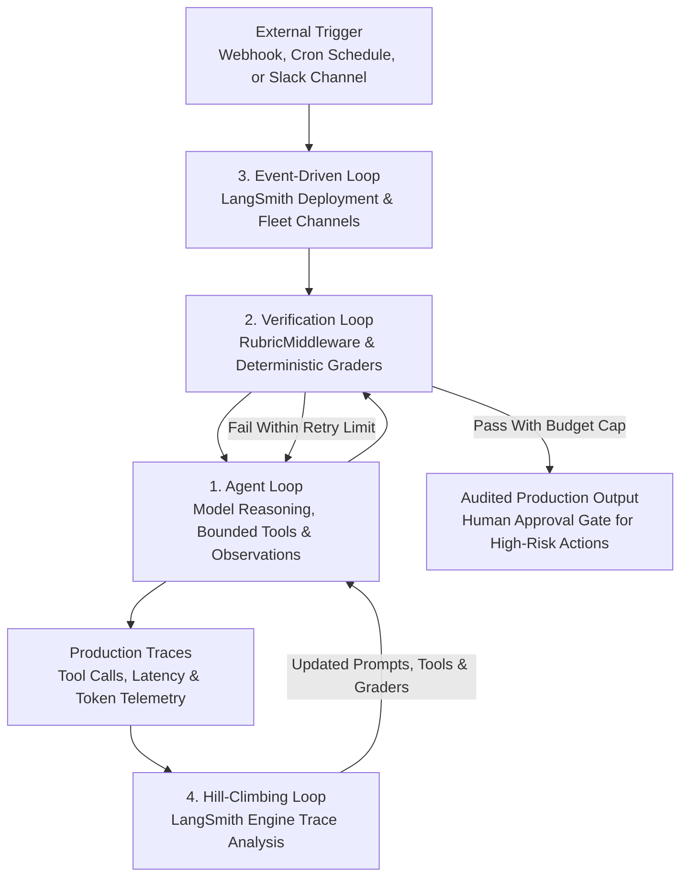
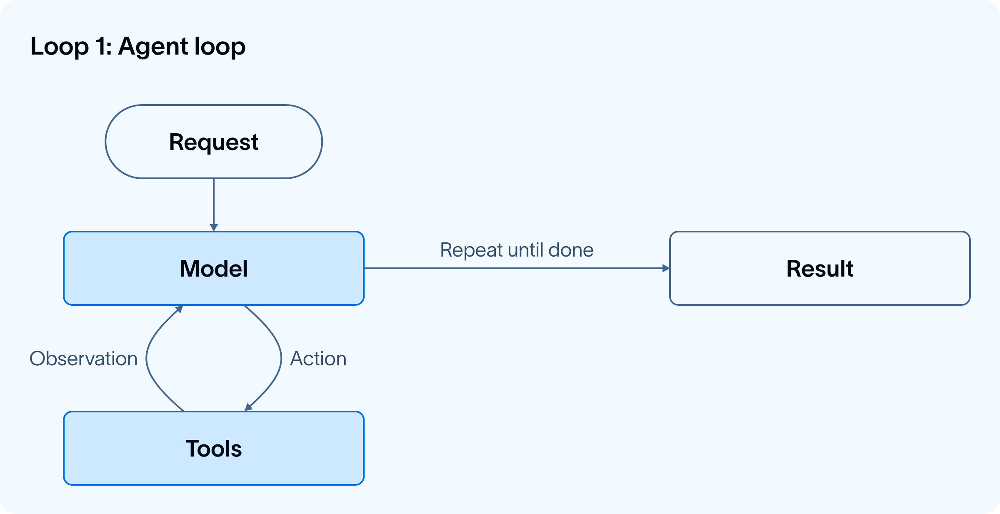
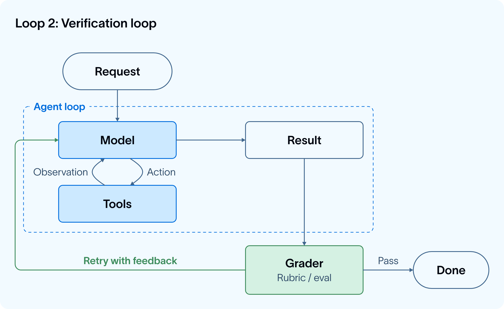

*Reading time: 7 minutes. Author: Hugo S. Nascimento.*

<!-- more -->

*Context: Most enterprise AI pilots die in staging because teams treat an autonomous agent as a single prompt wrapped around a bag of tools. When that loop hits malformed ERP data or ambiguous permissions, token consumption spikes while operational accuracy collapses. Drawing on LangChain's engineering breakdown of loop engineering, here is how we structure stacked execution, verification, event, and improvement loops to keep production agents profitable and predictable.*

> **Executive Summary for Technology Leaders:** Giving a foundation model tools inside an unbounded loop automates failure faster than it automates work. Reliable production systems require **loop engineering**, a disciplined architecture that stacks four distinct control circuits: an inner agent loop for task execution, a verification loop with deterministic graders, an event-driven loop decoupled from synchronous user timeouts, and an outer hill-climbing loop that refines prompts, tools, and guardrails from real production traces.

---

## Diligence Note and Technical Specifications

The architectural framework and primitive mappings in this post synthesize primary engineering specifications and open-source agent documentation:

* **LangChain Loop Engineering Specification:** detailing the four stacked control loops, `create_agent`, `RubricMiddleware`, `Fleet`, and `LangSmith Engine`, published in <a href="https://www.langchain.com/blog/the-art-of-loop-engineering">The Art of Loop Engineering</a>, building on Swyx's concept of loopcraft.
* **LangGraph Stateful Orchestration Specification:** detailing cyclic state graphs, bounded retry transitions, and native human-in-the-loop interrupts, available at <a href="https://langchain-ai.github.io/langgraph/">LangGraph Technical Documentation</a>.
* **hsnlabs Production LangGraph Practice:** enterprise deployment architecture and guardrail playbooks, available at <a href="https://hsnlabs.ai/en/langchain/">hsnlabs LangChain and LangGraph Engineering</a>.

---

## 1. Why Single-Loop Agents Burn Budget in Production

The core algorithm of an AI agent is deceptively simple: give a language model context, wire up external tools, and let it execute actions in a loop until the task is complete.

In controlled demos, a single loop looks sufficient. In enterprise production, single-loop agents fail silently and expensively. As we documented in <a href="/blog/post/unconstrained-agents-finite-state-machines/">our 2 AM incident audit of 42 recursive API calls</a>, an unconstrained model that hits a database constraint or stale API response keeps retrying variations of the same broken action. Without outer verification, retry ceilings, or trace analysis, those failures compound directly into runaway API bills and land initiatives in <a href="/blog/post/the-poc-graveyard/">the enterprise PoC graveyard</a>.

  
  Production-tested state graph engine for bounding agent transitions, token budgets, and verification gates.

Getting autonomous systems to deliver measurable margin requires shifting focus from prompt wording to the **harness** wrapped around the model. Loop engineering treats an agent not as one loop, but as four concentric loops working together.

---

## 2. The Four-Loop Stack in Loop Engineering

Every production agent architecture built with LangChain, LangGraph, and LangSmith organizes execution across four nested layers. Each outer loop governs, triggers, or upgrades the inner loops below it.

### Loop 1: The Agent Loop

At the innermost layer, the agent loop lets a model call tools repeatedly until it reaches a stopping condition. Using LangChain's `create_agent`, engineering teams bind a foundation model to repository readers, ERP connectors, or documentation writers so the system can plan and act in the real world.

In LangChain's internal documentation agent example, Loop 1 receives an improvement request, clones repositories, reads files, drafts edits, and opens a pull request.

<figure class="article-editorial-figure">
  
  <figcaption class="editorial-caption">LangChain architecture diagram for Loop 1: the model alternates between tool actions and observations until it produces a candidate result.</figcaption>
</figure>

Loop 1 automates execution, but it does not enforce correctness or cost discipline. Left alone, a model can declare victory on broken links, drift outside the requested scope, or burn tens of thousands of tokens repeating failing tool calls.

### Loop 2: The Verification Loop

When consistency matters more than raw demo speed, Loop 2 wraps the agent loop inside a **grader**. Instead of trusting the agent's first pass, the harness scores the output against an explicit rubric using either deterministic code checks or calibrated LLM-as-a-judge evaluators. In LangChain, teams implement this via `RubricMiddleware` or an `after_agent` hook on `create_agent`.

For a documentation agent, the deterministic grader automatically runs link checkers, verifies CI pipeline status, and confirms that the code diff stays strictly scoped to the original ticket before a human ever inspects the pull request.

<figure class="article-editorial-figure">
  
  <figcaption class="editorial-caption">LangChain architecture diagram for Loop 2: a rubric grader inspects the candidate result and sends structured feedback back to the model when checks fail.</figcaption>
</figure>

The operational tradeoff is explicit: **verification increases latency and token cost per run**. In production, teams must enforce strict retry caps and exit thresholds inside Loop 2. Without a hard maximum on grader retries, a verification loop designed to protect quality will quietly multiply token expenditure on unresolvable edge cases.

### Loop 3: The Event-Driven Loop

An agent triggered manually by an engineer typing into a chat window is a prototype, not enterprise infrastructure. Loop 3 embeds the verified agent into the company's live operational fabric so work executes continuously in the background.

Events fire the workflow automatically: a new invoice lands, a scheduled cron job runs, a webhook arrives from a CRM, or a teammate posts in a designated `#docs-plz` Slack channel. LangChain supports this layer through **LangSmith Deployment** for webhooks and cron triggers, proactive heartbeat schedules such as those popularized in `openclaw`, and **Fleet** channels for no-code event wiring.

Decoupling Loop 3 from synchronous chat interfaces is essential for cost and reliability control. Real-time messaging gateways enforce strict timeout windows. Running multi-step verification loops asynchronously behind event queues prevents dropped user sessions, duplicate retries, and wasted compute when upstream APIs slow down.

### Loop 4: The Hill-Climbing Loop

The first three loops automate execution. Loop 4 automates **systemic improvement**.

Every agent execution generates a full trace capturing model reasoning, tool payloads, latency, token consumption, and grader feedback. The hill-climbing loop runs an analysis agent, implemented in LangSmith via **LangSmith Engine**, continuously across those production traces to spot recurring failure modes. When multiple traces reveal the same friction point, the analysis loop opens an issue or proposes targeted rewrites to the offending prompt, tool schema, or grader rubric.

Critically, the return arrow of Loop 4 reaches directly inside Loop 1 and upgrades the harness itself. Over time, teams running open-weight models can also channel trace and evaluation outcomes into reinforcement learning fine-tuning, or continuously refine auxiliary memory and retrieved skills. Instead of paying higher inference costs forever to compensate for brittle prompts, each cycle of Loop 4 drives down error rates and wasted retries.

---

## 3. Loop Architecture Reference Matrix

Engineering and finance leaders can audit any agent deployment by verifying how each of the four loops is instrumented, bounded, and cost-controlled:

| Loop Layer | Core Function | Business and Cost Impact | LangChain Primitive | Mandatory Production Guardrail |
| :--- | :--- | :--- | :--- | :--- |
| **1. Agent Loop** | Model calls tools iteratively until task completion | Automates manual multi-step execution | `create_agent` with any supported model | Hard step ceiling and typed tool argument contracts |
| **2. Verification Loop** | Scores output against a rubric and retries with feedback | Eliminates silent errors before downstream impact | `RubricMiddleware` or `after_agent` hook | Explicit max-retry budget and deterministic pre-checks |
| **3. Event-Driven Loop** | Triggers asynchronous runs from webhooks, crons, or channels | Scales background execution across live systems | `LangSmith Deployment` or `Fleet` channels | Idempotency keys, queue concurrency limits, and spend alerts |
| **4. Hill-Climbing Loop** | Analyzes traces to refine prompts, tools, and rubrics | Compounds reliability while lowering repeat token waste | `LangSmith Engine` trace analysis agent | Staged CI evaluation and human approval before rollout |

---

## 4. Where Human Oversight Protects Capital

Stacking four loops does not mean removing humans from operational control. Automated graders verify syntax, link resolution, and schema compliance; experienced operators judge business context, commercial framing, and regulatory exposure.

LangChain treats human-in-the-loop checkpoints as first-class primitives across every layer of the stack:

| Loop Layer | Human Control Point | High-Stakes Enterprise Example |
| :--- | :--- | :--- |
| **Loop 1: Agent Loop** | Approval interrupt before sensitive tool execution | Blocking autonomous ERP write-offs, wire transfers, or database mutations until signed off |
| **Loop 2: Verification Loop** | Human acting as the final rubric grader | Reviewing credit risk memos or clinical triage summaries where nuanced domain judgment is required |
| **Loop 3: Event-Driven Loop** | Output review prior to external delivery | Approving customer-facing billing notices or regulatory filings generated by webhook triggers |
| **Loop 4: Hill-Climbing Loop** | Engineering review before harness deployment | Auditing prompt, tool, or rubric patches proposed by trace analysis against golden regression suites |

The competitive moat in enterprise AI does not come from waiting for the next foundation model release. Organizations that establish Loops 3 and 4 early build a compounding asset: every production exception sharpens the harness, protects token budgets from runaway retries, and converts operational judgment into durable software leverage.

---

## Strategic Resources and Related Reading
- <a href="https://www.langchain.com/blog/the-art-of-loop-engineering">LangChain Official Study: The Art of Loop Engineering</a>
- <a href="https://hsnlabs.ai/en/langchain/">hsnlabs LangChain and LangGraph Production Engineering</a>
- <a href="/blog/post/unconstrained-agents-finite-state-machines/">Case Study: 42 Calls in a Loop at 2 AM</a>
- <a href="/blog/post/the-poc-graveyard/">Why Agents Fail: The PoC Graveyard</a>
