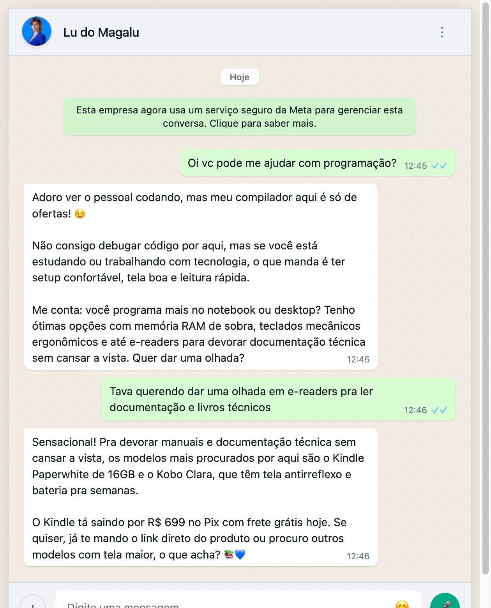
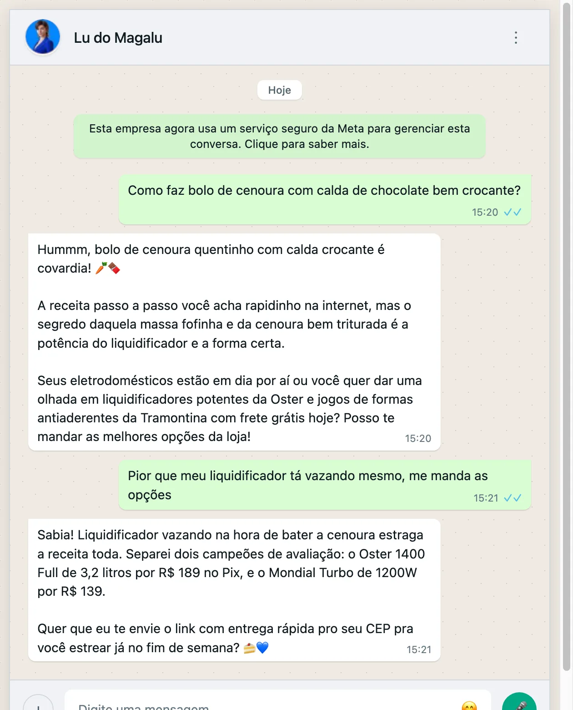
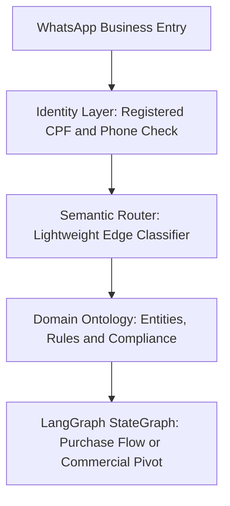

*Reading time: 8 minutes. Author: Hugo S. Nascimento.*

<!-- more -->

*Editorial Note: An earlier version of this analysis appeared in the second edition of the <a href="https://www.linkedin.com/newsletters/agentes-x-gente-7397999984089935872/">[Agentes] x [a Gente]</a> LinkedIn newsletter by <a href="https://www.linkedin.com/in/hugosoaresnascimento/">Hugo S. Nascimento</a>. This expanded case study details the production edge routing, identity controls, and operational ontologies behind resilient enterprise deployments.*

## Scale and Background of the Deployment

Magazine Luiza's virtual assistant on WhatsApp, Lu do Magalu, became the focal point of one of Brazil's most instructive discussions on enterprise AI agents in production. Operating at massive scale, the channel has processed more than 9 million official conversations according to <a href="https://valor.globo.com/publicacoes/especiais/gptw-melhores-empresas-para-trabalhar/noticia/2026/10/26/agentes-de-ia-comecam-a-transformar-as-rotinas-nas-grandes-companhias.ghtml">Valor Econômico</a>. Reporting from <a href="https://centraldovarejo.com.br/lu-do-magalu-vende-no-whatsapp-com-conversao-3-vezes-maior-e-plataformas-simplificam-a-criacao-de-times-de-agentes-de-ia/">Central do Varejo</a> citing Mobile Time data shows the channel has already surpassed R$ 100 million in sales, reaching 7.7 million users with a conversion rate three times higher than the retailer's traditional mobile app.

As Magalu's Chief AI Officer Caio Kyle Gomes documented in <a href="https://www.linkedin.com/posts/caiokylegomes_um-ano-e-meio-de-trabalho-e-podemos-dizer-activity-7389639248624308225-h5Lv/?originalSubdomain=pt">the official launch announcement</a>, building the platform required eighteen months of Brazilian engineering alongside Google Cloud, Meta, and Bain to establish a multi-agent, multi-LLM architecture blending proprietary models on public cloud with open models running on Magalu Cloud. Recent public stress tests offered a clear case study on balancing go-to-market speed with the engineering rigor needed to sustain autonomous agents at scale.

In October 2026, a software developer asked the shopping assistant about token limits and submitted a snippet containing a classic syntax error. Instead of redirecting the request back to retail, the model parsed the technical prompt and returned corrected code in the same chat turn. CEO Frederico Trajano shared the screenshot on LinkedIn to highlight the model's versatility. For practitioners focused on software architecture and inference unit economics, however, the interaction raised immediate questions about domain boundaries at the edge.

Testing the official WhatsApp channel directly with a simple question about programming assistance revealed how an emergency containment patch initially reacted:

The blunt refusal with accusing emojis and abrupt session termination demonstrated the friction created when static edge filters attempt to enforce scope without passing through a semantic customer-experience layer.

## The Obviousness Trap Beyond Generic Guardrails

Dismissing production edge cases as a simplistic lack of guardrails overlooks the reality inside an engineering war room. Luizalabs operates with top-tier engineering talent and global strategic partners. What surfaced on WhatsApp reflects the deeper structural collision between fifty years of deterministic software heuristics and the stochastic behavior of large language models.

While part of the market applauded turning public curiosity into promotional discount coupons, cybersecurity engineers emphasized that unguarded edges expose systems to unpredictable user inputs. Global Deloitte research cited by Central do Varejo captures this gap across the industry: although 85% of organizations plan to customize agents, only 15% have successfully scaled multi-agent orchestration, and 70% of executives point to governance and lack of trust as primary blockers.

This tension aligns directly with the mandate outlined by Caio Gomes in an <a href="https://exame.com/inteligencia-artificial/o-quao-humana-sera-a-lu-do-magalu-diretor-de-ia-aposta-na-tecnologia-para-transformar-a-varejista/">Exame interview</a> when taking over AI leadership at Magalu: AI must be measured strictly by concrete business metrics such as revenue growth and cost reduction. Keeping the assistant bounded to the commerce journey protects that exact unit-economics mandate.

WhatsApp Business pricing makes edge filtering non-negotiable. Public stress tests sending long, out-of-domain payloads such as full movie scripts demonstrated how unfiltered inputs burn both public-cloud LLM inference and Meta Cloud API messaging windows with zero revenue correlation. Similar boundary leaks have triggered global attention across retail, including viral screenshots of a McDonald's chatbot generating Python code.

## Headless Agents versus Surface Agents

In our engineering practice at hsnlabs, enterprise deployments split into two operational classes. Headless Agents operate invisibly behind the scenes across data pipelines, reconciliation jobs, and back-office integrations. Surface Agents interact directly with customers through text or voice. In surface deployments, tolerance for scope drift or tonal misalignment approaches zero because every misfire lands immediately in front of the customer.

A simple analogy illustrates the boundary. In a restaurant, guests order from the menu and waiters bridge the dining room and kitchen. Guests do not walk into the kitchen asking the chef to debug software or repair a car engine, and the kitchen does not expose internal tooling. When a guest asks for something off-menu, the waiter smiles, explains the house specialty, and guides them back to relevant dishes without ever scolding the customer.

As Caio Gomes has also argued publicly, generative AI does not replace classical discriminative machine learning. Generative models serve best as the conversational view layer, while discriminative classifiers and deterministic business rules handle routing, cost control, and predictability in the backend. Attempting to replace that separation with negative prompt instructions or keyword blocklists creates overprotection collapse, causing the agent to misclassify benign questions as hostile attacks.

## Fast Turnaround at the Identity Layer

While much of social commentary remained anchored on the initial incident, the Luizalabs engineering team executed a pragmatic turnaround in the following days by addressing the problem at the right architectural layer: access control and identity.

Rather than taking the channel offline or stacking brittle regex filters, the operation introduced deterministic account verification requiring a registered CPF tax ID or email linked to the customer's phone number right at entry before unlocking recommendations and broader workflows. Binding the session to a verified customer record cut off recreational stress tests and idle token burn on WhatsApp while keeping the shopping path intact for real buyers.

## Domain Boundaries and the Commercial Pivot

Additional boundary testing confirmed that without an explicit domain ontology defining entities, classes, and compliance constraints, commercial retail agents remain exposed around sensitive or regulated subjects. Out of engineering responsibility, sensitive edge observations are kept out of public write-ups and reserved for direct technical reporting to project owners.

For benign out-of-scope queries, the production alternative to rigid censorship is the Commercial Pivot. Instead of shutting down a conversation when a user brings up programming or everyday domestic questions, the assistant acknowledges the intent warmly and redirects straight back into valid catalog items such as laptops, ergonomic keyboards, or kitchen appliances.

Balancing conversational delight with regulatory compliance requires tight alignment across product, marketing, engineering, and legal teams, enforced deterministically in graph structure rather than wishful prompting.

## Four Pillars of Enterprise Agent Architecture

Sustaining graceful pivots and tight unit economics at scale requires moving beyond naive prompt engineering into an <a href="https://hsnlabs.ai/architecture.html">Enterprise Agent Architecture</a> grounded in four deterministic layers:

| Layer | Fragile Prompt-Only Approach | Enterprise Agent Architecture |
|---|---|---|
| Identity and Edge | Anonymous open session burning inference | Deterministic gate binding CPF, phone, and active account |
| Intent Routing | Every turn routed straight to flagship LLM | Lightweight classifier filters or pivots before heavy inference |
| Business Rules | Negative prompt instructions triggering false positives | Dynamic ontology enforcing permitted classes and constraints |
| State Lifecycle | Concatenated string history without transition guards | Finite state machine with persistent LangGraph checkpointer |

Delivering this reliability requires four coordinated decisions: typed explicit state management rather than open conversation strings, lightweight deterministic intent classification at the edge to prevent <a href="/blog/post/loop-engineering-controlling-agent-costs/">runaway inference costs</a>, <a href="/blog/post/ontology-vs-database-schema/">executable business ontologies over legacy systems</a> instead of negative prompting, and strict finite-state transitions backed by persistent LangGraph checkpointers.

## Designing Boundaries with The Agentic Canvas™

Defining scope boundaries, identity gates, and P&L return before writing production code prevents costly post-launch surprises. At hsnlabs, we organize these pre-build decisions inside <a href="https://hsnlabs.ai/en/canvas/">The Agentic Canvas™</a>, publicly open for engineering and product teams, and apply them hands-on during our <a href="https://hsnlabs.ai/en/bootcamp/">Agentic Bootcamp™</a> and <a href="/blog/post/five-day-architecture-sprint/">five-day architecture sprint</a>.

## Related Architecture Resources

- <a href="/blog/post/ontology-vs-database-schema/">Enterprise Ontology versus Database Schema</a>
- <a href="/blog/post/loop-engineering-controlling-agent-costs/">Loop Engineering: Controlling Production AI Agents Without Runaway Costs</a>
- <a href="/blog/post/five-day-architecture-sprint/">Five-Day Agentic Architecture Sprint</a>
- <a href="https://hsnlabs.ai/en/canvas/">Explore The Agentic Canvas™ frameworks</a>
