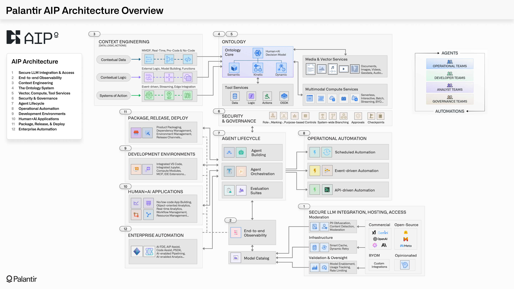

*Reading time: 7 minutes. Author: Hugo S. Nascimento.*

<!-- more -->

*Context: Enterprise AI software suffers an 85 percent mortality rate between proof of concept and production because systems integrators wire language models directly to raw databases. Palantir inverted this dynamic with its AIP Bootcamp by binding models to an Operational Ontology. Here is how that architecture works in production and how HSN Labs delivers the open-source equivalent in five days without platform lock-in.*

> **Executive Summary for Technology Leaders:** Connecting foundation models directly to raw SQL tables or vector indexes causes schema drift, missing transactional invariants, and destructive database mutations. Palantir solved this by anchoring its Artificial Intelligence Platform in an Operational Ontology — a software layer of typed objects, properties, and bounded kinetic actions — and proving value in 5-day bootcamps. For enterprises in Brazil and Latin America seeking that same five-day empirical execution without multi-year Palantir Foundry licensing or slow Big 4 consulting studies, the HSN Labs 5-Day Agentic Architecture Bootcamp builds an open operational ontology in Python, Pydantic, LangGraph, and MCP directly over your SAP, TOTVS, or Oracle sandbox.

---

## Diligence Note and Public Sources

The architectural diagrams, clinical performance metrics, and regulatory disclosures cited in this article were verified against primary public sources:

* **Palantir Technologies Inc. Form 10-K filings with the U.S. Securities and Exchange Commission:** documenting the introduction and commercial mechanics of AIP Bootcamps, available at <a href="https://www.sec.gov/Archives/edgar/data/1321655/000132165526000011/pltr-20251231.htm">SEC EDGAR Palantir 10-K</a>.
* **Palantir AIP Bootcamp and Operational Ontology Documentation:** official technical architecture overview, available at <a href="https://www.palantir.com/platforms/aip/bootcamp">Palantir AIP Bootcamp</a> and <a href="https://www.palantir.com/platforms/foundry/ontology">Palantir Foundry Ontology</a>.
* **Tampa General Hospital Clinical Operations Case Study:** audited hospital bed placement and staffing metrics, available at <a href="https://www.palantir.com/impact/tampa-general-hospital">Tampa General Hospital Case Study</a>.

---

## 1. The Core Flaw: Connecting Models to Data Without an Ontology

Enterprise AI software fails when organizations hire traditional IT consultancies to build conversational wrappers. The integrators spend six months producing PowerPoint slide decks and wiring large language models directly to raw SQL databases or vector search indexes.

The moment an autonomous model touches a production ledger, it hallucinates an invalid foreign key, executes an unauthorized mutation, and crashes. The C-suite freezes CapEx and cancels the initiative.

This point-to-point architecture fails in enterprise environments for three mathematical reasons:

1. **Schema Semantic Drift:** Enterprise databases are messy. Column names like `STATUS_CD_04` or `VNDR_BAL_NET` carry decades of institutional tribal knowledge that model context windows cannot decipher reliably.
2. **Missing Transactional Invariants:** A raw foundation model has no concept of double-entry ledger balancing, regulatory holding periods, or clinical compliance thresholds.
3. **Unbounded Action Execution:** Giving an autonomous model unconstrained tool-calling permissions against an ERP database guarantees operational corruption.

Palantir does not connect LLMs to raw database tables. Palantir binds LLMs to an **Operational Ontology**:

- **Objects:** Real-world business entities such as patients, hospital beds, supply orders, or shipping containers.
- **Properties:** Verified schema attributes extracted from disparate systems of record.
- **Actions:** Code-level state transitions and APIs that enforce business rules and authorization controls before any database mutation occurs.

When an AI agent operates through an ontology, the model never writes raw database queries. The model selects typed, bounded actions governed by strict deterministic rules.

<figure class="article-editorial-figure">
  
  <figcaption class="editorial-caption">Palantir AIP official architecture diagram: connecting legacy systems of record, operational ontology entities, and bounded autonomous actions.</figcaption>
</figure>

---

## 2. Tampa General Hospital: 83% Reduction in Placement Delay

The power of binding autonomous models to an operational ontology is visible in regulated healthcare.

Tampa General Hospital operates over 1,000 acute care beds. In a traditional hospital setting, managing patient admissions and bed allocations requires nurse managers to spend several hours every shift navigating disconnected spreadsheets and making manual phone calls across clinical units.

Tampa General deployed Palantir Foundry and AIP to integrate nurse scheduling, electronic health record telemetry, and surgical calendars into a unified hospital ontology.

The verified production results demonstrate the difference between conversational chatbots and ontology-grounded agent architecture:

- **83 percent reduction in time spent managing patient placements.**
- **28 percent reduction in patient hold time in the Post-Anesthesia Care Unit.**
- **30 percent improvement in nurse staffing ratios.**

The agent does not generate creative medical advice. The agent monitors real-time patient admissions against bed capacity invariants, predicts transfer bottlenecks, and routes surgical queues directly to hospital decision-makers.

---

## 3. Why the 5-Day Bootcamp De-Risks Enterprise CapEx

In its Form 10-K filings with the SEC, Palantir explicitly documented the strategic purpose of its bootcamp go-to-market motion:

> "Beginning in 2023, we introduced AIP bootcamps to the initial stages of our customer acquisition process, which helped to accelerate these discussions and provide an opportunity for our customers to experience our platforms through their own use cases in days."

Traditional enterprise procurement is broken because global systems integrators like Accenture, EY, and PwC charge hundreds of thousands of dollars on time-and-materials contracts just to produce theoretical discovery documentation.

By delivering functional workflows on customer data within 120 hours, the economic buyer evaluates working software rather than consulting promises.

---

## 4. Executive Comparison: Palantir AIP Bootcamp vs Big 4 Discovery vs HSN Labs Bootcamp

While Palantir proved the 5-day empirical onboarding model, its bootcamp is designed to lock the enterprise into a multi-million-dollar proprietary Foundry subscription.

Here is how the **HSN Labs 5-Day Agentic Architecture Bootcamp** compares against both the **Palantir AIP Bootcamp** and traditional **Big 4 Discovery Studies**:

| Evaluation Criterion | Traditional Big 4 Discovery - McKinsey, Accenture, EY | Palantir AIP Bootcamp | HSN Labs 5-Day Agentic Bootcamp |
| :--- | :--- | :--- | :--- |
| **Time to Working Proof** | 60 to 90 days of stakeholder interviews — delivers zero working code | 1 to 5 days of intensive engineering over sample or sandbox data | 5 days of Forward Deployed Engineering connected to your isolated staging environment |
| **Primary Deliverable** | 120-page strategy PowerPoint deck and high-level roadmap | Working prototype locked inside the proprietary Palantir Foundry and AIP platform | Working multi-agent prototype in pure code, audited ROI model, and production ADLC blueprint |
| **Underlying Tech Stack** | Theoretical diagrams; often biased toward the consultancy's cloud sponsor | Closed Palantir Foundry Ontology, Workshop, and AIP runtime | Open enterprise stack: Python, Pydantic v2, LangGraph, Neo4j or Postgres, and Model Context Protocol |
| **Post-Bootcamp Commercial Requirement** | Multi-million-dollar squad outsourcing and time-and-materials implementation | Multi-year USD enterprise subscription starting at seven figures annually | 100 percent of the bootcamp fee is credited toward fixed-scope production deployment; zero license fees |
| **Code and IP Ownership** | Slide IP belongs to the consultancy; no executable assets delivered | Zero code portability; leaving Palantir destroys the entire ontology and workflow | 100 percent client IP ownership from Day 1; runs inside your own AWS, GCP, or Azure account |
| **Regional ERP Readiness** | Requires months of custom middleware scoping | Built primarily for global US/European suites | Native MCP patterns pre-engineered for SAP, TOTVS Protheus, Senior, Oracle, and local APIs |

---

## 5. Building the Operational Ontology Without Vendor Lock-In

Mid-to-large enterprises in Brazil and Latin America do not need seven-figure dollar subscriptions to achieve production agent reliability.

At HSN Labs, we execute the same ontology-first engineering blueprint using modular, open architecture:

1. **Domain Ontology Mapping:** Reverse-engineering corporate databases into Pydantic data contracts and graph relations.
2. **Deterministic State Perimeters:** Wrapping autonomous reasoning graphs in formal finite state machines in LangGraph.
3. **Five-Day Architecture Sprint:** Deploying an isolated sandbox prototype on real corporate data to prove audited unit ROI before production rollout.

If you connect foundation models to raw enterprise data without a strict operational ontology, your agents will fail in production. If you bind autonomous agents to code-level software guards and typed business objects, you eliminate hallucinations and unlock operational scale.

---

## Strategic Resources and Related Essays
- <a href="../how-to-build-an-enterprise-ontology-from-scratch/">How to Build an Enterprise Ontology from Scratch: Step by Step</a>
- <a href="../perimeter-isolation-mcp-data-contracts/">How We Protect Enterprise Databases from AI Agents</a>
- <a href="../legacy-core-backing-engine/">Legacy Core Systems Will Not Die: They Are the Execution Engine</a>
- <a href="https://hsnlabs.ai/bootcamp">Apply for the HSN Labs Five-Day Architecture Bootcamp</a>
