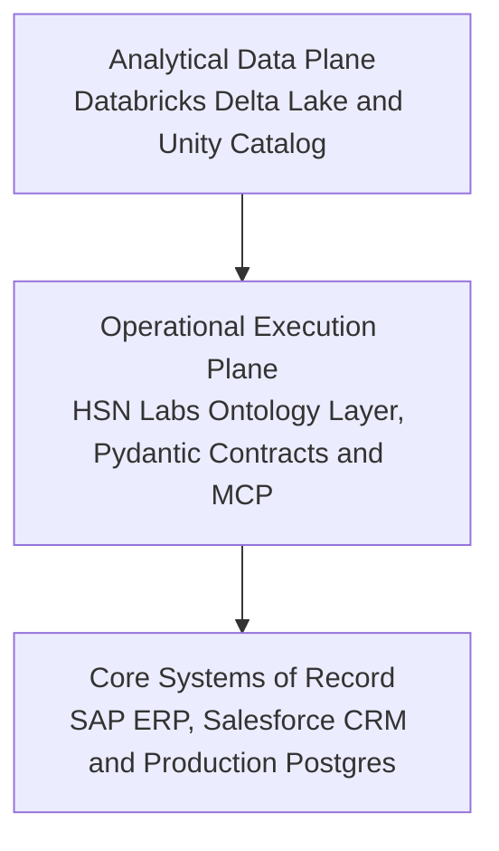

*Reading time: 7 minutes. Author: Hugo S. Nascimento.*

<!-- more -->

*Context: Enterprise engineering teams frequently attempt to build transactional AI agents directly on top of analytical platforms like Databricks or Snowflake. Within weeks of production testing, latency spikes and missing write-back guards stall the rollout. Here is why analytical lakehouses fail at operational agent execution, why Palantir built an ontology layer, and how HSN Labs constructs the hybrid architecture in open code.*

> **Executive Summary for Technology Leaders:** Databricks and Snowflake are world-class analytical platforms designed for high-throughput batch processing, business intelligence, and model training. However, connecting autonomous agents directly to analytical tables causes high query latency, unbounded cloud compute consumption, and dangerous transactional mutations without rollback guards. Palantir solved this by introducing an Operational Ontology between data and models. For enterprises seeking that exact operational resilience without replacing their Databricks lakehouse or signing seven-figure Palantir contracts, HSN Labs deploys an open Operational Execution Plane using Python, Pydantic, LangGraph, and the Model Context Protocol.

---

## Diligence Note and Public Sources

The architectural specifications, governance models, and case metrics referenced in this article were verified against official vendor documentation and regulatory disclosures:

* **Databricks Unity Catalog and Lakehouse Architecture Documentation:** detailing governance over analytical tables, volumes, and model artifacts, available at <a href="https://docs.databricks.com/en/data-governance/unity-catalog/index.html">Databricks Unity Catalog Documentation</a>.
* **Palantir Foundry Operational Ontology Specification:** detailing object types, properties, and kinetic action write-backs, available at <a href="https://www.palantir.com/platforms/foundry/ontology">Palantir Foundry Ontology</a>.
* **Tampa General Hospital Operational Case Study:** documenting clinical care coordination over Palantir AIP, available at <a href="https://www.palantir.com/impact/tampa-general-hospital">Palantir Tampa General Impact Study</a>.
* **Model Context Protocol Technical Standard:** open specification for connecting AI models to enterprise data and tools, available at <a href="https://modelcontextprotocol.io">Model Context Protocol Documentation</a>.

---

## 1. Analytical Planes vs Operational Planes: Comparing the Three Architectures

The failure of data-lake-backed agents stems from confusing two completely different architectural planes: passive analytical storage versus stateful operational execution.

| Architectural Vector | Analytical Lakehouse - Databricks and Snowflake | Proprietary Ontology - Palantir Foundry and AIP | Hybrid Open Ontology - HSN Labs |
| :--- | :--- | :--- | :--- |
| **Core Architectural Plane** | Analytical Data Plane: batch aggregation, BI reporting, feature engineering, and model training | Closed Operational Plane: end-to-end proprietary data ingestion, object modeling, and workflow apps | Decoupled Operational Execution Plane sitting between existing lakehouses and core ERPs |
| **Primary Data Asset** | Tables, Parquet and Delta files, analytical views, and vector embeddings | Proprietary object types, semantic links, and kinetic action definitions inside Foundry | Strongly-typed Pydantic v2 data contracts, Neo4j or PostgreSQL graphs, and MCP tool schemas |
| **Query and Access Pattern** | High throughput over terabytes of historical data; multi-second cold-start and scan latency | Low-latency operational lookups bound to internal Foundry indexes | Sub-second point lookups against operational read replicas and deterministic state machines |
| **Transactional Write-Back** | Append-only batch merges; zero native transactional rollback into legacy ERPs | Bidirectional write-back into systems of record via proprietary Foundry connectors | Deterministic write-back into SAP, TOTVS, Salesforce, and Oracle via audited MCP servers |
| **Governance Target** | Static data assets: schemas, tables, views, and ML model registries via Unity Catalog | Business rules, role permissions, and action parameters locked inside Palantir | Code-level finite state machines in LangGraph, invariant validators, and Human-in-the-Loop gates |
| **Commercial and Lock-in Profile** | Consumption-based DBU and compute billing; high compute burn when queried in agent loops | Multi-year seven-figure USD contracts with total platform lock-in | 100 percent client-owned Python codebase deployed inside the client's existing cloud tenant |

Databricks is an exceptional data intelligence engine. Unity Catalog delivers centralized governance across analytical tables, machine learning models, and SQL endpoints.

However, Unity Catalog governs *data artifacts*. It does not govern *operational actions*.

When an autonomous agent operates in a real enterprise, it does not just aggregate historical metrics. It mutates operational reality:

- Reallocating acute hospital beds across clinical units.
- Rerouting international supply chain purchase orders.
- Adjusting dynamic credit limits on banking ledgers.

An analytical lakehouse cannot safely govern these mutations on its own.

---

## 2. Why RAG on Delta Tables Hallucinates in Production

When developers connect an LLM directly to an analytical table in Databricks or Snowflake, the agent relies on vector similarity or text-to-SQL generation.

In production, this creates three structural points of failure:

### A. Lack of Object-Action Grounding
In a data lake, enterprise concepts are scattered across hundreds of normalized or semi-structured tables. A customer entity might exist across forty relational tables with divergent temporal schemas.

An operational ontology abstracts these disparate rows into a single software object: `Customer`.

Crucially, the ontology attaches bounded actions directly to that object: `UpdateCreditLimit`, `FlagFraud`, `IssueRefund`. The agent is never permitted to generate raw SQL mutations. It must invoke typed actions that validate business invariants before touching backend storage.

### B. High Query Latency Destroys Agentic Reasoning Loops
Deep agents operate via multi-hop reasoning graphs.

  
  Autonomous multi-agent swarms engineered over formal state graphs.

An agent might inspect an anomaly, query historical inventory, verify contract pricing, and cross-reference vendor SLAs.

If each intermediate tool call queries an analytical SQL warehouse with a four-second cold-start latency, a five-step reasoning chain exceeds twenty seconds. End users abandon the session, API connection pools time out, and DBU compute bills spike.

### C. The Absence of Bidirectional Write-Back
Data lakes are read-heavy analytical targets. They ingest data downstream from ERPs and CRMs via ETL pipelines.

If an AI agent decides to approve an invoice, writing that update to a data lake table achieves nothing. The operational reality lives in SAP, TOTVS Protheus, Oracle, or Salesforce.

Palantir Foundry and AIP succeed because the ontology is bidirectional: when an agent triggers an action, the platform writes the transaction directly back to the operational system of record while enforcing audit logs.

---

## 3. The Production Pattern: The HSN Labs Hybrid Architecture

Enterprises do not need to abandon Databricks or Snowflake, nor do they need to pay millions of dollars for Palantir Foundry, to deploy resilient autonomous agents.

The solution is establishing a clean separation of concerns between your analytical lakehouse and an open operational ontology:

1. **Keep Analytical Heavy Lifting in the Lakehouse:** Continue using Databricks or Snowflake for batch processing, historical feature engineering, and offline BI pipelines.
2. **Deploy an Open Operational Ontology for Agents:** HSN Labs abstracts your core business entities into strongly-typed Python and Pydantic objects with deterministic execution perimeters in LangGraph.
3. **Bind Agent Outputs to Audited MCP Actions:** Never allow an LLM to generate arbitrary database writes. Intercept every tool call with schema-validated state machines that write safely back to SAP, TOTVS, or Salesforce.

If you treat a data lake as an operational agent backend, your initiative will stall in pilot purgatory. When you decouple analytical storage from operational execution, autonomous agents run with sub-second latency, zero hallucinations, and full transactional integrity.

---

## Strategic Resources and Related Essays
- <a href="../what-is-an-ontology-for-ai-agents/">What Is an Ontology for AI Agents? The Definitive Guide</a>
- <a href="../the-poc-graveyard/">Why Agents Fail: The PoC Graveyard</a>
- <a href="../why-rag-breaks-on-erp/">Why I Never Use Normal RAG on Financial ERPs</a>
- <a href="https://hsnlabs.ai/bootcamp">Apply for the HSN Labs Five-Day Architecture Bootcamp</a>
