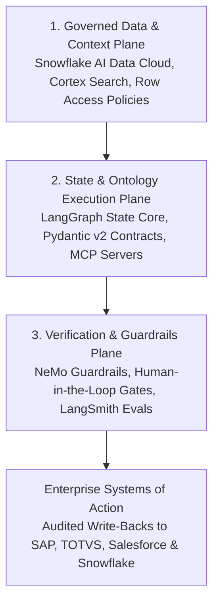

*Reading time: 8 minutes. Author: Hugo S. Nascimento.*

<!-- more -->

*Context: Enterprise technology leaders invest heavily in Snowflake's AI Data Cloud to unify corporate tables, enforce role-based access controls, and consolidate analytical context. Yet when engineering teams connect probabilistic language models directly to the Snowflake platform via unconstrained text-to-SQL or naive RAG pipelines, ninety percent of agent pilots stall before production. Here is the reference architecture we deploy at hsnlabs to bind deterministic LangGraph state machines and executable business ontologies directly over the Snowflake AI Data Cloud.*

> **Executive Summary for Technology Leaders:** Snowflake's AI Data Cloud provides an unmatched governed data foundation, combining relational tables, Cortex Search, and granular role-based security within a single perimeter. However, data governance alone does not govern multi-step agent execution. Giving an autonomous agent raw SQL generation privileges leads to schema hallucinations, unbounded compute credits burn, and invalid business state transitions. By pairing the Snowflake platform with an open Agentic Development Life Cycle layer built on LangGraph, Pydantic v2 data contracts, and Model Context Protocol servers, enterprises achieve zero-copy grounding and deterministic execution without vendor lock-in.

---

## Diligence Note and Technical Specifications

The architectural patterns and platform capabilities detailed in this post align with official technical documentation and open engineering standards:

* **Snowflake AI Data Cloud and Cortex Architecture:** detailing governed enterprise data, hybrid vector search via Cortex Search, and semantic models via Cortex Analyst, available at <a href="https://docs.snowflake.com/en/user-guide/snowflake-cortex">Snowflake Cortex Documentation</a>.
* **Snowflake Role-Based Access Control and Row Access Policies:** detailing fine-grained security boundaries enforced at the platform level, available at <a href="https://docs.snowflake.com/en/user-guide/security-access-control-overview">Snowflake Access Control Documentation</a>.
* **LangGraph Stateful Orchestration Specification:** detailing cyclic state graphs, durable checkpointing, and human-in-the-loop interrupts, available at <a href="https://langchain-ai.github.io/langgraph/">LangGraph Technical Documentation</a>.
* **hsnlabs Snowflake Architecture Practice:** reference specifications and deployment methodology, available at <a href="https://hsnlabs.ai/en/snowflake/">hsnlabs Snowflake AI Data Cloud Practice</a>.

---

## 1. Why Raw Text-to-SQL Fails Over Enterprise Schemas

When organizations attempt to build operational agents over their corporate data, the default instinct is connecting an LLM directly to database credentials and prompting it to generate SQL queries.

In a real enterprise environment, this approach collapses across four predictable vectors:

| Failure Vector | Raw LLM + Unconstrained SQL | Governed ADLC Over the Snowflake AI Data Cloud |
| :--- | :--- | :--- |
| **Schema Complexity** | Hallucinates table joins across hundreds of historical views and denormalized reporting tables | Queries curated semantic contracts and Snowflake Cortex views bound to strict Pydantic schemas |
| **State & Multi-Step Logic** | Loses context across multi-turn investigations; repeats expensive full-table scans | Maintains durable state in LangGraph checkpoints, caching intermediate context and minimizing compute |
| **Security & Compliance** | Executes under a single over-privileged service account, risking cross-tenant data leaks | Inherits native Snowflake RBAC and Row Access Policies scoped to the invoking user's identity |
| **Transactional Write-Back** | Attempts direct mutations without validating cross-system business rules in SAP or Salesforce | Enforces code-level finite state guards and human-in-the-loop checkpoints before any action commits |

Snowflake's AI Data Cloud solves the hardest infrastructure problem in enterprise AI: eliminating data silos and governing access at scale.

However, a table schema only defines *how data is stored*. It does not define *which business transitions are legal*.

---

## 2. The Three-Layer Reference Architecture: Snowflake + LangGraph + ADLC

To move autonomous agents from fragile proofs of concept into mission-critical production, engineering leaders must separate the **Governed Data Plane** from the **Deterministic State & Ontology Plane**.

### Layer 1: Zero-Copy Grounding on the Snowflake Platform
Instead of exporting sensitive corporate tables into external vector databases via brittle nightly ETL scripts, all grounding stays inside your existing security perimeter on the Snowflake platform.

* **Structured Ground Truth:** Financial ledgers, inventory positions, and customer contracts remain in governed tables on Snowflake's AI Data Cloud.
* **Hybrid Retrieval:** Unstructured policy documents, contracts, and support tickets are indexed natively inside Snowflake, keeping embeddings synchronized with relational metadata and role permissions.

### Layer 2: LangGraph State Core & Executable Business Ontology
Above the Snowflake platform, we deploy an explicit state machine orchestrated in **LangGraph**.

Rather than letting a model improvise its own workflow, the agent traverses a finite graph where every node represents a verified engineering step:

1. **Identity & Scope Resolution:** The state graph validates the user's role and passes scoped credentials to the Snowflake session so Row Access Policies and Dynamic Data Masking apply automatically.
2. **Typed Context Hydration:** Using the Model Context Protocol, the agent invokes deterministic read tools rather than arbitrary SQL strings. Each tool returns strongly-typed Pydantic objects representing core domain entities such as `CustomerAccount`, `SupplyOrder`, or `ClaimDossier`.
3. **Kinetic Invariant Validation:** Before proposing any operational decision, such as approving a credit limit expansion or rerouting a shipment, deterministic Python guards verify margin thresholds, regulatory limits, and SLA rules.

### Layer 3: Verification, Guardrails, and Continuous Evaluation
No enterprise agent should enter production without an automated audit trail and regression harness.

* **Pre-Commit Interception:** High-value or irreversible state transitions pause automatically at a LangGraph checkpoint, routing a structured approval payload to a human operator before executing.
* **Traceability & Regression Suites:** Every query latency, token cost, and state transition is logged in LangSmith and Braintrust, ensuring schema updates never cause silent behavioral drift.

---

## 3. From PoC to Production in 4 Steps

At hsnlabs, we operationalize this architecture directly inside our clients' cloud environments with full code and IP handover:

1. **Step 01 · Architectural Validation:** We audit your target workflow, map the required data domains inside your Snowflake instance, and calculate the exact unit-economic ROI before writing production code.
2. **Step 02 · Ontology & Data Setup:** We map your governed schemas on the Snowflake platform into executable Pydantic contracts and configure zero-copy retrieval pipelines.
3. **Step 03 · Agentic Integration:** We build the LangGraph state machines, wire audited MCP tool servers to your Snowflake AI Data Cloud and core ERPs, and enforce deterministic guardrails.
4. **Step 04 · Team Handover:** We deliver the complete repository, evaluation test suites, and architecture documentation so your internal engineering team owns and operates the system with zero recurring consultancy dependency.

---

## About Snowflake

Snowflake makes enterprise AI easy, efficient and trusted. Thousands of companies around the globe, including hundreds of the world's largest, use Snowflake's AI Data Cloud to share data, build applications, and power their business with AI. The era of enterprise AI is here. Learn more at <a href="https://www.snowflake.com">snowflake.com</a>.

---

## Strategic Resources and Related Reading
- <a href="https://hsnlabs.ai/en/snowflake/">hsnlabs Snowflake AI Data Cloud Architecture Practice</a>
- <a href="https://hsnlabs.ai/en/langchain/">hsnlabs LangChain & LangGraph Production Engineering</a>
- <a href="../what-is-an-ontology-for-ai-agents/">What Is an Ontology for AI Agents? The Definitive Guide</a>
- <a href="../ontology-vs-database-schema/">Ontology versus Database Schema: Why Tables Alone Cannot Define Business Transitions</a>
- <a href="../the-poc-graveyard/">The PoC Graveyard: Why 90% of Enterprise Pilots Collapse Under Dirty Data</a>
