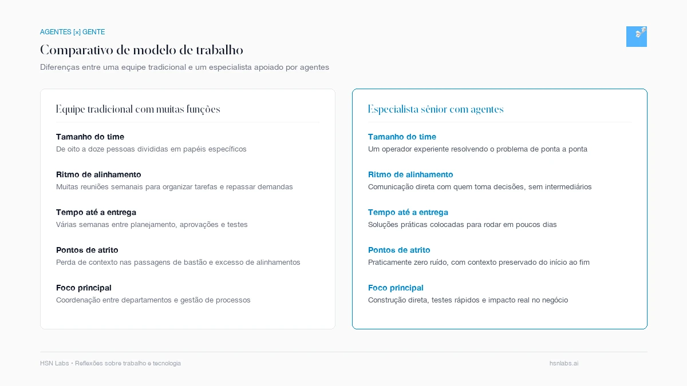
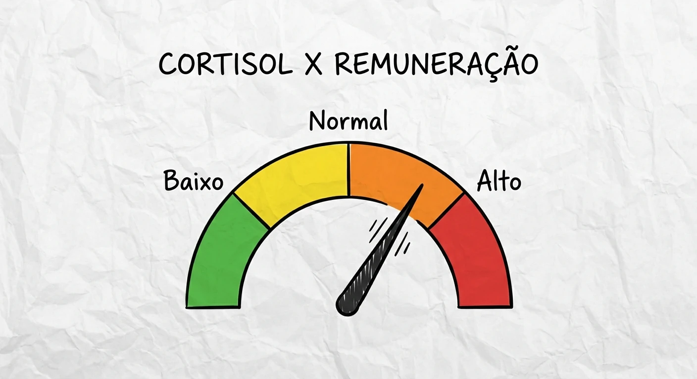
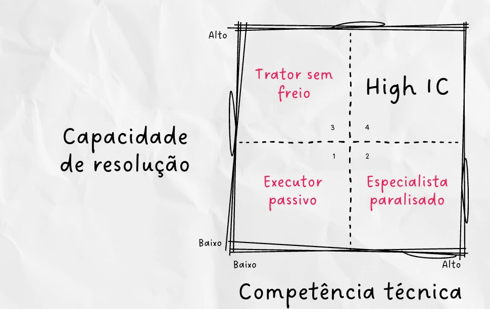
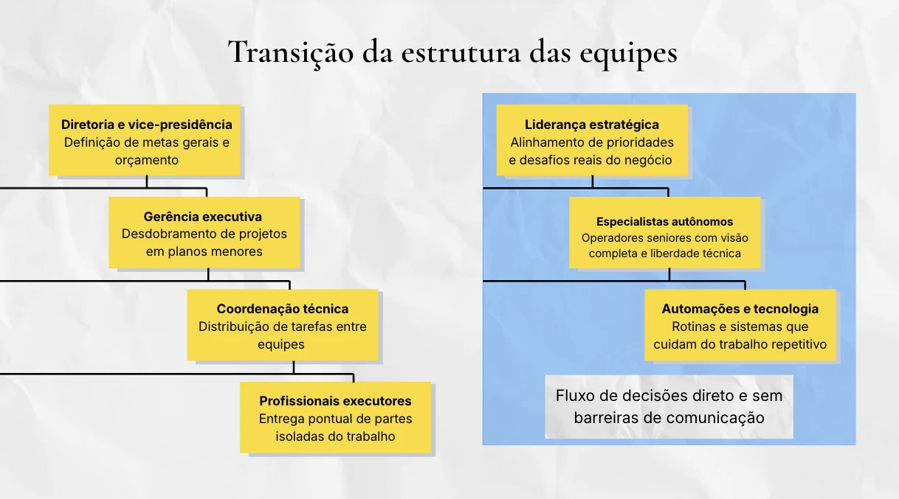
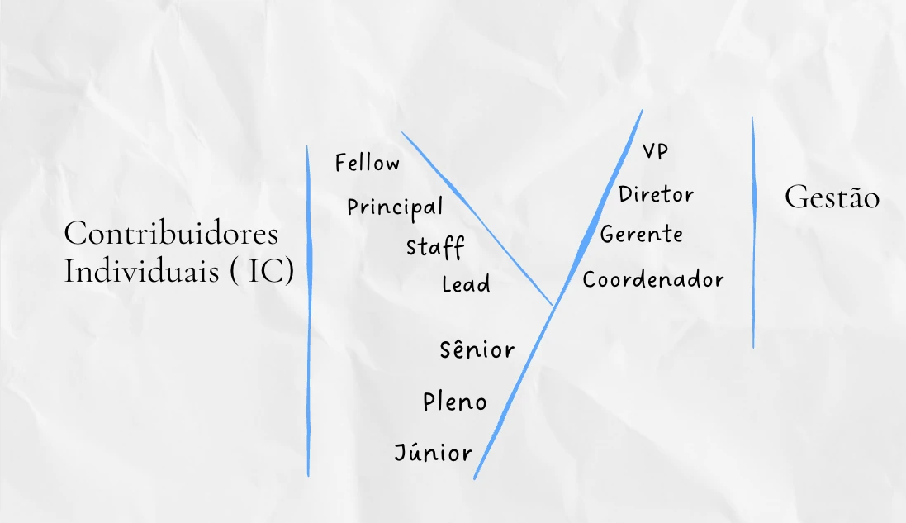

*Reading time: 7 minutes. Author: Hugo S. Nascimento.*

<!-- more -->

*Editorial Note: An earlier version of this analysis appeared in the inaugural edition of the <a href="https://www.linkedin.com/newsletters/agentes-x-a-gente-7397999984089935872">[Agentes] x [a Gente]</a> newsletter on LinkedIn by <a href="https://www.linkedin.com/in/hugosoaresnascimento/">Hugo S. Nascimento</a>. This expanded essay details the economic and structural implications for enterprise leadership.*

In 2016, I was living in Brasília, having just closed an investment round for my second startup, WeCare. While assembling the team to scale product traction post-MVP, I sat down with a seasoned VP of Engineering.

I asked for his perspective on initial team composition. His response was blunt:

> "Do not bring in interns or juniors right now. In the beginning, they only drain throughput. They take months to ramp up, consume a senior engineer's entire workday specifying tickets, unblocking issues, and reviewing code, and ultimately ship slower than if the senior had executed alone."

At the time, the operational math offered no alternative. A senior engineer could produce significantly more, but faced the hard physical constraints of two hands and eight hours a day. To handle volume, enterprises had to hire entry-level analysts in bulk, layering coordinators and middle managers over them purely to triage queues, distribute tasks, and track milestones.

For years, corporate leadership believed this bottleneck was isolated to software engineering. Today, nearly every corporate function operates on top of software and structured data. Human Resources, financial planning, treasury, and corporate legal suffer from the exact same headcount coordination friction.

Autonomous enterprise AI agents permanently eliminated this physical execution ceiling for senior operators. That single shift is inverting the traditional corporate org chart.

## The Agentic Multiplier

The core question facing modern executive leadership is straightforward: does it still make sense to measure productive capacity by team size?

In leading tech hubs, the High-Impact Individual Contributor—or High IC—has become an established structural reality. A High IC is neither a junior analyst executing clerical scripts nor an aspiring people manager. Yet they routinely command compensation packages on par with executive directorships.

This economic equation is made viable strictly by autonomous AI agents operating alongside senior domain veterans.

The operational workflow is straightforward. The senior specialist works paired with agents integrated directly into enterprise APIs and transactional cores. As a result, they no longer need to decompose foundational tasks to delegate to junior staff. Without constant handoffs, alignment meetings disappear. The specialist gains direct execution authority at the perimeter, delivering greater business outcomes without subordinate headcount.

## High Compensation, Low Cortisol

Historically, the only structural route to top-tier compensation in an enterprise was moving into people management.

Top technical and domain performers hit a compensation ceiling early. To advance, companies routinely promoted their best tax counsel, senior payroll specialist, or lead financial modeler into administrative management—spending their days approving PTO requests, filling budget spreadsheets, and firefighting political comittees.

That higher pay package came bundled with massive cortisol levels.

The implicit corporate contract dictated that higher earnings required absorbing interpersonal friction, resolving team disputes, and navigating corporate diplomacy.

Autonomous agents broke this structural compromise. Forward-thinking enterprises now offer director-level compensation to technical specialists driving mission-critical outcomes with AI agents, maintaining operational focus without administrative burnout. Specialists no longer need to become people managers to earn top compensation. The enterprise rewards the capacity to solve high-stakes business problems, not the volume of bureaucratic friction absorbed.

## Profile of the High IC

The terminology originated in Silicon Valley, where IC denotes an Individual Contributor: a specialist who drives outcomes through direct execution rather than team oversight. The ecosystem frequently adopts variants such as High-Impact IC, HI-IC, or HI-C, articulated by product leaders such as Elena Verna at Lovable.

Historically, professionals who remained individual contributors past their mid-thirties were viewed skeptically by traditional HR, stereotyped as lacking corporate ambition. The modifier High fundamentally changed that perception.

A High IC is not an amateur using generic consumer chatbots to summarize meetings. They are seasoned domain practitioners who master regulatory rules, understand systems architecture, and orchestrate autonomous agents to complete end-to-end workflows.

Across corporate departments, organizations often divide employees into passive operators awaiting direction, cynical critics stalled by bureaucracy, and high-initiative juniors who execute without rigor and create downstream chaos.

The High IC combines deep domain mastery with high agency. They identify business friction, deploy autonomous agents to handle repetitive volume, and ship working solutions without getting trapped in departmental handoffs.

This mirrors Paul Graham's analysis of Founder Mode in late 2024. Enterprises stall when layers of middle management stand between decision-makers and builders. The High IC bypasses this latency, sitting directly with executive leadership to understand priorities and delivering execution directly at the edge.

## The Market Equation

Chief Financial Officers are already evaluating the balance sheet impact: does it still make sense to maintain extensive headcount rosters, or transition to lean, agent-dense pods?

Compensation benchmarks compiled by <a href="https://www.levels.fyi">Levels.fyi</a> highlight this structural shift. A High IC currently earns 35 to 55 percent more than a traditional senior counterpart. When the specialist demonstrates fluency with autonomous AI agent operations, compensation expands by an additional 19 percent.

Compared to direct frontline managers, upper-tier High ICs match executive pay bands and frequently outearn traditional team managers by 5 to 15 percent. Capital markets have begun pricing problem-solving capacity above administrative milestone tracking.

## The Cost of Alignment

The largest expenditure in corporate operations is rarely software tooling or cloud compute. The true cost is organizational latency across expanding teams.

In a traditional five-tier hierarchy, the executive team sets direction, middle management drafts operational plans, team leads delegate assignments, and junior analysts execute. At each handoff, strategic context degrades and execution slows.

This operational reality led Jensen Huang at Nvidia in 2024 to maintain over fifty direct executive reports. He deliberately rejects managerial buffers because intermediate organizational layers distort operational truth and retard market execution.

In a lean, agent-leveraged pod, the senior specialist communicates directly with leadership and offloads transactional execution to autonomous systems. Communication stays clean, and business execution accelerates without bureaucratic friction.

## The Transversal Y-Career

In software engineering, the dual-track Y-Career model was established decades ago to ensure distinguished architects could attain executive parity without managing people.

John Collison, co-founder of Stripe, describes this profile as a double major. The most valuable professional in the agentic economy is not a pure prompt engineer, but a business domain authority who masters tax code, structured debt, or regulatory compliance and operates autonomous agents with technical rigor. They architect the workflow and deliver the completed transaction without filing IT support tickets or waiting in queue.

This paradigm is actively transforming core corporate functions:

* Corporate Legal: Senior tax counsel uses agents to audit hundreds of contracts in minutes, advising the board directly on structural tax exposure without managing junior paralegal pools.
* Corporate Finance: A quantitative modeler pairs with agents to perform continuous daily cash reconciliation, sparring with the CFO on liquidity and capital allocation without teams of clerks.
* Human Resources: Total rewards leads orchestrate agentic workflows to calibrate compensation bands across business units, eliminating administrative data entry and advising the CEO directly.

The mandate to accept people management for financial advancement is broken. Professional value is now determined by the complexity of the problems you resolve.

## Winners and Losers

This structural transition reshapes corporate leverage:

For technical specialists who prioritize craft and execution over personnel management, this is the most advantageous market in decades.

For middle managers whose core daily output consists of routing messages, tracking status spreadsheets, and assembling slide decks, the traditional operating model faces swift obsolescence.

For entry-level candidates, the bar for entry has escalated. Traditional entry-level roles centered around manual data entry, clerical triage, and rote drafting are completed by autonomous agents in seconds. New professionals must demonstrate analytical depth and technical problem-solving capabilities from day one.

## Unresolved Strategic Questions

The shift toward agent-leveraged corporate structures raises critical questions for leadership teams:

* Value Capture: Will massive productivity surges translate into higher compensation for elite specialists, or will enterprises absorb efficiency gains into gross margins?
* Pod Dynamics: How will organizations manage peer dynamics and territorial friction between multiple High ICs operating within the same vertical?
* Backoffice Contraction: Which operational support departments will experience initial headcount consolidation across enterprise markets?
* Senior Pipeline: Without routine foundational tasks to train junior staff, how will enterprises develop the next generation of senior domain authorities?

Explore ongoing operational analyses on agentic engineering and autonomous workforce design by subscribing to <a href="https://www.linkedin.com/newsletters/agentes-x-a-gente-7397999984089935872">[Agentes] x [a Gente]</a> on LinkedIn, authored by <a href="https://www.linkedin.com/in/hugosoaresnascimento/">Hugo S. Nascimento</a>.

## Related Field Notes & Strategic Resources
- <a href="/blog/post/bpo-replacement-matrix/">The BPO Replacement Matrix: Operational and Financial Benchmarks</a>
- <a href="/blog/post/c-suite-margin-protection-playbook/">The C-Suite Transition Playbook: Protecting Margins in the Agentic Economy</a>
- <a href="/blog/post/buy-versus-build-b2b-enterprise-crm/">B2B Sales CRM: Buy Salesforce, Adapt Twenty, or Build with Agents</a>
- <a href="/blog/post/collapse-of-legacy-rpa/">The Legacy RPA Market Is Collapsing</a>
- <a href="/blog/post/manifesto/">Why I Founded hsnlabs</a>
- <a href="https://hsnlabs.ai/en/bootcamp/">Explore the hsnlabs Agentic Bootcamp™</a>
