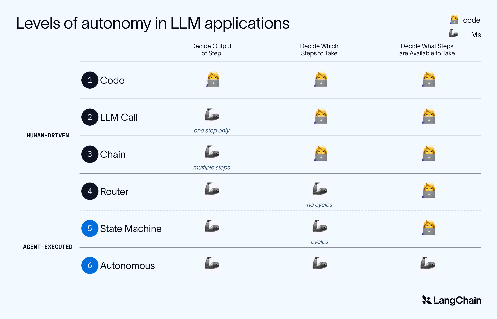
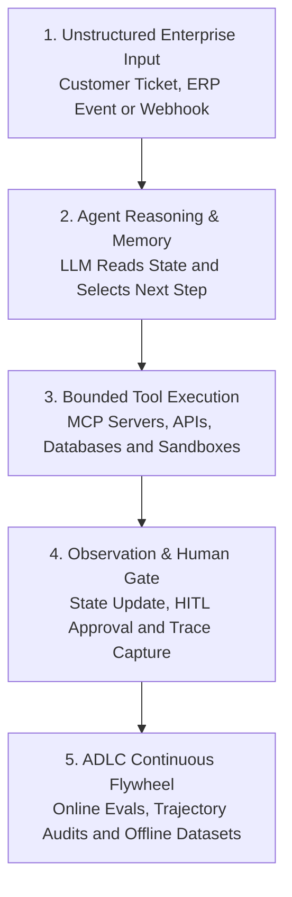
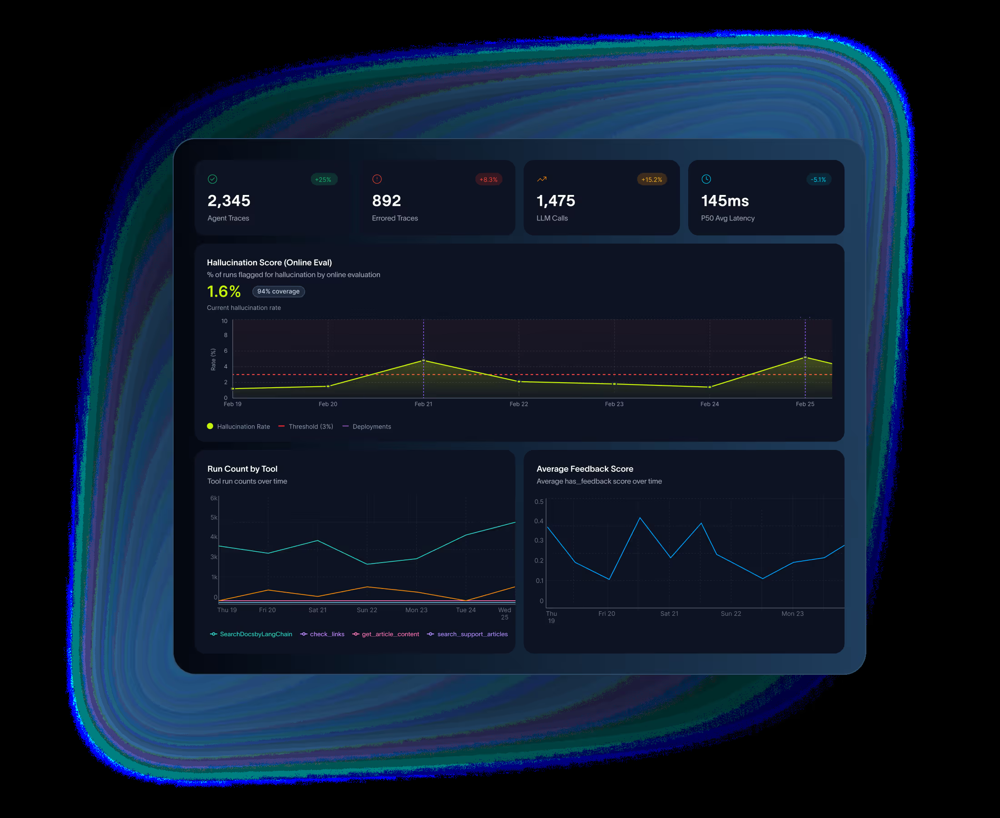

*Reading time: 7 minutes. Author: Hugo S. Nascimento.*

<!-- more -->

*Context: Enterprise technology buyers are bombarded with software vendors relabeling basic prompt wrappers as autonomous agents. Drawing on LangChain's primary field guide on production agents and our architectural practice at hsnlabs, this post separates marketing noise from operational reality: how control flow defines an agent, where state machines sit on the autonomy spectrum, and which observability controls prevent production failures.*

> **Executive Summary for Technology Leaders:** An AI agent is not a conversational chat interface. In software engineering, an AI agent is a system that uses a large language model to decide the control flow of an application. Moving from static workflows to autonomous execution introduces non-determinism that breaks unprotected corporate operations. Enterprises escape pilot purgatory by choosing the lowest necessary level of autonomy, anchoring execution in bounded state machines, and instrumenting every trajectory with continuous observability and evaluation.

---

## Diligence Note and Technical Specifications

The definitions, autonomy taxonomy, and production engineering principles in this post synthesize primary engineering research and official platform documentation:

* **LangChain Primary Architectural Study:** "What is an AI agent?" detailing control-flow ownership, the six-level autonomy spectrum, the Agent Development Lifecycle, and production reliability data, available at <a href="https://www.langchain.com/blog/what-is-an-agent">LangChain Blog: What Is an AI Agent</a>.
* **LangChain & LangGraph Production Stack:** open-source orchestration and stateful execution frameworks for bounded corporate workflows, available at <a href="https://www.langchain.com/">LangChain Platform Documentation</a>.
* **hsnlabs LangChain & LangGraph Practice:** independent enterprise deployment patterns and observability architectures, available at <a href="https://hsnlabs.ai/en/langchain/">hsnlabs LangChain & LangGraph Engineering</a>.

  
  Production agent architecture combining LLM-directed control flow, bounded LangGraph state machines, and LangSmith runtime observability.

---

## 1. What Defines an AI Agent in Software Engineering

Vendors routinely label FAQ chatbots as agents, while academic researchers reserve the term for open-ended autonomous systems. After four years of shipping agents into production, LangChain offers a crisp engineering definition: **an AI agent is a system that uses a large language model to decide the control flow of an application.**

Anthropic expresses a complementary operational view: agents are systems where language models dynamically direct their own processes and tool usage, retaining control over how tasks are completed. For engineering leaders, the boundary is binary. An agent begins when the model chooses the next execution step at runtime, rather than merely generating text inside a sequence hard-coded by developers.

This distinction explains why conversational bots fail to eliminate operational cost centers. As examined in our analysis of <a href="/blog/post/chatbot-vs-agent/">chatbot versus production agent architecture</a>, summarizing PDF manuals in a chat window leaves BPO labor intact. Real financial return requires software that dynamically routes work, validates payloads, and mutates state across corporate systems of record.

---

## 2. The Six Levels of Autonomy: Workflows vs. State Machines

Arguing whether a system is "truly" an agent wastes executive time. Just as automotive engineering adopted numbered SAE levels instead of debating whether driver assistance counts as self-driving, enterprise architects must evaluate systems across a concrete **autonomy spectrum**.

LangChain maps six levels of autonomy across three control decisions: who decides the output of each step, who decides which step comes next, and who decides what steps are available to take.

<figure class="article-editorial-figure">
  
  <figcaption class="editorial-caption">Six levels of autonomy in LLM applications, published by LangChain, mapping control over step output, next step selection, and available action space.</figcaption>
</figure>

Across this spectrum, systems shift from **human-driven** code paths to **agent-executed** loops:

| Autonomy Tier | Output of Step | Next Step Selection | Available Action Space | Enterprise Operational Fit |
| :--- | :--- | :--- | :--- | :--- |
| **1. Deterministic Code** | Developer code | Developer code | Developer code | Fixed ledger calculations, tax rules, and hard compliance checks |
| **2. Single LLM Call** | LLM single step | Developer code | Developer code | Document classification, entity extraction, and ticket tagging |
| **3. Chain** | LLM multiple steps | Developer code | Developer code | Sequential summarization, translation, and fixed enrichment pipelines |
| **4. Router** | LLM | LLM without cycles | Developer code | Intent triage directing inbound requests to specialized sub-workflows |
| **5. State Machine** | LLM | LLM with cycles | Developer code | Production ERP reconciliation, customer operations, and LangGraph workflows |
| **6. Autonomous** | LLM | LLM with cycles | LLM dynamically | Open-ended research or code synthesis where the system invents new tools |

In production, choosing the wrong tier creates immediate failure. Deploying a Level 6 autonomous agent on a deterministic invoice check injects unrequested non-determinism. Conversely, forcing a rigid Level 3 chain onto unstructured vendor disputes causes brittle paths to shatter on the first unexpected format.

The optimal enterprise architecture blends both. Keep deterministic code in charge of compliance, calculations, and irreversible writes, and hand runtime control to the LLM strictly where unstructured inputs or multi-step decisions require adaptation.

---

## 3. Inside the Agent Loop and Runtime Architecture

Every AI agent executes as a language model inside a continuous reasoning loop. At each turn, the system reads the current state, selects an action, invokes a tool, observes the tool output, updates memory, and decides whether to loop again or terminate.

Four foundational components govern that loop:

| Component | Architectural Role | Enterprise Production Examples |
| :--- | :--- | :--- |
| **Model** | Evaluates current state and decides the next action | Frontier reasoning LLMs with reliable structured output and tool calling |
| **Tools** | Reads external state and executes bounded mutations | Corporate REST APIs, read replicas, sandboxed code execution, retrieval, and MCP servers |
| **Memory** | Persists context across conversation turns and long tasks | Thread conversation history, checkpointed state stores, and editable policy files |
| **Loop** | Orchestrates perceive, reason, act, observe, and update | ReAct, Reflexion, plan-and-execute, and supervisor-worker state graphs |

---

## 4. When You Actually Need an Agent

Sophisticated orchestration adds latency, token burn, and failure modes. A well-engineered retrieval pipeline or deterministic workflow outperforms an unconstrained agent on straightforward tasks.

LangChain's production guidance aligns directly with what we enforce during hsnlabs architecture sprints:

1. **Start with a single agent and sharp prompt engineering:** A single well-instructed model equipped with clean, typed tools solves most operational workflows without orchestration overhead.
2. **Add tools before adding agents:** Missing capabilities belong in deterministic tools or MCP endpoints, not in extra sub-agents that multiply reasoning hops.
3. **Adopt multi-agent patterns only at real limits:** Split into routers, handoffs, or supervisor patterns only when context window overflow, tool sprawl, or strict organizational boundaries make a single loop untenable. In our teardown of the <a href="/blog/post/latam-airlines-case-study/">LATAM Airlines production case study</a>, centralizing output formatting under a strict supervisor eliminated 15 percent token and latency overhead while cutting routing errors to 1 percent.
4. **Prioritize retrieval before reasoning:** On knowledge-heavy tasks, accurate indexing and structured ontology lookups beat long chains of speculative reasoning.
5. **Never outsource judgment you cannot evaluate:** If your domain experts cannot define and verify a correct answer, an autonomous agent will not reliably produce one either.

---

## 5. The Agent Development Lifecycle, Human Oversight, and Observability

Shipping an agent is not a one-time deployment. LangChain formalizes continuous improvement through the **Agent Development Lifecycle**, connecting four operational stages: **build**, **test**, **deploy**, and **monitor**. Production traces and user feedback feed back into curated datasets so every release is tested against real operational edge cases before touching live customers.

### Online Evals, Offline Evals, and Trajectory Audits

* **Online Evals:** Run asynchronously over sampled live traces to flag sudden drops in helpfulness, spikes in hallucination rates, or failing tool endpoints. They act as production telemetry rather than absolute ground truth.
* **Offline Evals:** Execute against curated golden datasets before deployment to prove whether a prompt edit, model swap, or graph change genuinely improved performance.
* **LLM-as-a-Judge Calibration:** Automated judges scale evaluation across thousands of traces, but uncalibrated judges drift easily. Teams must align judge prompts against hand-labeled production traces, while pairing subjective rubrics with deterministic code assertions for compliance boundaries.
* **Trajectory Evals:** In multi-step and multi-agent architectures, grading only the final message hides broken intermediate behavior. Trajectory evaluation verifies whether the agent selected the right sub-agent, invoked the right tools, and followed the required execution sequence.

### Human-in-the-Loop Controls That Compound Quality

For sensitive or irreversible operations such as financial disbursements, contract modifications, or regulated customer disclosures, human-in-the-loop gates pause execution for explicit approval, parameter edits, or rejection. Rather than letting human review become a permanent manual bottleneck, every reviewer edit in an annotation queue becomes a golden dataset record that permanently sharpens future agent versions.

---

## 6. Escaping Pilot Purgatory in Enterprise Production

Industry data reveals a wide gap between experimentation and operational scale. McKinsey's November 2025 State of AI survey found that **62 percent** of organizations were experimenting with agents, yet **no more than 10 percent** in any business function had scaled them into production. Similarly, Gartner projects that **more than 40 percent** of agentic AI projects will be canceled by the end of 2027 due to escalating costs, unclear business value, or inadequate risk controls.

Closing that gap requires engineering infrastructure around the language model from day one:

<figure class="article-editorial-figure">
  
  <figcaption class="editorial-caption">LangSmith production observability dashboard monitoring agent traces, errored runs, online hallucination rates against alert thresholds, tool run counts, and average feedback scores.</figcaption>
</figure>

* **End-to-End Observability:** Capture complete execution traces from day one using framework-agnostic platforms like LangSmith, exposing every prompt, tool call, latency percentile, and token cost across LangChain, LangGraph, Deep Agents, or custom runtimes.
* **Isolated Execution Sandboxes:** Run any agent-generated code inside isolated environments such as LangSmith Sandboxes so probabilistic outputs never execute directly against core corporate hosts.
* **Scoped Authentication and Access Boundaries:** Enforce multi-user authorization and role-based access controls via platforms like LangSmith Deployment so every agent action inherits strict enterprise permissions.

Start at the simplest tier on the autonomy spectrum that solves the business bottleneck, capture traces before the first end user touches the system, and expand autonomy only as verified evaluation coverage matures.

---

## Strategic Resources and Related Reading
- <a href="https://hsnlabs.ai/en/langchain/">hsnlabs LangChain & LangGraph Production Engineering</a>
- <a href="/blog/post/chatbot-vs-agent/">Chatbot vs Agent: Why Replacing BPOs Requires Production Guardrails</a>
- <a href="/blog/post/latam-airlines-case-study/">LATAM Airlines: Production Agents in a 3% Margin Business</a>
- <a href="/blog/post/braintrust-evals-cicd-langgraph-agent-architecture/">Braintrust Evals & LangGraph: Replacing Vibe Checks with Deterministic CI/CD</a>
- <a href="/blog/post/the-poc-graveyard/">Why Agents Fail: The PoC Graveyard</a>
