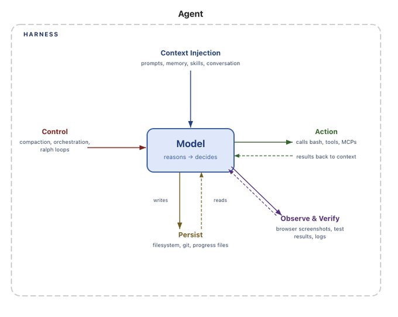
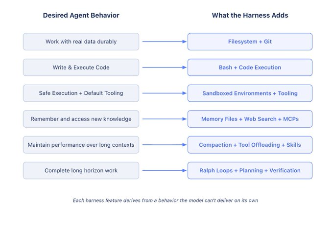
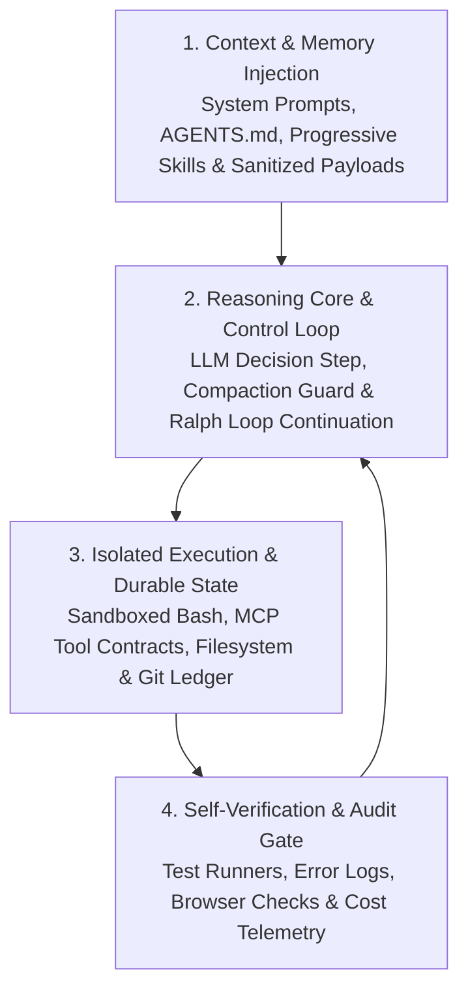

*Reading time: 9 minutes. Author: Hugo S. Nascimento.*

<!-- more -->

*Context: Most enterprise AI teams spend ninety percent of their energy debating which frontier model to license and less than ten percent engineering the runtime that wraps it. When pilots collapse in staging or burn budget in production, the foundation model rarely caused the outage. The missing layer is the agent harness. Drawing on LangChain's architectural analysis of agent harnesses alongside our production deployments at hsnlabs, this post breaks down why raw models fail alone and how harness primitives turn stochastic text predictors into reliable enterprise work engines.*

> **Executive Summary for Technology Leaders:** An autonomous agent is never just a language model. As formalized by LangChain, `Agent = Model + Harness`. The model supplies raw reasoning intelligence, while the harness supplies every deterministic system wrapped around it: prompts, tool contracts, durable filesystems, isolated sandboxes, context compaction, and verification hooks. Upgrading model weights cannot compensate for a weak harness. On Terminal Bench 2.0, changing only the harness lifted the same underlying model from Top 30 to Top 5. For enterprise CTOs and Heads of Architecture, harness engineering is the decisive lever separating stalled pilots from production-grade ROI.

---

## Diligence Note and Technical Specifications

The architectural model, behavioral primitives, and benchmark evidence referenced in this post align with primary engineering publications and open-source specifications:

* **LangChain Harness Engineering Study:** primary conceptual taxonomy and behavioral derivation detailing `Agent = Model + Harness`, context rot mitigation, Ralph Loops, and Terminal Bench 2.0 findings, published in <a href="https://www.langchain.com/blog/the-anatomy-of-an-agent-harness">The Anatomy of an Agent Harness on the LangChain Blog</a>.
* **Deep Agents Open-Source Harness Library:** reference implementation built on LangGraph providing filesystem backends, subagent isolation, planning tools, and context compaction, available at <a href="https://github.com/langchain-ai/deepagents">Deep Agents on GitHub</a>.
* **LangGraph Stateful Runtime Specification:** durable execution graphs, checkpointing, and deterministic control flows, available at <a href="https://langchain-ai.github.io/langgraph/">LangGraph Technical Documentation</a>.
* **hsnlabs Enterprise Production Practice:** reference specifications for wrapping foundation models in governed state machines and MCP perimeters, available at <a href="https://hsnlabs.ai/en/langchain/">hsnlabs LangChain & LangGraph Production Engineering</a>.

---

## 1. What an Agent Harness Is and Why Raw Models Fail

Out of the box, a foundation model is not an agent. It is a stateless function that accepts tokens or multimodal inputs and returns text. On its own, a raw model cannot persist state across sessions, execute code against an API, inspect live database schemas, or configure an operating environment to verify its own output.

Everything in an agent system that is not the model weights themselves is the **harness**. Concretely, the harness encompasses five operational layers:

1. **System Prompts and Policy Framing:** instructions, persona boundaries, and behavioral priors injected before user input arrives.
2. **Tools, Skills, and MCP Contracts:** typed function schemas, Model Context Protocol servers, and concise tool descriptions that define how the model touches external systems.
3. **Bundled Execution Infrastructure:** durable filesystems, isolated sandboxes, shell access, and headless browsers.
4. **Orchestration and Routing Logic:** subagent spawning, model routing, state transitions, and handoff protocols.
5. **Deterministic Hooks and Middleware:** automated compaction triggers, continuation guards, lint checks, and test-runner verification loops.

<figure class="article-editorial-figure landscape">
  
  <figcaption class="editorial-caption">LangChain reference anatomy: the model sits inside the harness perimeter, receiving context injection and control signals while persisting state, firing bash or MCP actions, and verifying logs and screenshots.</figcaption>
</figure>

When enterprise teams skip harness engineering and wire a bare LLM directly to thirty tools inside an unbounded `while` loop, failure is structural rather than accidental. That exact omission is why most corporate pilots end up buried in <a href="/blog/post/the-poc-graveyard/">The PoC Graveyard</a> or trigger runaway API incidents like <a href="/blog/post/unconstrained-agents-finite-state-machines/">forty-two unguarded calls in a 2 AM loop</a>.

---

## 2. Working Backwards from Desired Behavior to Harness Primitives

Good harness engineering starts from operational behavior, not from framework hype. As LangChain outlines, every core harness primitive exists because a raw model cannot reliably perform a required production behavior on its own.

<figure class="article-editorial-figure landscape">
  
  <figcaption class="editorial-caption">Working backwards from desired behavior to harness primitives, adapted from LangChain: each capability a raw model lacks maps directly to durable infrastructure.</figcaption>
</figure>

The table below translates LangChain's behavioral derivation into concrete enterprise architecture requirements:

| Desired Agent Behavior | Harness Primitive Added | Enterprise Failure Prevented |
| :--- | :--- | :--- |
| **Work durably with real data** | Filesystem abstractions and Git versioning | Eliminates copy-paste context loss and provides full audit trail plus rollback |
| **Write and execute logic flexibly** | General-purpose Bash and code execution | Removes the bottleneck of pre-building hundreds of brittle single-purpose tools |
| **Run safely with default tooling** | Isolated sandboxes, allow-listed CLIs, and network rules | Protects corporate VPCs and ERPs from unvalidated agent-generated code |
| **Remember and access live knowledge** | Memory files like `AGENTS.md`, web search, and MCPs | Bridges training knowledge cutoffs and preserves operational lessons across sessions |
| **Sustain accuracy over long sessions** | Context compaction, tool offloading, and progressive skills | Prevents context rot and API token limit crashes on multi-step workflows |
| **Finish complex multi-window tasks** | Ralph Loops, persistent plan files, and test hooks | Stops premature termination and keeps trajectories aligned across hours of execution |

### Filesystems and Git for Durable Working Memory

Models can only reason over tokens currently sitting inside their context window. Before filesystems became a first-class agent primitive, engineers jammed entire documents and intermediate payloads into conversation history, hitting token ceilings and degrading latency.

Because foundation models were trained on billions of tokens of software repositories and shell workflows, filesystems act as a native collaboration surface. Agents read source files, offload large intermediate outputs, coordinate through shared ledgers across subagents, and use Git commits to branch experiments or roll back faulty mutations.

### Bash, Code Execution, and Isolated Sandboxes

Pre-defining a dedicated REST wrapper for every micro-operation creates maintenance sprawl. Granting an agent bash and code execution inside an **isolated sandbox** lets the model synthesize short-lived scripts, parse CSV exports, or transform payloads dynamically.

In enterprise production, isolation is non-negotiable. Running agent-generated scripts on a shared application server exposes credentials, file descriptors, and internal networks. A proper harness provisions ephemeral sandboxes with pre-installed runtimes, strict command allow-lists, and network egress policies, tearing down each container as soon as verification completes.

### Memory, Live Search, and Battling Context Rot

Static weights freeze at pre-training cutoff. Harnesses inject live operational memory through standardized markdown files like `AGENTS.md` loaded at session start, paired with web search and live MCP endpoints such as documentation or schema registries.

Even with large context windows, **context rot** degrades reasoning quality long before the hard token limit arrives. As transcripts accumulate noisy JSON payloads and stack traces, instruction adherence drops sharply. Production harnesses counter context rot with three deterministic mechanisms:

1. **Compaction:** summarizing older trajectory turns and offloading historical state before the window approaches saturation.
2. **Tool Call Offloading:** retaining only the head and tail tokens of oversized tool responses in active context while saving the complete payload to disk for targeted inspection.
3. **Progressive Skills Disclosure:** loading only compact skill metadata on startup rather than stuffing dozens of heavy MCP schemas into the initial system prompt.

### Long-Horizon Execution and Ralph Loops

Long tasks expose two chronic LLM failure modes: **early stopping**, where the model declares victory after completing half the checklist, and **cross-window drift**, where restarting with a clean context erases prior progress.

LangChain highlights **Ralph Loops** as a decisive harness pattern for long-horizon work. A Ralph Loop attaches an execution hook that intercepts the model's exit attempt, inspects objective completion criteria, and reinjects the original goal into a fresh context window anchored to the durable filesystem state. Combined with explicit plan files and automated test-runner hooks, the agent iterates until deterministic checks actually pass rather than stopping when the model feels finished.

---

## 3. Model Co-Evolution and Why Harness Optimization Beats Weight Swaps

Modern coding and operational models such as Claude Code and Codex are post-trained with harnesses directly in the loop. This co-evolution teaches models to use filesystems, bash, planning artifacts, and parallel subagents natively.

However, training inside a loop introduces subtle **harness overfitting**. Changing a low-level tool contract, such as modifying how file-editing patches are formatted in Codex-5.3, can measurably drop task success rates even though the underlying reasoning intelligence did not change.

Crucially, the vendor's default harness is rarely optimal for your specific enterprise workflow. On the **Terminal Bench 2.0** leaderboard, identical weights for Opus 4.6 produced dramatically different scores across competing harnesses. LangChain demonstrated how modifying only the harness, without touching model weights, moved their coding agent from **Top 30 into the Top 5** on Terminal Bench 2.0.

  
  Open-source harness architecture built on LangGraph for durable planning, filesystem state, subagent isolation, and context compaction.

Today, open-source harness engineering via libraries like **Deep Agents** over **LangGraph** focuses on three active frontiers: orchestrating hundreds of parallel subagents against a shared codebase, building self-evaluating trace loops that pinpoint harness-level failure modes, and assembling tools just-in-time rather than pre-loading bloated static toolsets.

---

## 4. Reference Production Architecture: Binding the Harness to State Machines

While foundation models will continue absorbing some basic planning and self-correction habits over time, production enterprise environments still demand deterministic execution boundaries. You cannot leave financial approvals, schema migrations, or customer mutations to an unbounded prompt loop.

At hsnlabs, we deploy agent harnesses using a strict separation of concerns across four engineering layers:

| Harness Layer | Deterministic Responsibility | Production Guarantee |
| :--- | :--- | :--- |
| **Context Perimeter** | Progressive skill loading, `AGENTS.md` operational priors, and PII sanitization | Keeps token spend bounded and prevents prompt bloat before step one |
| **State Control** | LangGraph finite state machines, compaction thresholds, and Ralph Loop hooks | Prevents premature exits and stops infinite retry spirals |
| **Execution Sandbox** | Ephemeral containers, allow-listed bash, and typed Pydantic v2 MCP tools | Eliminates arbitrary host mutations and enforces schema contracts |
| **Verification Loop** | Automated test suites, lint gates, screenshot checks, and LangSmith traces | Converts stochastic model proposals into audited, reversible actions |

If your engineering organization is still debugging fragile prompt wrappers or blaming model intelligence for production outages, audit the harness first. The model provides the intelligence; the harness is the engineering system that makes that intelligence safe, bounded, and commercially useful.

---

## Strategic Resources and Related Reading
- <a href="https://hsnlabs.ai/en/langchain/">hsnlabs LangChain & LangGraph Production Engineering</a>
- <a href="https://www.langchain.com/blog/the-anatomy-of-an-agent-harness">LangChain: The Anatomy of an Agent Harness</a>
- <a href="/blog/post/the-poc-graveyard/">The PoC Graveyard: Why 90% of Enterprise Pilots Collapse Under Dirty Data</a>
- <a href="/blog/post/unconstrained-agents-finite-state-machines/">Case Study: 42 Calls in a Loop at 2 AM and Finite State Machines</a>
- <a href="/blog/post/braintrust-evals-cicd-langgraph-agent-architecture/">Braintrust Evals & LangGraph: Replacing Vibe Checks with Deterministic CI/CD</a>
