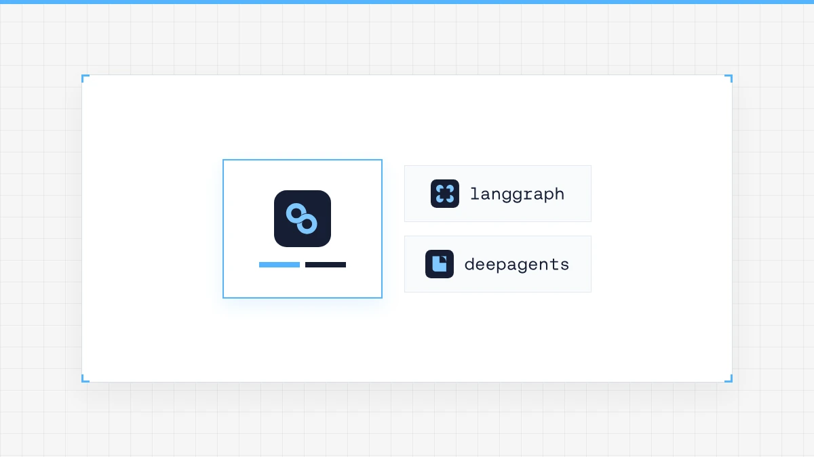
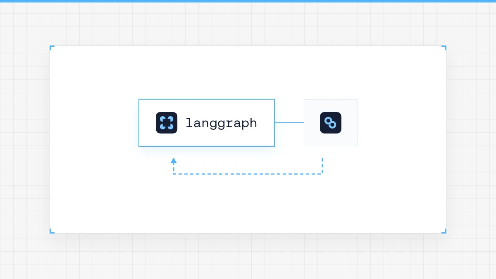
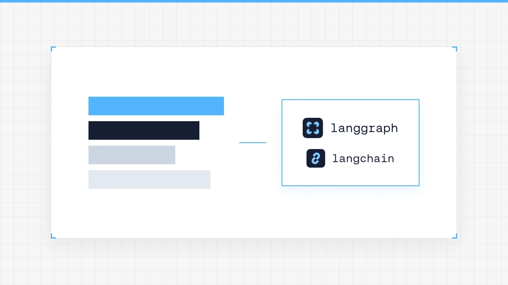
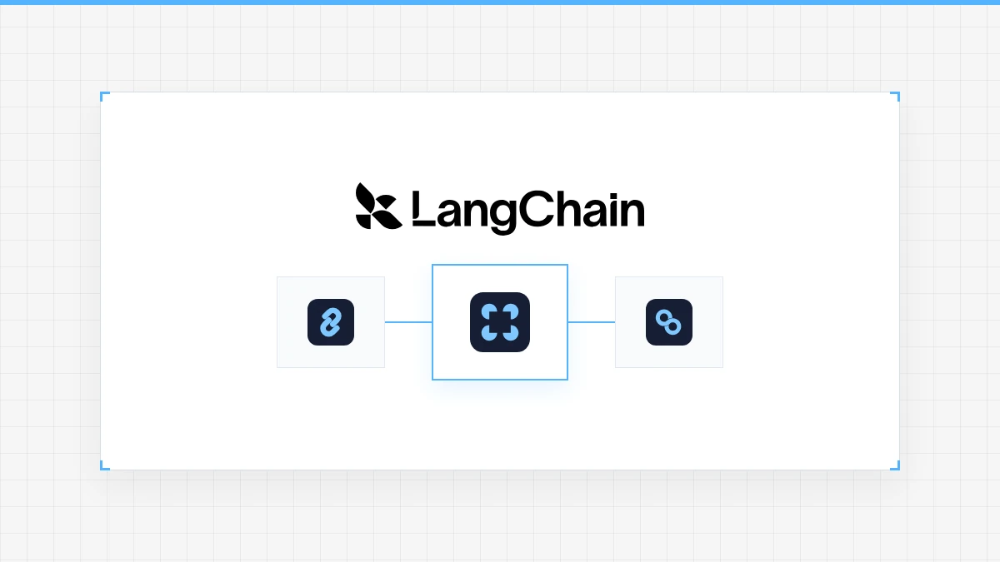
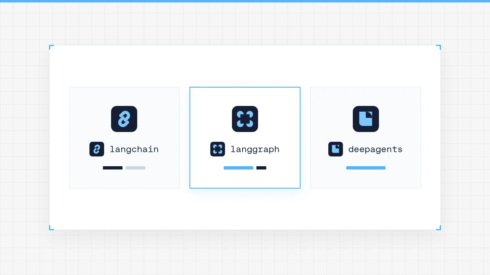
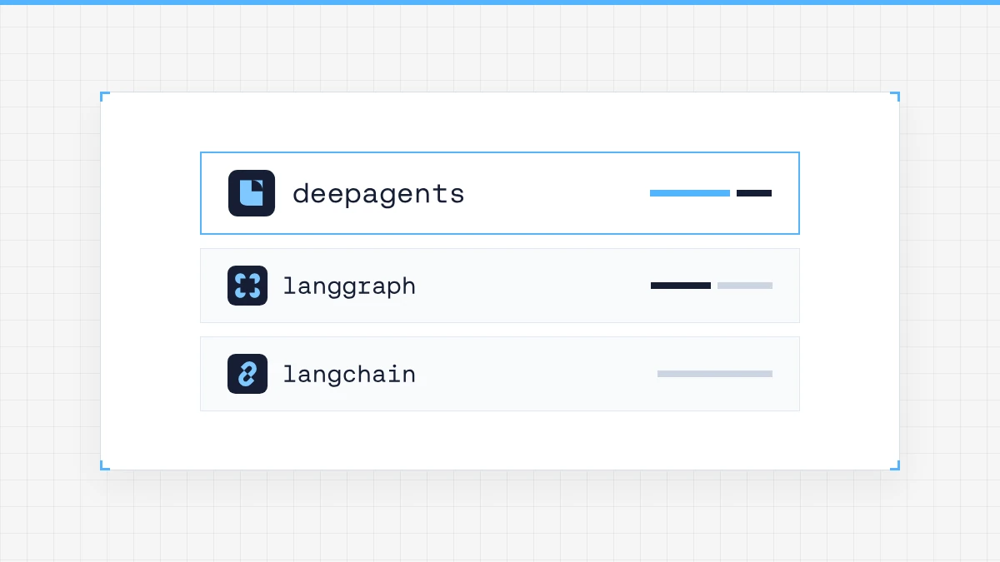
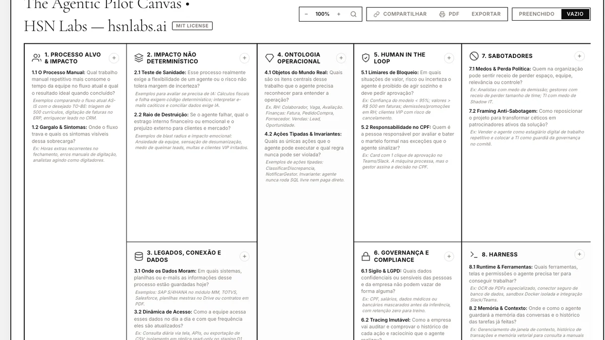

# Hugo S. Nascimento

Empresário, consultor e diretor de tecnologia e produto como CPTO. Pioneiro na implementação de sistemas agênticos em produção para grandes contas e referência na aplicação dessas arquiteturas desde 2022.

Meu foco operacional é **Arquitetura de Agentes Enterprise**. Construo arquiteturas multiagente customizadas sobre ontologias de domínio executáveis para operações corporativas de missão crítica. Substituo operações manuais frágeis de BPO e gargalos de TI legada por forças de trabalho digitais autônomas que não alucinam nem falham em produção.

Arquiteturas entregues incluem **Deloitte**, **Santander**, **Softplan**, **Unipar Carbocloro**, **LWSA**, **Turbi**, **Caju**, **Cast Group** e **Insi**.

<a href="https://hsnlabs.ai/">hsnlabs Boutique</a> &nbsp;&bull;&nbsp; <a href="https://www.linkedin.com/in/hugosoaresnascimento/">LinkedIn</a> &nbsp;&bull;&nbsp; <a href="https://github.com/hsnlabs-ai/blog">GitHub</a> &nbsp;&bull;&nbsp; <a href="/blog/">English Version</a>

---

  <article class="blog-row blog-post-item" data-page="1" data-category="Why Agents Fail" data-tags="why-agents-fail,case-studies,production,guardrails,ontology">
    <a class="blog-row-card-link" href="/blog/pt/post/estudo-caso-lu-magalu-whatsapp-agentes-ia/">
      

        
      

      

        <h2 class="blog-row-title">Lu do Magalu no WhatsApp: do desvio de escopo à trava de identidade em produção</h2>
        
2026-11-16 &bull; Por Que Agentes Falham

        
Estudo de caso sobre o incidente da Lu do Magalu no WhatsApp, a resposta rápida com trava de CPF na camada de identidade e os quatro pilares para sustentar agentes em escala.

      

    </a>
  </article>
  <article class="blog-row blog-post-item" data-page="1" data-category="Why Agents Fail" data-tags="langsmith,evaluation,deep-agents,observability,production">
    <a class="blog-row-card-link" href="/blog/pt/post/langsmith-evals-producao-agentes/">
      

        
      

      

        <h2 class="blog-row-title">LangSmith e evals em produção: como medir agentes antes do erro</h2>
        
2026-11-15 &bull; Por Que Agentes Falham

        
Como usar LangSmith, evals de trajetória e métricas de eficiência para medir agentes de IA antes que falhas cheguem ao usuário em produção.

      

    </a>
  </article>
  <article class="blog-row blog-post-item" data-page="1" data-category="Why Agents Fail" data-tags="loop-engineering,langgraph,langsmith,guardrails,production">
    <a class="blog-row-card-link" href="/blog/pt/post/loop-engineering-controle-custos-agentes/">
      

        
      

      

        <h2 class="blog-row-title">Loop Engineering: como controlar agentes de IA sem estourar custos</h2>
        
2026-11-14 &bull; Por Que Agentes Falham

        
Como aplicar loop engineering em quatro camadas com LangGraph e LangSmith para conter custos em dólar, latência e falhas silenciosas de agentes em produção.

      

    </a>
  </article>
  <article class="blog-row blog-post-item" data-page="1" data-category="Agentic AI" data-tags="context-engineering,langgraph,agent-memory,rag,production">
    <a class="blog-row-card-link" href="/blog/pt/post/context-engineering-engenharia-de-contexto-agentes/">
      

        
      

      

        <h2 class="blog-row-title">Context Engineering: engenharia de contexto para agentes em produção</h2>
        
2026-11-13 &bull; Agentic AI

        
Como context engineering em LangGraph aplica escrever, selecionar, comprimir e isolar contexto em ERPs brasileiros para cortar desperdício de tokens em USD e proteger dados sob LGPD.

      

    </a>
  </article>
  <article class="blog-row blog-post-item" data-page="1" data-category="Agentic AI" data-tags="ai-agents,langchain,langgraph,enterprise,architecture">
    <a class="blog-row-card-link" href="/blog/pt/post/o-que-sao-agentes-de-ia-producao/">
      

        
      

      

        <h2 class="blog-row-title">O que são agentes de IA na prática corporativa além de chatbots</h2>
        
2026-11-12 &bull; Agentic AI

        
Entenda o que são agentes de IA além de chatbots, os seis níveis de autonomia até máquinas de estado em LangGraph e a infraestrutura do LangSmith em produção.

      

    </a>
  </article>
  <article class="blog-row blog-post-item" data-page="1" data-category="Agentic AI" data-tags="langchain,langgraph,deep-agents,architecture,comparison">
    <a class="blog-row-card-link" href="/blog/pt/post/langchain-vs-langgraph-vs-deep-agents/">
      

        
      

      

        <h2 class="blog-row-title">LangChain vs LangGraph vs Deep Agents: quando usar cada um em produção</h2>
        
2026-11-11 &bull; Agentic AI

        
Comparativo técnico de LangChain vs LangGraph e Deep Agents em produção: entenda quando usar runtime determinístico, middleware ou harness completo.

      

    </a>
  </article>
  <article class="blog-row blog-post-item" data-page="1" data-category="Why Agents Fail" data-tags="agent-harness,deep-agents,langgraph,architecture,production">
    <a class="blog-row-card-link" href="/blog/pt/post/o-que-e-agent-harness-producao/">
      

        
      

      

        <h2 class="blog-row-title">O que é Agent Harness e por que agentes quebram sem ele</h2>
        
2026-11-10 &bull; Por Que Agentes Falham

        
O que é agent harness, por que modelos isolados falham na produção corporativa e como Deep Agents e LangGraph resolvem context rot e loops longos.

      

    </a>
  </article>
  <article class="blog-row blog-post-item" data-page="1" data-category="Future of Work" data-tags="future-of-work,economics,c-suite,ai-agents">
    <a class="blog-row-card-link" href="/blog/pt/post/o-fenomeno-high-ic/">
      

        
      

      

        <h2 class="blog-row-title">O Fenômeno High IC: Produtividade e Equipes Enxutas</h2>
        
2026-10-20 &bull; O Futuro do Trabalho

        
Por que medir capacidade operacional pelo tamanho da equipe perdeu o sentido com a chegada dos agentes de inteligência artificial corporativos.

      

    </a>
  </article>
  <article class="blog-row blog-post-item" data-page="1" data-category="Agentic AI" data-tags="databricks,langgraph,architecture,data-contracts,production">
    <a class="blog-row-card-link" href="/blog/pt/post/arquitetura-agentes-databricks-lakehouse-unity-catalog-langgraph/">
      

        
      

      

        <h2 class="blog-row-title">Databricks Lakehouse e LangGraph: Conectando Unity Catalog e Mosaic AI a Máquinas de Estado Operacionais</h2>
        
2026-10-19 &bull; Agentic AI

        
Por que agentes autônomos falham ao receber acesso SQL livre sobre tabelas Delta e como vincular máquinas de estado em LangGraph e ontologias executáveis ao Databricks Unity Catalog e Mosaic AI.

      

    </a>
  </article>
  <article class="blog-row blog-post-item" data-page="1" data-category="Agentic AI" data-tags="evaluation,langgraph,architecture,production,guardrails">
    <a class="blog-row-card-link" href="/blog/pt/post/arquitetura-agentes-braintrust-evals-cicd-langgraph/">
      

        
      

      

        <h2 class="blog-row-title">Braintrust Evals e LangGraph: Substituindo Testes Manuais por CI/CD Determinístico</h2>
        
2026-10-17 &bull; Agentic AI

        
Por que testes manuais de prompt falham na produção corporativa e como integrar suítes de avaliação do Braintrust e travas de CI/CD em agentes LangGraph.

      

    </a>
  </article>
  <article class="blog-row blog-post-item" data-page="2" data-category="Agentic AI" data-tags="snowflake,langgraph,architecture,data-contracts,production" style="display: none;">
    <a class="blog-row-card-link" href="/blog/pt/post/arquitetura-agentes-snowflake-ai-data-cloud-langgraph/">
      

        
      

      

        <h2 class="blog-row-title">Snowflake AI Data Cloud e LangGraph: Conectando Máquinas de Estado aos Dados Corporativos</h2>
        
2026-10-16 &bull; Agentic AI

        
Por que agentes autônomos falham ao receber acesso SQL direto e como vincular máquinas de estado em LangGraph e ontologias executáveis à Snowflake AI Data Cloud.

      

    </a>
  </article>
  <article class="blog-row blog-post-item" data-page="2" data-category="Agentic AI" data-tags="canvas,architecture,enterprise-agents,methodology" style="display: none;">
    <a class="blog-row-card-link" href="/blog/pt/post/the-agentic-pilot-canvas-v1-4/">
      

        
      

      

        <h2 class="blog-row-title">The Agentic Canvas™: O Framework para Desenhar Sistemas de IA que Sobrevivem à Produção</h2>
        
2026-10-07 &bull; Agentic AI

        
Framework de arquitetura em 10 blocos para desenhar sistemas de IA corporativa antes de escrever código. Atualizado em outubro de 2026.

      

    </a>
  </article>
  <article class="blog-row blog-post-item" data-page="2" data-category="Future of Work" data-tags="crm,model-context-protocol,saas,bpo,arquitetura" style="display: none;">
    <a class="blog-row-card-link" href="/blog/pt/post/comprar-ou-construir-crm-vendas-b2b/">
      

        
      

      

        <h2 class="blog-row-title">CRM de Vendas B2B: Comprar Salesforce, Adaptar Twenty ou Construir com Agentes</h2>
        
2026-09-28 &bull; O Futuro do Trabalho

        
Análise técnica e econômica entre assentos de Salesforce, Twenty CRM e stacks agênticas proprietárias para líderes de tecnologia.

      

    </a>
  </article>
  <article class="blog-row blog-post-item" data-page="2" data-category="Agentic AI" data-tags="healthcare,ontologies,operations" style="display: none;">
    <a class="blog-row-card-link" href="/blog/pt/post/estudo-caso-cleveland-clinic-agentes-operacionais/">
      

        
      

      

        <h2 class="blog-row-title">Estudo de Caso: Como a Cleveland Clinic Escalou o Fluxo de Pacientes em 6.600 Leitos Hospitalares</h2>
        
2026-09-28 &bull; Agentic AI

        
Análise arquitetural de como uma das maiores instituições de saúde do mundo orquestra leitos e fluxos críticos com agentes operacionais.

      

    </a>
  </article>
  <article class="blog-row blog-post-item" data-page="2" data-category="Agentic AI" data-tags="ontology,foundation,enterprise" style="display: none;">
    <a class="blog-row-card-link" href="/blog/pt/post/a-ontologia-operacional/">
      

        
      

      

        <h2 class="blog-row-title">A Ontologia Operacional: Como Empresas Conectam Dados, Regras de Negócio e Ações Autônomas</h2>
        
2026-09-27 &bull; Agentic AI

        
O guia definitivo sobre como estruturar a camada ontológica que permite a agentes de software operar em produção corporativa sem falhas.

      

    </a>
  </article>
  <article class="blog-row blog-post-item" data-page="2" data-category="Agentic AI" data-tags="ontology,architecture,enterprise" style="display: none;">
    <a class="blog-row-card-link" href="/blog/pt/post/como-construir-ontologia-enterprise-do-zero/">
      

        
      

      

        <h2 class="blog-row-title">Como Construir uma Ontologia Enterprise do Zero: Blueprint Arquitetural Completo</h2>
        
2026-09-27 &bull; Agentic AI

        
Passo a passo detalhado para desenhar, modelar e implantar ontologias corporativas funcionais para sistemas multiagente em produção.

      

    </a>
  </article>
  <article class="blog-row blog-post-item" data-page="2" data-category="Future of Work" data-tags="economics,ebitda,bpo" style="display: none;">
    <a class="blog-row-card-link" href="/blog/pt/post/matriz-substituicao-bpo/">
      

        
      

      

        <h2 class="blog-row-title">A Matriz de Substituição de BPO: Métricas Operacionais e Financeiras</h2>
        
2026-09-27 &bull; O Futuro do Trabalho

        
Framework quantitativo analisando economia unitária, métricas operacionais e impacto na margem ao substituir contratos de BPO por agentes de software.

      

    </a>
  </article>
  <article class="blog-row blog-post-item" data-page="2" data-category="Why Agents Fail" data-tags="ontology,definitive-guide,engineering" style="display: none;">
    <a class="blog-row-card-link" href="/blog/pt/post/o-que-e-uma-ontologia-para-agentes-ia/">
      

        
      

      

        <h2 class="blog-row-title">O Que É uma Ontologia para Agentes de IA? O Guia Definitivo para Engenharia Corporativa</h2>
        
2026-09-27 &bull; Por Que Agentes Falham

        
Tudo o que engenheiros e líderes de tecnologia precisam saber sobre ontologias operacionais para construir agentes que funcionam em produção.

      

    </a>
  </article>
  <article class="blog-row blog-post-item" data-page="2" data-category="Agentic AI" data-tags="ontology,knowledge-graph,architecture" style="display: none;">
    <a class="blog-row-card-link" href="/blog/pt/post/ontologia-vs-grafo-conhecimento/">
      

        
      

      

        <h2 class="blog-row-title">Ontologia vs Grafo de Conhecimento: Diferenças Centrais, Arquitetura e Aplicações Enterprise</h2>
        
2026-09-27 &bull; Agentic AI

        
Desmistificando os conceitos de ontologia e grafo de conhecimento em projetos corporativos de inteligência artificial e agentes autônomos.

      

    </a>
  </article>
  <article class="blog-row blog-post-item" data-page="2" data-category="Why Agents Fail" data-tags="ontology,database,vector-stores" style="display: none;">
    <a class="blog-row-card-link" href="/blog/pt/post/ontologia-vs-schema-banco-dados/">
      

        
      

      

        <h2 class="blog-row-title">Ontologia vs Schema de Banco de Dados: Por Que Tabelas Relacionais e Vetores Não Bastam para IA</h2>
        
2026-09-27 &bull; Por Que Agentes Falham

        
Análise técnica das diferenças estruturais entre schemas de bancos de dados relacionais e ontologias operacionais para agentes autônomos.

      

    </a>
  </article>
  <article class="blog-row blog-post-item" data-page="3" data-category="Agentic AI" data-tags="python,mcp,pydantic" style="display: none;">
    <a class="blog-row-card-link" href="/blog/pt/post/como-construir-ontologia-operacional-python-mcp/">
      

        
      

      

        <h2 class="blog-row-title">Como Construir uma Ontologia Operacional de Negócios em Python com Pydantic e MCP</h2>
        
2026-09-25 &bull; Agentic AI

        
Implementação prática em Python utilizando Pydantic e servidores Model Context Protocol para criar ontologias executáveis para agentes.

      

    </a>
  </article>
  <article class="blog-row blog-post-item" data-page="3" data-category="Future of Work" data-tags="c-suite,margins,unit-economics" style="display: none;">
    <a class="blog-row-card-link" href="/blog/pt/post/playbook-c-suite-protecao-margem/">
      

        
      

      

        <h2 class="blog-row-title">Playbook C-Suite: Proteção de Margem e Redução de Custos com Software Agêntico</h2>
        
2026-09-25 &bull; O Futuro do Trabalho

        
Guia executivo para CEOs, CFOs e CIOs sobre como proteger margens operacionais substituindo custos fixos de BPO por software agêntico.

      

    </a>
  </article>
  <article class="blog-row blog-post-item" data-page="3" data-category="Future of Work" data-tags="philosophy,future-of-work,society" style="display: none;">
    <a class="blog-row-card-link" href="/blog/pt/post/kafka-metamorfose-ia-futuro-do-trabalho/">
      

        
      

      

        <h2 class="blog-row-title">De 1915 a Era da IA: Kafka, Utilitarismo e o Valor de Quem Trabalha</h2>
        
2026-09-22 &bull; O Futuro do Trabalho

        
Reflexão filosófica e econômica sobre a mercantilização do trabalho humano a luz da obra A Metamorfose e o avanço da automação por IA.

      

    </a>
  </article>
  <article class="blog-row blog-post-item" data-page="3" data-category="Agentic AI" data-tags="case-studies,consulting,sprint" style="display: none;">
    <a class="blog-row-card-link" href="/blog/pt/post/sprint-arquitetura-cinco-dias/">
      

        
      

      

        <h2 class="blog-row-title">Por Que Apresentações de Big 4 Falham em Projetos de Agentes</h2>
        
2026-09-22 &bull; Agentic AI

        
Por que decks genéricos de estratégia de consultorias tradicionais falham em entregar software agêntico em ambientes corporativos complexos.

      

    </a>
  </article>
  <article class="blog-row blog-post-item" data-page="3" data-category="Future of Work" data-tags="bpo,collections,contracts,fsm" style="display: none;">
    <a class="blog-row-card-link" href="/blog/pt/post/negociacoes-autonomas-cobranca-contratos/">
      

        
      

      

        <h2 class="blog-row-title">Operações em Alta Velocidade: Negociação Autônoma, Cobrança e Execução Contratual</h2>
        
2026-09-18 &bull; O Futuro do Trabalho

        
Como agentes operacionais com ontologia e máquinas de estados finitos automatizam negociação de cobrança e aditamentos contratuais sem erro.

      

    </a>
  </article>
  <article class="blog-row blog-post-item" data-page="3" data-category="Agentic AI" data-tags="palantir,ontology,enterprise" style="display: none;">
    <a class="blog-row-card-link" href="/blog/pt/post/palantir-aip-bootcamp-ontologia-operacional/">
      

        
      

      

        <h2 class="blog-row-title">A Arquitetura do Palantir AIP: Por Que Agentes Corporativos Falham sem uma Ontologia Operacional</h2>
        
2026-09-18 &bull; Agentic AI

        
Estudo aprofundado dos princípios de arquitetura do Palantir AIP e por que sua abordagem ontológica é a única que sobrevive em produção corporativa.

      

    </a>
  </article>
  <article class="blog-row blog-post-item" data-page="3" data-category="Future of Work" data-tags="economics,bpo,hr-tech" style="display: none;">
    <a class="blog-row-card-link" href="/blog/pt/post/guarda-do-balanco-extincao-bpo/">
      

        
      

      

        <h2 class="blog-row-title">O Que Aprendi Construindo HR Tech Sobre a Morte do BPO</h2>
        
2026-09-15 &bull; O Futuro do Trabalho

        
Lições operacionais sobre o colapso estrutural de contratos de terceirização de RH e fluxos de trabalho manuais em grandes empresas.

      

    </a>
  </article>
  <article class="blog-row blog-post-item" data-page="3" data-category="Future of Work" data-tags="palantir,tco,pricing" style="display: none;">
    <a class="blog-row-card-link" href="/blog/pt/post/preco-palantir-tco-alternativas-abertas/">
      

        
      

      

        <h2 class="blog-row-title">O TCO Real da Palantir: A Barreira dos Milhões de Dólares e Alternativas Abertas Modernas</h2>
        
2026-09-14 &bull; O Futuro do Trabalho

        
Dissecando o custo total de propriedade da Palantir e como construir ontologias operacionais comparáveis com software de código aberto.

      

    </a>
  </article>
  <article class="blog-row blog-post-item" data-page="3" data-category="Future of Work" data-tags="insurance,healthcare,underwriting" style="display: none;">
    <a class="blog-row-card-link" href="/blog/pt/post/arbitragem-protocolo-sinistros-subscricao/">
      

        
      

      

        <h2 class="blog-row-title">Arbitragem de Protocolo: Liquidação Multimodal Autônoma em Seguros e Saúde</h2>
        
2026-09-11 &bull; O Futuro do Trabalho

        
Como o processamento multimodal e protocolos de validação automatizam análise de sinistros e subscrição de apólices sem intermediação humana.

      

    </a>
  </article>
  <article class="blog-row blog-post-item" data-page="3" data-category="Why Agents Fail" data-tags="palantir,databricks,architecture" style="display: none;">
    <a class="blog-row-card-link" href="/blog/pt/post/palantir-vs-databricks-arquitetura-agentes/">
      

        
      

      

        <h2 class="blog-row-title">Palantir vs Databricks: Por Que Data Lakes Falham em Operações com Agentes Autônomos</h2>
        
2026-09-11 &bull; Por Que Agentes Falham

        
Comparativo arquitetural entre a abordagem de lakehouse e a ontologia operacional em projetos corporativos de software agêntico.

      

    </a>
  </article>
  <article class="blog-row blog-post-item" data-page="4" data-category="Future of Work" data-tags="erp,support,consulting" style="display: none;">
    <a class="blog-row-card-link" href="/blog/pt/post/morte-suporte-nivel-1-erp/">
      

        
      

      

        <h2 class="blog-row-title">A Morte do Suporte Nível 1: Por Que Consultorias de ERP Não Sustentarão o Modelo de Horas Faturáveis</h2>
        
2026-09-08 &bull; O Futuro do Trabalho

        
Como agentes operacionais com compreensão de regras de negócio estão tornando obsoletas as mesas terceirizadas de atendimento de ERP.

      

    </a>
  </article>
  <article class="blog-row blog-post-item" data-page="4" data-category="Future of Work" data-tags="economics,rpa,automation" style="display: none;">
    <a class="blog-row-card-link" href="/blog/pt/post/colapso-rpa-legado/">
      

        
      

      

        <h2 class="blog-row-title">O Mercado de RPA Está em Colapso</h2>
        
2026-09-04 &bull; O Futuro do Trabalho

        
Por que bots frágeis de gravação de tela estão em colapso em ambientes corporativos e como agentes em produção os substituem.

      

    </a>
  </article>
  <article class="blog-row blog-post-item" data-page="4" data-category="Why Agents Fail" data-tags="case-studies,poc,ai-failures" style="display: none;">
    <a class="blog-row-card-link" href="/blog/pt/post/cemiterio-de-pocs/">
      

        
      

      

        <h2 class="blog-row-title">Por Que Agentes Falham: O Cemitério de PoCs</h2>
        
2026-09-01 &bull; Por Que Agentes Falham

        
Post-mortem sobre a causa raiz de noventa por cento das provas de conceito de IA falharem antes da produção.

      

    </a>
  </article>
  <article class="blog-row blog-post-item" data-page="4" data-category="Agentic AI" data-tags="architecture,mcp,data-contracts" style="display: none;">
    <a class="blog-row-card-link" href="/blog/pt/post/isolamento-perimetro-mcp-contratos-dados/">
      

        
      

      

        <h2 class="blog-row-title">Como Protegemos Bancos de Dados Enterprise de Agentes de IA</h2>
        
2026-08-26 &bull; Agentic AI

        
Padrões de arquitetura para isolamento de perímetro, contratos de contexto e limites de acesso blindando dados corporativos contra agentes de IA.

      

    </a>
  </article>
  <article class="blog-row blog-post-item" data-page="4" data-category="Agentic AI" data-tags="case-studies,latam-airlines,production" style="display: none;">
    <a class="blog-row-card-link" href="/blog/pt/post/estudo-caso-latam-airlines/">
      

        
      

      

        <h2 class="blog-row-title">LATAM Airlines: Agentes em Produção com Margem de 3 Por Cento</h2>
        
2026-08-21 &bull; Agentic AI

        
Estudo de caso operacional sobre a implantação de agentes corporativos em aviação comercial com margens apertadas e alta volumetria.

      

    </a>
  </article>
  <article class="blog-row blog-post-item" data-page="4" data-category="Why Agents Fail" data-tags="architecture,llm-judge,audit" style="display: none;">
    <a class="blog-row-card-link" href="/blog/pt/post/falacia-llm-como-juiz/">
      

        
      

      

        <h2 class="blog-row-title">Por Que LLM Como Juiz Falha no Setor Bancário</h2>
        
2026-08-18 &bull; Por Que Agentes Falham

        
Vulnerabilidades estruturais e riscos de conformidade ao confiar em avaliadores estocásticos de LLM para auditar decisões financeiras.

      

    </a>
  </article>
  <article class="blog-row blog-post-item" data-page="4" data-category="Agentic AI" data-tags="case-studies,production,api-loops" style="display: none;">
    <a class="blog-row-card-link" href="/blog/pt/post/agentes-ilimitados-maquinas-estados-finitos/">
      

        
      

      

        <h2 class="blog-row-title">Estudo de Caso: 42 Chamadas em Loop às 2 da Manhã</h2>
        
2026-08-12 &bull; Agentic AI

        
Auditoria de incidente de emergência e remédio de arquitetura para loops infinitos de chamadas em agentes por máquinas de estados finitos.

      

    </a>
  </article>
  <article class="blog-row blog-post-item" data-page="4" data-category="Why Agents Fail" data-tags="architecture,rag,erp" style="display: none;">
    <a class="blog-row-card-link" href="/blog/pt/post/por-que-rag-falha-em-erp/">
      

        
      

      

        <h2 class="blog-row-title">Por Que RAG Tradicional Falha em ERPs Financeiros</h2>
        
2026-08-07 &bull; Por Que Agentes Falham

        
Por que a busca vetorial por similaridade corrompe a precisão aritmética e a integridade de livros contábeis em ERPs.

      

    </a>
  </article>
  <article class="blog-row blog-post-item" data-page="4" data-category="Agentic AI" data-tags="architecture,legacy-core,mainframe" style="display: none;">
    <a class="blog-row-card-link" href="/blog/pt/post/sistemas-legados-motor-execucao/">
      

        
      

      

        <h2 class="blog-row-title">Sistemas Transacionais Legados Não Vão Morrer: Eles São o Motor</h2>
        
2026-08-04 &bull; Agentic AI

        
Por que sistemas transacionais legados continuam sendo a fundação indispensável para agentes enterprise autônomos.

      

    </a>
  </article>
  <article class="blog-row blog-post-item" data-page="4" data-category="Why Agents Fail" data-tags="architecture,schema-drift,mcp" style="display: none;">
    <a class="blog-row-card-link" href="/blog/pt/post/deriva-de-integracao/">
      

        
      

      

        <h2 class="blog-row-title">A Deriva de Integração: Quando Prompts Quebram Agentes em Produção</h2>
        
2026-07-29 &bull; Por Que Agentes Falham

        
Como detectar e blindar fluxos de agentes em produção contra quebras silenciosas provocadas por desvios de schemas e APIs.

      

    </a>
  </article>
  <article class="blog-row blog-post-item" data-page="5" data-category="Agentic AI" data-tags="architecture,guardrails,state-machines" style="display: none;">
    <a class="blog-row-card-link" href="/blog/pt/post/chatbot-vs-agente/">
      

        
      

      

        <h2 class="blog-row-title">Chatbot vs Agente: Por Que Substituir BPOs Exige Ontologias em Produção</h2>
        
2026-07-22 &bull; Agentic AI

        
Diferenças críticas de arquitetura entre chatbots conversacionais e agentes corporativos em produção que alteram o estado de ERPs.

      

    </a>
  </article>
  <article class="blog-row blog-post-item" data-page="5" data-category="Future of Work" data-tags="architecture,legacy-it,reliability" style="display: none;">
    <a class="blog-row-card-link" href="/blog/pt/post/custo-ia-ilimitada-ti-legada/">
      

        
      

      

        <h2 class="blog-row-title">O Custo de IA Sem Limites na TI Legada</h2>
        
2026-07-15 &bull; O Futuro do Trabalho

        
Auditoria econômica e técnica sobre custos descontrolados e riscos operacionais causados por IA estocástica na infraestrutura legada.

      

    </a>
  </article>
  <article class="blog-row blog-post-item" data-page="5" data-category="Future of Work" data-tags="case-studies,hsnlabs,manifesto" style="display: none;">
    <a class="blog-row-card-link" href="/blog/pt/post/manifesto/">
      

        
      

      

        <h2 class="blog-row-title">Por Que Criei a hsnlabs</h2>
        
2026-07-08 &bull; O Futuro do Trabalho

        
Tese fundadora da hsnlabs: construindo arquiteturas de agentes enterprise sobre ontologias executáveis de domínio.

      

    </a>
  </article>
  

    

      Mostrando 1–10 de 43 posts
    

    <nav class="pagination-controls" aria-label="Paginação do Blog">
      <button class="pagination-btn pagination-nav" id="pagination-prev" disabled aria-label="Página anterior">
        <svg width="14" height="14" viewBox="0 0 24 24" fill="none" stroke="currentColor" stroke-width="2" stroke-linecap="round" stroke-linejoin="round" style="vertical-align: -1px; margin-right: 4px;"><line x1="19" y1="12" x2="5" y2="12"></line><polyline points="12 19 5 12 12 5"></polyline></svg>
        Anterior
      </button>
      

        <button class="pagination-btn pagination-num active" data-target-page="1" aria-label="Página 1">1</button>
        <button class="pagination-btn pagination-num " data-target-page="2" aria-label="Página 2">2</button>
        <button class="pagination-btn pagination-num " data-target-page="3" aria-label="Página 3">3</button>
        <button class="pagination-btn pagination-num " data-target-page="4" aria-label="Página 4">4</button>
        <button class="pagination-btn pagination-num " data-target-page="5" aria-label="Página 5">5</button>
      

      <button class="pagination-btn pagination-nav" id="pagination-next" aria-label="Próxima página">
        Próxima
        <svg width="14" height="14" viewBox="0 0 24 24" fill="none" stroke="currentColor" stroke-width="2" stroke-linecap="round" stroke-linejoin="round" style="vertical-align: -1px; margin-left: 4px;"><line x1="5" y1="12" x2="19" y2="12"></line><polyline points="12 5 19 12 12 19"></polyline></svg>
      </button>
    </nav>
  

