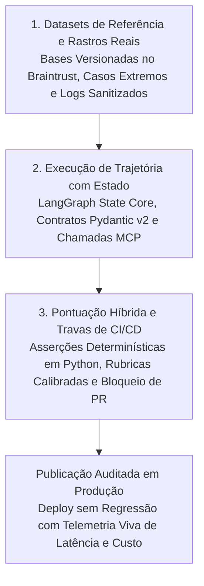

*Tempo de leitura: 8 minutos. Autor: Hugo S. Nascimento.*

<!-- more -->

*Contexto: Equipes de engenharia corporativa dedicam meses para conectar agentes autônomos a ERPs, CRMs e plataformas de dados. Porém, no momento de ajustar um prompt de sistema, atualizar a versão de um modelo ou adicionar uma nova ferramenta, noventa por cento dos times ainda dependem de testes manuais no olhômetro: digitar cinco perguntas na interface de chat e torcer para que nada tenha quebrado. Poucos dias após a publicação, regressões silenciosas passam a corromper registros operacionais. Apresento aqui a arquitetura de referência que implementamos na hsnlabs para vincular suítes de avaliação no Braintrust e travas automatizadas de CI/CD diretamente às máquinas de estado em LangGraph.*

> **Resumo Executivo para Lideranças de Tecnologia:** Modelos probabilísticos não podem ser governados por amostragem manual. Cada ajuste de prompt, troca de modelo ou alteração na busca vetorial modifica a distribuição de probabilidade das trajetórias do agente em centenas de casos extremos. Ao integrar o Braintrust como camada contínua de avaliação e observabilidade sobre máquinas de estado em LangGraph e contratos de dados em Pydantic v2, líderes de engenharia transformam testes subjetivos de IA em engenharia de software determinística: bloqueando regressões antes da aprovação do código e convertendo anomalias reais de produção em casos permanentes de teste.

---

## Nota de Diligência e Especificações Técnicas

Os padrões arquiteturais e fluxos de avaliação contínua detalhados neste post seguem a documentação técnica oficial e especificações abertas de engenharia:

* **Plataforma de Avaliação e Observabilidade de IA Braintrust:** detalhando versionamento de conjuntos de dados, avaliadores determinísticos e baseados em rubricas, travas de CI/CD e rastreamento em produção, disponível em <a href="https://www.braintrust.dev/docs">Braintrust Technical Documentation</a>.
* **Especificação de Orquestração com Estado no LangGraph:** detalhando grafos cíclicos de estado, inspeção granular por nó e persistência durável de checkpoints, disponível em <a href="https://langchain-ai.github.io/langgraph/">LangGraph Technical Documentation</a>.
* **Prática de Arquitetura Braintrust Evals da hsnlabs:** especificações de referência e metodologia de implantação, disponível em <a href="https://hsnlabs.ai/braintrust/">Prática Braintrust Evals e CI/CD da hsnlabs</a>.

---

## 1. Por Que Testes Manuais no Olhômetro Colapsam em Produção

No desenvolvimento de software tradicional, um teste unitário garante que a entrada `X` produz exatamente a saída `Y`. Em sistemas agênticos, uma única solicitação do usuário pode acionar múltiplas chamadas de ferramentas, validações de schema e desvios condicionais de estado.

Quando equipes dependem de testes manuais improvisados ou scripts ingênuos de avaliação subjetiva, a operação entra em colapso em quatro vetores previsíveis:

| Vetor de Falha | Testes Manuais e Scripts Improvisados | ADLC Governado com Braintrust Evals e LangGraph |
| :--- | :--- | :--- |
| **Cegueira de Regressão** | Corrigir o prompt para um caso específico quebra silenciosamente três fluxos que já funcionavam | Executa cada alteração de código contra centenas de cenários versionados de referência antes da publicação |
| **Opacidade de Trajetória** | Avalia apenas o texto final da resposta, ignorando chamadas incorretas de ferramentas no meio do caminho | Pontua individualmente cada transição de nó no LangGraph, argumentos de ferramentas e conformidade com Pydantic |
| **Deriva de Avaliação Subjetiva** | Juízes baseados em modelos sem calibração atribuem notas de 1 a 5 inconsistentes para a mesma execução | Combina asserções determinísticas em código Python com rubricas binárias ancoradas em fatos verificáveis |
| **Desconexão com a Produção** | As bases de teste permanecem estáticas e artificiais enquanto o comportamento real dos usuários evolui | Converte rastros de falhas reais capturados em produção em novos casos permanentes de teste de regressão |

---

## 2. A Arquitetura de Avaliação em Três Camadas: Braintrust + LangGraph + ADLC

Para atingir confiabilidade corporativa, a avaliação não pode ser um relatório manual feito após o lançamento. Ela precisa operar como um circuito contínuo unindo **Curadoria de Datasets**, **Pontuação por Nó** e **Travas Automatizadas de CI/CD**.

### Camada 1: Conjuntos de Dados Versionados a Partir da Operação Real
Perguntas fictícias criadas por desenvolvedores raramente refletem as falhas reais de uma operação corporativa.

* **Extração de Casos Históricos e Logs de ERP:** Durante nosso sprint inicial de arquitetura, extraímos transações históricas reais, exceções operacionais e limites de conformidade para compor a base inicial de referência no Braintrust.
* **Colheita Contínua de Telemetria:** Sempre que um agente encontra um estado inesperado de schema ou aciona uma escalada para supervisão humana em produção, o rastro exato é sanitizado e incorporado ao conjunto de dados no Braintrust para que o sistema nunca repita a mesma falha.

### Camada 2: Inspeção por Nó sobre Máquinas de Estado em LangGraph
Avaliar um agente como uma caixa-preta esconde fragilidades estruturais. Como a hsnlabs constrói agentes sobre máquinas de estado explícitas em **LangGraph**, cada transição intermediária é inspecionada pelo Braintrust:

1. **Precisão de Roteamento e Intenção:** Avaliadores determinísticos verificam se o nó de entrada classifica a intenção de negócio e seleciona o conjunto exato de ferramentas MCP com cem por cento de precisão.
2. **Fidelidade de Schema e Argumentos:** Antes de qualquer execução no Snowflake, Databricks ou SAP, funções de validação em Python atestam que a carga gerada respeita estritamente o contrato Pydantic v2.
3. **Conformidade de Guardrails e Limites:** Baterias de testes negativos comprovam que solicitações sem alçada, tentativas de injeção de prompt ou valores financeiros fora da política acionam o bloqueio determinístico em vez de alucinar atalhos.

### Camada 3: Travas Automatizadas em CI/CD antes do Deploy
Cada modificação em um template de prompt, versão de modelo ou aresta do grafo de estado dispara uma bateria automatizada de avaliação no pipeline de integração contínua:

* **Comparativo Direto por Alteração:** A engenharia visualiza imediatamente se houve regressão de precisão, fidelidade de ferramentas, custo de tokens ou latência p95 em qualquer recorte da base de referência.
* **Bloqueio Automático de Publicação:** Se os indicadores críticos de conformidade ou validade de schema caírem abaixo de cem por cento, o pipeline interrompe a publicação automaticamente.

---

## 3. Do Piloto à Produção em 4 Etapas

Na hsnlabs, implantamos dutos de avaliação contínua com Braintrust diretamente no fluxo de engenharia dos nossos clientes, com transferência integral de código e propriedade intelectual:

1. **Etapa 01 · Auditoria de Modos de Falha:** Mapeamos o processo operacional alvo, identificamos os riscos críticos de negócio e definimos métricas rígidas de aprovação antes de escrever o código do agente.
2. **Etapa 02 · Engenharia de Datasets e Avaliadores:** Curamos os casos reais mais complexos da operação em bases versionadas no Braintrust e programamos avaliadores determinísticos em Python combinados a rubricas de domínio.
3. **Etapa 03 · Integração de CI/CD e Telemetria:** Conectamos o Braintrust às suas máquinas de estado em LangGraph e às esteiras de deploy, ativando o rastreamento em tempo real de latência, consumo de tokens e acurácia.
4. **Etapa 04 · Handover Técnico:** Entregamos toda a suíte de avaliação, conjuntos de dados de referência e manuais de operação para que sua própria equipe evolua prompts e modelos com segurança matemática.

---

## Recursos Estratégicos e Leituras Relacionadas
- <a href="https://hsnlabs.ai/braintrust/">Prática de Arquitetura Braintrust Evals e CI/CD da hsnlabs</a>
- <a href="https://hsnlabs.ai/langchain/">Engenharia de Produção LangChain e LangGraph da hsnlabs</a>
- <a href="https://hsnlabs.ai/snowflake/">Prática de Arquitetura Snowflake AI Data Cloud da hsnlabs</a>
- <a href="/blog/pt/post/falacia-llm-como-juiz/">A Falácia do LLM como Juiz: Por Que Avaliadores Probabilísticos Falham em Operações Reguladas</a>
- <a href="/blog/pt/post/cemiterio-de-pocs/">O Cemitério de PoCs: Por Que 90% dos Pilotos Corporativos Colapsam em Dados Sujos</a>
