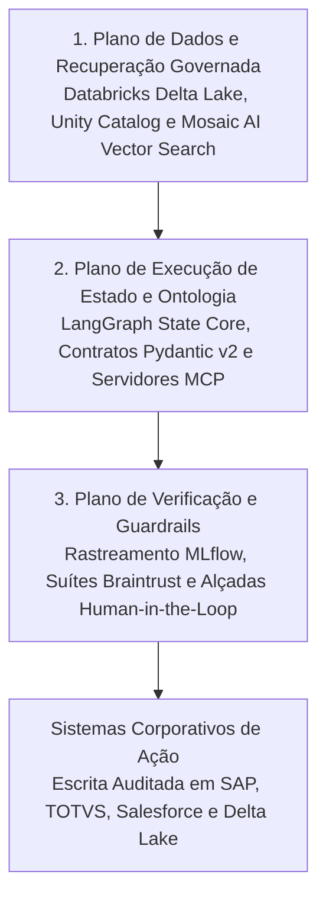

*Tempo de leitura: 8 minutos. Autor: Hugo S. Nascimento.*

<!-- more -->

*Contexto: Líderes de tecnologia padronizam sua fundação de dados na Databricks Data Intelligence Platform para unificar pipelines Delta Lake, governar tabelas e modelos pelo Unity Catalog e escalar busca vetorial com Mosaic AI. Porém, quando equipes de engenharia conectam modelos probabilísticos diretamente ao Lakehouse por meio de geração livre de SQL ou pipelines ingênuos de RAG, noventa por cento dos pilotos de agentes travam antes de chegar à produção. Apresento aqui a arquitetura de referência que implementamos na hsnlabs para vincular máquinas de estado determinísticas em LangGraph e ontologias de negócios executáveis diretamente sobre o Databricks Lakehouse.*

> **Resumo Executivo para Lideranças de Tecnologia:** A Databricks Data Intelligence Platform oferece uma fundação unificada para engenharia de dados em Delta Lake, recuperação vetorial com Mosaic AI e governança centralizada via Unity Catalog. Contudo, governar artefatos analíticos não equivale a governar a execução transacional de agentes em múltiplas etapas. Conceder permissão para que um modelo gere consultas SQL arbitrárias sobre centenas de tabelas Delta provoca alucinações de schema, consumo descontrolado de DBUs e mutações sem validação nos ERPs de origem. Ao combinar Databricks Unity Catalog e Mosaic AI com uma camada aberta de ciclo de vida de desenvolvimento agêntico construída em LangGraph, contratos Pydantic v2, servidores Model Context Protocol e suítes de avaliação no MLflow, as empresas alcançam ancoragem governada e execução determinística sem aprisionamento tecnológico.

---

## Nota de Diligência e Especificações Técnicas

Os padrões arquiteturais e capacidades de plataforma detalhados neste artigo seguem a documentação técnica oficial e especificações abertas de engenharia:

* **Arquitetura Databricks Data Intelligence Platform e Governança Unity Catalog:** detalhando controle de acesso centralizado sobre tabelas Delta, volumes não estruturados, funções e modelos de IA, disponível em <a href="https://docs.databricks.com/en/data-governance/unity-catalog/index.html">Databricks Unity Catalog Documentation</a>.
* **Databricks Mosaic AI Vector Search e Agent Framework:** detalhando indexação vetorial híbrida sincronizada com tabelas Delta e rastreamento nativo no MLflow, disponível em <a href="https://docs.databricks.com/en/generative-ai/generative-ai.html">Databricks Mosaic AI Documentation</a>.
* **Especificação de Orquestração com Estado no LangGraph:** detalhando grafos cíclicos de estado, persistência durável de checkpoints e interrupções supervisionadas por humanos, disponível em <a href="https://langchain-ai.github.io/langgraph/">LangGraph Technical Documentation</a>.
* **Prática de Arquitetura Databricks da hsnlabs:** especificações de referência e metodologia de implantação em produção, disponível em <a href="https://hsnlabs.ai/databricks/">Prática Databricks Lakehouse e Mosaic AI da hsnlabs</a>.

---

## 1. Por Que Text-to-SQL Direto Colapsa sobre Schemas de Lakehouse

Quando organizações tentam construir agentes operacionais sobre seu ambiente Databricks, o impulso inicial mais comum é conectar um modelo de linguagem às credenciais de um SQL Warehouse e pedir que ele escreva consultas dinamicamente.

Em uma operação corporativa de missão crítica, essa abordagem falha em quatro vetores previsíveis:

| Vetor de Falha | LLM Puro com SQL Irrestrito sobre Tabelas Delta | ADLC Governado sobre Databricks e Unity Catalog |
| :--- | :--- | :--- |
| **Dispersão da Arquitetura Medallion** | Alucina cruzamentos entre tabelas brutas da camada Bronze, visões intermediárias Silver e agregações Gold | Consulta contratos semânticos curados na camada Gold e funções registradas no Unity Catalog vinculadas a schemas Pydantic v2 |
| **Estado e Raciocínio Multietapas** | Perde o contexto em investigações longas e repete varreduras completas que inflam o consumo de DBUs | Mantém estado durável em checkpoints do LangGraph, preservando o contexto intermediário e otimizando a computação |
| **Segurança e Linhagem** | Opera sob uma conta de serviço única superprivilegiada, contornando fronteiras de acesso por área | Herda nativamente filtros de linha, máscaras de coluna e linhagem do Unity Catalog conforme a identidade do usuário |
| **Escrita e Mutação Transacional** | Tenta gravar alterações sem validar regras cruzadas em sistemas como SAP, TOTVS ou Salesforce | Impõe guardas determinísticos em código e alçadas humanas antes de efetivar qualquer transação via servidores MCP |

A plataforma Databricks resolve o desafio mais complexo de infraestrutura de dados na IA corporativa: unificar tabelas Delta Lake, volumes não estruturados e índices vetoriais sob um único perímetro de governança.

Entretanto, o schema de uma tabela Delta define apenas *como o dado analítico é armazenado*. Ele não define *quais transições operacionais de negócio são permitidas*.

---

## 2. A Arquitetura de Referência em Três Camadas: Databricks + LangGraph + ADLC

Para levar agentes autônomos de provas de conceito frágeis para a operação crítica em produção, líderes de engenharia precisam conectar o **Plano Governado do Lakehouse** ao **Plano Determinístico de Estado e Ontologia**.

### Camada 1: Ancoragem Direta sobre Delta Lake, Unity Catalog e Mosaic AI
Em vez de exportar tabelas sensíveis do Lakehouse para bancos vetoriais externos por meio de rotinas frágeis de sincronização, toda a ancoragem analítica e semântica permanece dentro do seu perímetro atual de segurança na plataforma Databricks.

* **Verdade Analítica Governada:** Históricos de clientes, livros contábeis e telemetria de cadeia de suprimentos permanecem nas tabelas Delta Lake governadas pelo Unity Catalog.
* **Recuperação Híbrida Sincronizada:** Contratos em PDF, manuais técnicos e documentos normativos armazenados em Volumes do Unity Catalog são indexados via Mosaic AI Vector Search, mantendo os vetores automaticamente sincronizados com atualizações das tabelas Delta e permissões de acesso.

### Camada 2: LangGraph State Core e Ontologia de Negócios Executável
Acima da plataforma Databricks, implantamos uma máquina de estados finitos explícita orquestrada em **LangGraph**.

Em vez de permitir que o modelo probabilístico improvise seu próprio fluxo de trabalho, o agente percorre um grafo determinístico onde cada nó representa uma etapa verificada de engenharia:

1. **Resolução de Identidade e Escopo no Unity Catalog:** O grafo de estado valida a função operacional do usuário e repassa credenciais com escopo restrito para a sessão Databricks, garantindo a aplicação automática de filtros de linha e mascaramento dinâmico de colunas.
2. **Hidratação Tipada de Contexto via MCP:** Utilizando o Model Context Protocol, o agente aciona ferramentas determinísticas de leitura e funções homologadas no Unity Catalog em vez de comandos SQL abertos. Cada ferramenta retorna objetos Pydantic fortemente tipados que representam entidades reais do domínio, como `ContaCliente`, `PedidoSuprimento` ou `DossieSinistro`.
3. **Validação de Invariantes Operacionais:** Antes de propor qualquer mutação transacional, como aprovar uma elevação de limite de crédito ou redirecionar um lote logístico, guardas determinísticos em Python validam margens mínimas, limites regulatórios e acordos de nível de serviço.

### Camada 3: Verificação, Rastreamento no MLflow e Avaliação Contínua
Nenhum agente corporativo deve entrar em produção sem uma trilha automatizada de auditoria e uma bateria contínua de testes de regressão.

* **Interceptação Pré-Commit Supervisionada:** Transições de estado de alto valor financeiro ou irreversíveis pausam automaticamente em um checkpoint durável do LangGraph, enviando um pacote estruturado para aprovação humana antes da efetivação no SAP ou Salesforce.
* **Telemetria Ponta a Ponta e Travas de CI/CD:** Cada latência de consulta, custo de tokens e transição de grafo é registrado nas suítes de avaliação do MLflow e do Braintrust, garantindo que evoluções de schema nunca gerem deriva silenciosa de comportamento em produção.

---

## 3. Do Piloto à Produção em 4 Etapas

Na hsnlabs, operacionalizamos essa arquitetura diretamente dentro do ambiente de nuvem dos nossos clientes em ciclos de dois meses, com transferência integral de código e propriedade intelectual:

1. **Etapa 01 · Validação Arquitetural:** Auditamos o fluxo operacional alvo, mapeamos os domínios de dados necessários no seu workspace Databricks e calculamos o caso de negócio auditado antes de iniciar o código de produção.
2. **Etapa 02 · Ontologia e Unity Catalog:** Mapeamos os schemas governados da camada Gold no Unity Catalog em contratos executáveis em Pydantic e configuramos os pipelines de recuperação no Mosaic AI.
3. **Etapa 03 · Integração Agêntica:** Construímos as máquinas de estado em LangGraph, conectamos servidores MCP auditados ao seu Databricks Lakehouse e aos seus ERPs centrais, e ativamos os guardrails determinísticos.
4. **Etapa 04 · Handover Técnico:** Entregamos o repositório completo, as suítes automatizadas de avaliação e a documentação de arquitetura para que sua própria equipe de engenharia opere o sistema sem dependência contínua de consultoria.

---

## Sobre a Databricks

A Databricks é a empresa de Dados e IA. Mais de 10.000 organizações em todo o mundo, incluindo Comcast, Condé Nast, Grammarly e mais de 60 por cento da Fortune 500, utilizam a Databricks Data Intelligence Platform para unificar e democratizar dados, análises e inteligência artificial. Saiba mais em <a href="https://www.databricks.com">databricks.com</a>.

---

## Recursos Estratégicos e Leituras Relacionadas
- <a href="https://hsnlabs.ai/databricks/">Prática de Arquitetura Databricks Lakehouse e Mosaic AI da hsnlabs</a>
- <a href="https://hsnlabs.ai/langchain/">Engenharia de Produção LangChain e LangGraph da hsnlabs</a>
- <a href="/blog/pt/post/palantir-vs-databricks-arquitetura-agentes/">Palantir vs Databricks: Por Que Lakehouses Analíticos Exigem uma Ontologia Operacional</a>
- <a href="/blog/pt/post/o-que-e-uma-ontologia-para-agentes-ia/">O Que É uma Ontologia para Agentes de IA? O Guia Definitivo</a>
- <a href="/blog/pt/post/ontologia-vs-schema-banco-dados/">Ontologia versus Schema de Banco de Dados: Por Que Tabelas Não Definem Transições de Negócio</a>
