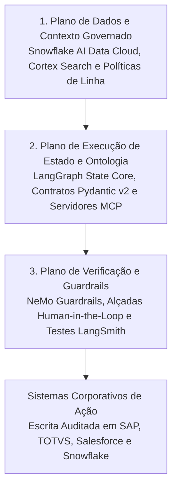

*Tempo de leitura: 8 minutos. Autor: Hugo S. Nascimento.*

<!-- more -->

*Contexto: Líderes de tecnologia investem pesado na Snowflake AI Data Cloud para unificar tabelas corporativas, impor controle rigoroso de acesso e consolidar o contexto analítico da empresa. Porém, quando equipes de engenharia conectam modelos probabilísticos diretamente à plataforma Snowflake por meio de geração livre de SQL ou pipelines ingênuos de RAG, noventa por cento dos pilotos travam antes de chegar à produção. Apresento aqui a arquitetura de referência que implementamos na hsnlabs para vincular máquinas de estado determinísticas em LangGraph e ontologias de negócios executáveis diretamente sobre a Snowflake AI Data Cloud.*

> **Resumo Executivo para Lideranças de Tecnologia:** A Snowflake AI Data Cloud oferece uma fundação governada de dados incomparável, unindo tabelas relacionais, busca híbrida via Cortex Search e políticas granulares de acesso dentro de um único perímetro de segurança. Contudo, governar dados não equivale a governar a execução de agentes em múltiplas etapas. Conceder permissão para que um modelo gere consultas SQL arbitrárias provoca alucinações de schema, consumo descontrolado de créditos computacionais e mutações inválidas nas regras de negócio. Ao combinar a plataforma Snowflake com uma camada aberta de ciclo de vida de desenvolvimento agêntico construída em LangGraph, contratos Pydantic v2 e servidores Model Context Protocol, as empresas alcançam ancoragem sem cópias e execução determinística sem aprisionamento tecnológico.

---

## Nota de Diligência e Especificações Técnicas

Os padrões arquiteturais e capacidades de plataforma detalhados neste post seguem a documentação técnica oficial e especificações abertas de engenharia:

* **Arquitetura Snowflake AI Data Cloud e Cortex:** detalhando governança de dados corporativos, busca vetorial híbrida via Cortex Search e modelos semânticos via Cortex Analyst, disponível em <a href="https://docs.snowflake.com/en/user-guide/snowflake-cortex">Snowflake Cortex Documentation</a>.
* **Controle de Acesso Baseado em Função e Políticas de Acesso por Linha na Snowflake:** detalhando fronteiras de segurança impostas nativamente na plataforma, disponível em <a href="https://docs.snowflake.com/en/user-guide/security-access-control-overview">Snowflake Access Control Documentation</a>.
* **Especificação de Orquestração com Estado no LangGraph:** detalhando grafos cíclicos de estado, persistência durável de checkpoints e interrupções supervisionadas por humanos, disponível em <a href="https://langchain-ai.github.io/langgraph/">LangGraph Technical Documentation</a>.
* **Prática de Arquitetura Snowflake da hsnlabs:** especificações de referência e metodologia de implantação, disponível em <a href="https://hsnlabs.ai/snowflake/">Prática Snowflake AI Data Cloud da hsnlabs</a>.

---

## 1. Por Que Text-to-SQL Direto Colapsa sobre Schemas Corporativos

Quando organizações tentam construir agentes operacionais sobre seus dados corporativos, o impulso inicial mais comum é conectar um modelo de linguagem às credenciais do banco e pedir que ele escreva consultas SQL dinamicamente.

Em uma operação real de grande porte, essa abordagem falha em quatro vetores previsíveis:

| Vetor de Falha | LLM Puro com SQL Irrestrito | ADLC Governado sobre a Snowflake AI Data Cloud |
| :--- | :--- | :--- |
| **Complexidade de Schema** | Alucina relacionamentos entre centenas de visões históricas e tabelas desnormalizadas de relatórios | Consulta contratos semânticos curados e visões na plataforma Snowflake vinculadas a schemas estritos em Pydantic |
| **Estado e Raciocínio Multietapas** | Perde o contexto em investigações longas e repete varreduras completas de alto custo | Mantém estado durável em checkpoints do LangGraph, preservando o contexto intermediário e reduzindo o consumo |
| **Segurança e Conformidade** | Opera sob uma conta de serviço única superprivilegiada, criando risco de vazamento entre áreas | Herda nativamente o controle RBAC e as políticas de linha da plataforma Snowflake conforme a identidade do usuário |
| **Escrita e Mutação Transacional** | Tenta gravar alterações sem validar regras cruzadas em sistemas como SAP, TOTVS ou Salesforce | Impõe guardas determinísticos em código e alçadas humanas antes de efetivar qualquer transação operacional |

A Snowflake AI Data Cloud resolve o problema mais difícil de infraestrutura na IA corporativa: eliminar silos de dados e governar o acesso em escala.

Entretanto, o schema de uma tabela define apenas *como o dado é armazenado*. Ele não define *quais transições de negócio são permitidas*.

---

## 2. A Arquitetura de Referência em Três Camadas: Snowflake + LangGraph + ADLC

Para levar agentes autônomos de provas de conceito frágeis para a operação crítica em produção, líderes de engenharia precisam separar o **Plano de Dados Governados** do **Plano Determinístico de Estado e Ontologia**.

### Camada 1: Ancoragem sem Cópias na Plataforma Snowflake
Em vez de exportar tabelas corporativas sensíveis para bancos vetoriais externos por meio de rotinas noturnas frágeis de ETL, toda a ancoragem permanece dentro do seu perímetro de segurança atual na plataforma Snowflake.

* **Verdade Relacional Governada:** Livros contábeis, posições de estoque e contratos de clientes permanecem nas tabelas governadas da Snowflake AI Data Cloud.
* **Recuperação Híbrida:** Documentos normativos, contratos em PDF e chamados técnicos são indexados nativamente na plataforma Snowflake, mantendo os vetores sincronizados com os metadados relacionais e as permissões de acesso.

### Camada 2: LangGraph State Core e Ontologia de Negócios Executável
Acima da plataforma Snowflake, implantamos uma máquina de estados explícita orquestrada em **LangGraph**.

Em vez de permitir que o modelo improvise seu próprio fluxo de trabalho, o agente percorre um grafo finito onde cada nó representa uma etapa verificada de engenharia:

1. **Resolução de Identidade e Escopo:** O grafo de estado valida a função do usuário e repassa credenciais com escopo restrito para a sessão Snowflake, garantindo a aplicação automática de mascaramento dinâmico e políticas de acesso por linha.
2. **Hidratação Tipada de Contexto:** Utilizando o Model Context Protocol, o agente aciona ferramentas determinísticas de leitura em vez de comandos SQL abertos. Cada ferramenta retorna objetos Pydantic fortemente tipados que representam entidades reais do domínio, como `ContaCliente`, `PedidoSuprimento` ou `DossieSinistro`.
3. **Validação de Invariantes Operacionais:** Antes de propor qualquer ação, como aprovar uma elevação de limite de crédito ou redirecionar uma carga logística, guardas determinísticos em Python validam margens mínimas, limites regulatórios e acordos de nível de serviço.

### Camada 3: Verificação, Guardrails e Avaliação Contínua
Nenhum agente corporativo deve entrar em produção sem uma trilha automatizada de auditoria e uma bateria de testes de regressão.

* **Interceptação Pré-Commit:** Transições de estado de alto valor financeiro ou irreversíveis pausam automaticamente em um checkpoint do LangGraph, enviando um pacote estruturado para aprovação humana antes da efetivação.
* **Rastreabilidade e Testes de Regressão:** Cada latência de consulta, custo de tokens e transição de grafo é registrado no LangSmith e no Braintrust, garantindo que evoluções de schema nunca gerem deriva silenciosa de comportamento.

---

## 3. Do Piloto à Produção em 4 Etapas

Na hsnlabs, operacionalizamos essa arquitetura diretamente dentro do ambiente de nuvem dos nossos clientes com transferência integral de código e propriedade intelectual:

1. **Etapa 01 · Validação Arquitetural:** Auditamos o fluxo operacional alvo, mapeamos os domínios de dados necessários na sua instância Snowflake e calculamos o retorno econômico unitário antes de iniciar o código de produção.
2. **Etapa 02 · Ontologia e Dados:** Mapeamos os schemas governados na plataforma Snowflake em contratos executáveis em Pydantic e configuramos pipelines de leitura sem cópias.
3. **Etapa 03 · Integração Agêntica:** Construímos as máquinas de estado em LangGraph, conectamos servidores MCP auditados à sua Snowflake AI Data Cloud e aos seus ERPs centrais, e ativamos os guardrails determinísticos.
4. **Etapa 04 · Handover Técnico:** Entregamos o repositório completo, as suítes automatizadas de avaliação e a documentação de arquitetura para que sua própria equipe de engenharia opere o sistema sem dependência contínua de consultoria.

---

## Sobre a Snowflake

A Snowflake torna a IA corporativa fácil, eficiente e confiável. Milhares de empresas ao redor do globo, incluindo centenas das maiores organizações do mundo, utilizam a Snowflake AI Data Cloud para compartilhar dados, construir aplicações e impulsionar seus negócios com inteligência artificial. Saiba mais em <a href="https://www.snowflake.com">snowflake.com</a>.

---

## Recursos Estratégicos e Leituras Relacionadas
- <a href="https://hsnlabs.ai/snowflake/">Prática de Arquitetura Snowflake AI Data Cloud da hsnlabs</a>
- <a href="https://hsnlabs.ai/langchain/">Engenharia de Produção LangChain e LangGraph da hsnlabs</a>
- <a href="/blog/pt/post/o-que-e-uma-ontologia-para-agentes-ia/">O Que É uma Ontologia para Agentes de IA? O Guia Definitivo</a>
- <a href="/blog/pt/post/ontologia-vs-schema-banco-dados/">Ontologia versus Schema de Banco de Dados: Por Que Tabelas Não Definem Transições de Negócio</a>
- <a href="/blog/pt/post/cemiterio-de-pocs/">O Cemitério de PoCs: Por Que 90% dos Pilotos Corporativos Colapsam em Dados Sujos</a>
