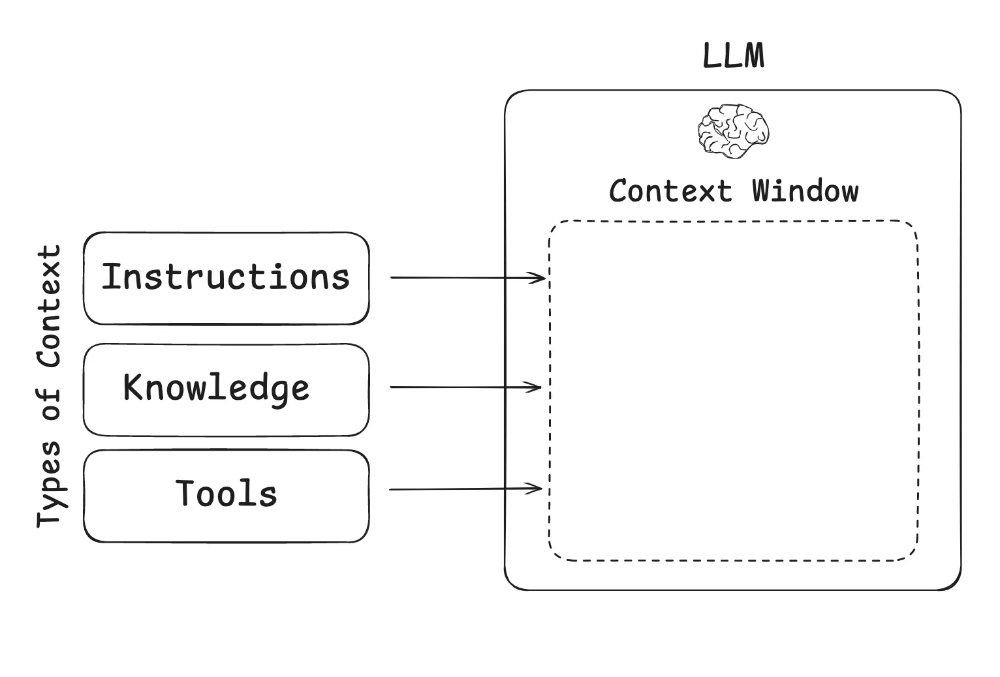
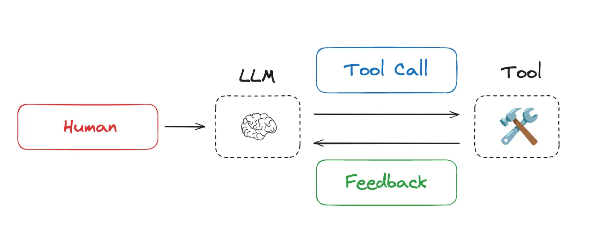
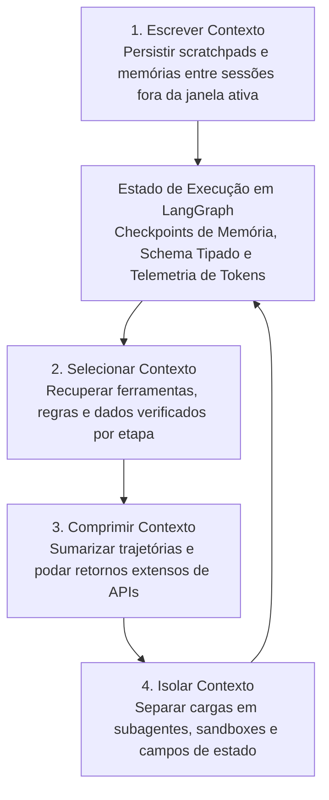

*Tempo de leitura: 8 minutos. Autor: Hugo S. Nascimento.*

<!-- more -->

*Contexto: A maioria dos pilotos corporativos de IA funciona bem no primeiro turno e colapsa por volta do décimo segundo. Quando agentes autônomos consultam APIs de ERP em português, leem tabelas fiscais e acumulam retornos extensos de ferramentas, a janela de contexto inchada dispara a latência, queima orçamento de tokens em USD e gera alucinações silenciosas. Partindo do estudo original da LangChain sobre context engineering para agentes, detalho como estruturamos arquiteturas de contexto em LangGraph na hsnlabs para operações brasileiras.*

> **Resumo executivo para lideranças de tecnologia:** Um LLM opera como uma CPU cuja memória de trabalho é a janela de contexto. Quando equipes de engenharia despejam instruções sem curadoria, trechos extensos de busca vetorial e cargas brutas de API dentro dessa janela finita, a acurácia cai mesmo nos modelos de fronteira. Ao governar o contexto como recurso de execução em quatro frentes, escrever, selecionar, comprimir e isolar, com implementação nativa em **LangGraph** e auditoria em **LangSmith**, empresas reduzem o desperdício em USD, aplicam mascaramento de dados para conformidade com a LGPD e estabilizam fluxos autônomos.

---

## Nota de diligência e especificações técnicas

Os padrões arquiteturais e estratégias de **context engineering** detalhados neste post têm como base pesquisa primária de mercado e especificações oficiais de engenharia:

* **Estudo original da LangChain sobre context engineering:** taxonomia das estratégias de escrever, selecionar, comprimir e isolar contexto em agentes de produção e pesquisa, publicada em <a href="https://www.langchain.com/blog/context-engineering-for-agents">Context Engineering for Agents pela LangChain</a>.
* **Especificação de orquestração com estado no LangGraph:** checkpoints de curto prazo, armazenamentos persistentes entre sessões e isolamento multiagente, documentados em <a href="https://langchain-ai.github.io/langgraph/">LangGraph Technical Documentation</a>.
* **Plataforma de observabilidade e avaliação LangSmith:** rastreamento granular de tokens e avaliação de regressões após ajustes de contexto, documentados em <a href="https://docs.smith.langchain.com/">LangSmith Technical Documentation</a>.
* **Prática de engenharia LangChain e LangGraph da hsnlabs:** padrões de arquitetura corporativa e metodologia de implantação, disponíveis em <a href="https://hsnlabs.ai/langchain/">Engenharia de Produção LangChain e LangGraph da hsnlabs</a>.

---

## 1. Por que a janela de contexto é o gargalo de produção em agentes corporativos

Andrej Karpathy comparou LLMs modernos a um novo tipo de sistema operacional: o modelo funciona como a CPU e a janela de contexto equivale à memória RAM, atuando como memória de trabalho finita. Assim como o kernel de um sistema operacional decide o que permanece na RAM e o que sai para disco, **context engineering** é a disciplina de preencher a janela de contexto exclusivamente com a informação necessária para o próximo passo de execução.

Em aplicações corporativas, essa memória de trabalho disputa espaço entre três categorias de dados:

* **Instructions:** prompts de sistema, regras de alçada, exemplos de comportamento e schemas de ferramentas.
* **Knowledge:** fatos verificados do negócio, políticas internas, tabelas tributárias e registros operacionais recuperados.
* **Tools:** parâmetros intermediários e retornos brutos devolvidos por APIs externas e bancos de dados.

<figure class="article-editorial-figure">
  
  <figcaption class="editorial-caption">Taxonomia de contexto publicada pela LangChain: Instructions, Knowledge e Tools disputam espaço finito na memória de trabalho do LLM.</figcaption>
</figure>

Interfaces simples de chat escondem essa restrição. Agentes autônomos, ao contrário, executam ciclos contínuos que alternam raciocínio do modelo e chamadas a sistemas externos, acumulando cada retorno JSON e consulta SQL dentro da trajetória ativa.

<figure class="article-editorial-figure">
  
  <figcaption class="editorial-caption">Ciclo de execução de agentes publicado pela LangChain: cada chamada de ferramenta injeta feedback bruto de volta na janela de contexto nos turnos seguintes.</figcaption>
</figure>

Quando fluxos financeiros ou fiscais avançam por dezenas de turnos, o acúmulo sem curadoria destrói a confiabilidade em quatro modos de falha descritos por Drew Breunig e recorrentes em auditorias no Brasil:

| Modo de falha | Mecanismo dentro da janela de contexto | Impacto na operação corporativa brasileira |
| :--- | :--- | :--- |
| **Context Poisoning** | Uma alucinação inicial ou erro de retorno entra na memória de trabalho e persiste nos turnos seguintes | Lançamentos em ERPs como SAP ou Totvs Protheus propagam o dado errado para contas a pagar e conciliações |
| **Context Distraction** | Histórico excessivo sufoca os padrões aprendidos de raciocínio do modelo | O agente ignora travas de alçada definidas no início do prompt e repete consultas redundantes |
| **Context Confusion** | Schemas supérfluos de ferramentas ou trechos irrelevantes enviesam a próxima decisão | Modelos acionam endpoints errados de mutação ou misturam regras de filiais distintas em uma mesma resposta |
| **Context Clash** | Fatos contraditórios de buscas diferentes ou turnos antigos coexistem no mesmo prompt | Agentes de aprovação recebem limites de crédito divergentes e travam em laços sem convergência |

Por esse motivo, despejar notas fiscais ou extrações brutas de banco em um repositório vetorial colapsa em produção, padrão analisado em <a href="/blog/pt/post/por-que-rag-falha-em-erp/">Por Que RAG Tradicional Falha em ERPs Financeiros</a>. Janelas maiores não corrigem falta de curadoria, apenas multiplicam a fatura em USD a cada turno.

---

## 2. As quatro estratégias de context engineering: escrever, selecionar, comprimir e isolar

Para impedir que janelas infladas degradem a precisão e o custo operacional, equipes de engenharia organizam o **context engineering** em quatro operações complementares em torno de um estado persistente.

### Escrever contexto fora da janela com scratchpads e memórias

Escrever contexto significa salvar registros intermediários fora da janela do modelo para que o LLM não carregue todo o histórico na memória ativa:

* **Scratchpads de sessão:** durante uma apuração fiscal ou conferência de pedidos em português, o agente grava planos de trabalho, chaves de notas e totalizadores em arquivo ou campo dedicado do estado. No pesquisador multiagente da Anthropic, o coordenador grava seu plano em memória logo no início para evitar perda de rumo caso a janela ultrapasse duzentos mil tokens.
* **Memórias entre sessões com governança LGPD:** seguindo referências como Reflexion e Generative Agents, produtos como ChatGPT, Cursor e Windsurf sintetizam memórias duráveis a partir de interações passadas. Em ambientes corporativos brasileiros, antes de persistir memórias de longo prazo, o fluxo precisa aplicar mascaramento de dados pessoais como CPF, CNPJ de sócios, e-mail e telefone para atender à LGPD sem contaminar sessões futuras.

### Selecionar contexto relevante sem sobrecarregar ferramentas ou RAG

Gravar contexto só gera ganho quando o agente recupera apenas o recorte necessário em cada nó da execução:

* **Leitura granular do scratchpad:** quando o scratchpad reside em um objeto tipado de estado e não em texto corrido, a engenharia define com precisão quais campos ficam visíveis ao modelo em cada etapa.
* **Seleção de memórias procedurais, episódicas e semânticas:** agentes de código usam arquivos objetivos como `CLAUDE.md` ou arquivos de regras do Cursor e Windsurf para instruções procedurais, enquanto fatos amplos exigem índices vetoriais ou grafos de conhecimento. Seleção mal calibrada quebra a confiança do usuário, como mostrou Simon Willison ao relatar que o ChatGPT puxou sua localização salva da memória para injetá-la em uma imagem sem pedido explícito.
* **RAG sobre descrições de ferramentas:** entregar dezenas de ferramentas de ERP com descrições sobrepostas confunde o modelo. Aplicar busca semântica sobre descrições de ferramentas para expor apenas o subconjunto relevante triplicou a precisão de escolha de ferramentas em estudos recentes.
* **Além do RAG genérico em consultas brasileiras:** como destacou Varun da Windsurf, indexar código ou documentos corporativos não equivale a recuperar contexto útil. Em escala, similaridade pura por embeddings perde confiabilidade e precisa combinar análise estrutural, busca exata por palavras-chave, grafos de conhecimento e reordenamento por relevância, mesma arquitetura aplicada em <a href="/blog/pt/post/como-construir-ontologia-operacional-python-mcp/">Como Construir uma Ontologia Operacional de Negócios em Python com Pydantic e MCP</a>.

### Comprimir contexto com sumarização e poda determinística

Consultas extensas a ERPs e integrações de estoque devolvem dezenas de colunas inúteis para a decisão. Comprimir mantém apenas o sinal indispensável e reduz o gasto em USD por transação:

* **Sumarização de trajetória e fronteiras:** ferramentas como o Claude Code executam compactação automática ao atingir noventa e cinco por cento da janela de contexto, resumindo a conversa acumulada. Também é eficaz aplicar sumarização na saída de ferramentas pesadas ou na passagem entre agentes, técnica na qual a Cognition treina modelos específicos para preservar decisões críticas sem descartar exceções.
* **Poda determinística de histórico:** diferente da sumarização por LLM, a poda filtra mensagens antigas, cabeçalhos redundantes e campos fiscais inertes por regras fixas ou modelos podadores como o Provence, cortando latência e custo sem chamada extra de inferência.

### Isolar contexto entre subagentes, sandboxes e schema de estado

Isolar contexto separa fisicamente grandes volumes de dados para que ruídos operacionais não disputem atenção no prompt principal:

* **Especialização multiagente:** bibliotecas como OpenAI Swarm e o pesquisador paralelo da Anthropic atribuem a cada subagente suas próprias ferramentas, instruções e janela privada. A Anthropic observou ganho de qualidade sobre agentes únicos, com a ressalva de que ramificações paralelas exigem coordenação rigorosa e podem consumir até quinze vezes mais tokens do que um fluxo simples.
* **Isolamento em sandboxes de execução:** o CodeAgent da HuggingFace executa código gerado em um sandbox isolado e devolve ao LLM apenas o valor resumido de retorno, mantendo tabelas extensas, planilhas ou arquivos binários em variáveis de ambiente fora do prompt.
* **Particionamento por schema de estado:** mesmo em grafos com um único agente, um schema estruturado permite expor apenas mensagens sintetizadas ao modelo enquanto cargas completas de pedidos, tokens de auditoria e registros mascarados para LGPD trafegam isolados em campos específicos do estado.

---

## 3. Como implementar context engineering com LangGraph e LangSmith

  
  Orquestração de baixo nível com estado para controlar escrita, seleção, compressão e isolamento de contexto.

Ajustar prompts às cegas não funciona quando não há visibilidade sobre onde os tokens estão sendo queimados. Antes de otimizar janelas, a equipe precisa de duas bases no **LangSmith**: rastreamento de consumo de tokens por nó para localizar gargalos de custo em USD, e suítes de avaliação para comprovar que comprimir ou podar contexto não introduziu regressões silenciosas.

Como o **LangGraph** estrutura agentes como grafos cíclicos explícitos que trafegam um objeto de estado tipado entre nós, cada estratégia de **context engineering** se traduz diretamente em recursos nativos da arquitetura:

| Estratégia | Recurso no LangGraph e ecossistema | Efeito prático em produção no Brasil |
| :--- | :--- | :--- |
| **Escrever** | Checkpoints por sessão para scratchpads; Store entre sessões e **LangMem** para memória durável | Salva planos de consulta e aprendizados após mascaramento LGPD sem poluir o prompt ativo |
| **Selecionar** | Projeção seletiva de estado por nó; busca em Store e filtragem semântica **LangGraph Bigtool** | Entrega ao modelo apenas as regras tributárias, campos e ferramentas MCP necessários na etapa atual |
| **Comprimir** | Utilitários nativos de poda de mensagens, nós de sumarização e pós-processadores de saída | Enxuga retornos extensos de ERPs em português antes que inflem a janela e a fatura em USD |
| **Isolar** | Particionamento de campos no schema de estado, sandboxes E2B ou Pyodide e subgrafos Supervisor ou Swarm | Mantém anexos, extratos brutos e sub-rotinas de pesquisa isolados da janela principal de decisão |

---

## 4. Da auditoria de tokens à produção em 4 etapas

Na hsnlabs, implantamos pipelines de **context engineering** para que lideranças de engenharia reduzam custos em dólar e aumentem a previsibilidade operacional sem reescrever sistemas legados:

1. **Etapa 01 · Auditoria de tokens e trajetórias:** instrumentamos rastros reais no LangSmith para medir quanto do orçamento em USD vai para instruções, buscas vetoriais e retornos de ERP, identificando pontos de distração e conflito.
2. **Etapa 02 · Desenho de schema de estado e isolamento:** segregamos cargas pesadas e dados sensíveis sob LGPD em campos isolados de estado no LangGraph e em sandboxes de execução, mantendo o histórico do LLM enxuto.
3. **Etapa 03 · Portões de seleção e compressão:** ativamos filtragem semântica de ferramentas, busca híbrida apoiada em ontologia e regras determinísticas de poda ou sumarização nas fronteiras de integração.
4. **Etapa 04 · Entrega validada por avaliações contínuas:** validamos cada ajuste de contexto contra conjuntos de regressão em CI/CD antes da publicação, entregando grafos, políticas de memória e painéis de telemetria à equipe interna.

---

## Recursos estratégicos e leituras relacionadas
- <a href="https://hsnlabs.ai/langchain/">Engenharia de Produção LangChain e LangGraph da hsnlabs</a>
- <a href="https://www.langchain.com/blog/context-engineering-for-agents">Context Engineering for Agents: estudo original da LangChain</a>
- <a href="/blog/pt/post/arquitetura-agentes-braintrust-evals-cicd-langgraph/">Braintrust Evals e LangGraph: Substituindo Testes Manuais por CI/CD Determinístico</a>
- <a href="/blog/pt/post/por-que-rag-falha-em-erp/">Por Que RAG Tradicional Falha em ERPs Financeiros</a>
- <a href="/blog/pt/post/como-construir-ontologia-operacional-python-mcp/">Como Construir uma Ontologia Operacional de Negócios em Python com Pydantic e MCP</a>
