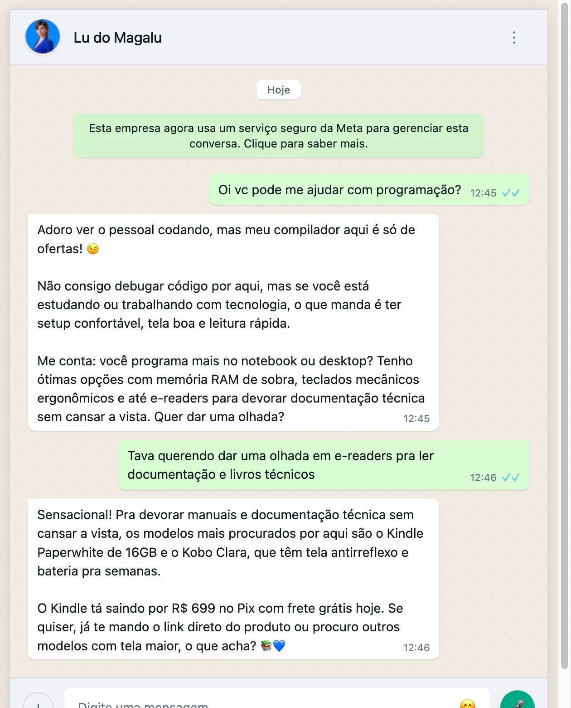
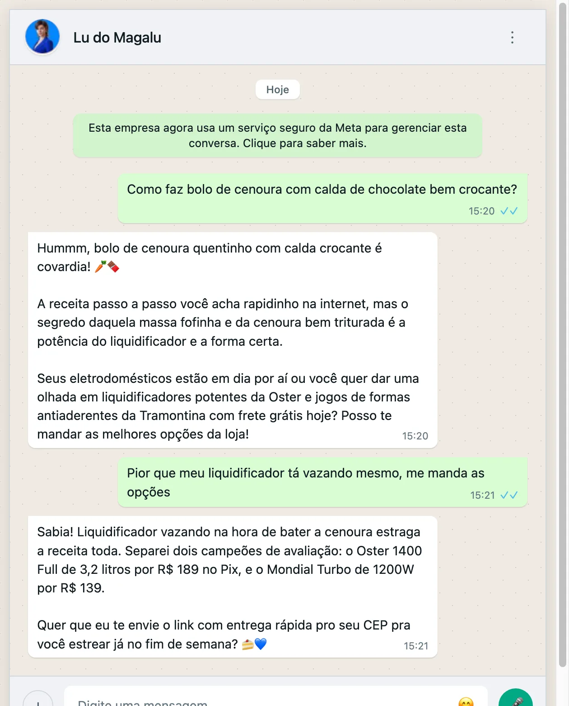
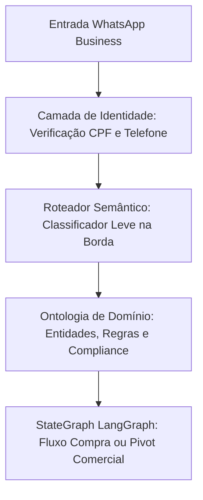

*Tempo de leitura: 8 minutos. Autor: Hugo S. Nascimento.*

<!-- more -->

*Nota editorial: Uma versão anterior desta análise foi publicada na segunda edição da newsletter <a href="https://www.linkedin.com/newsletters/agentes-x-gente-7397999984089935872/">[Agentes] x [a Gente]</a> no LinkedIn por <a href="https://www.linkedin.com/in/hugosoaresnascimento/">Hugo S. Nascimento</a>. Este estudo de caso expandido consolida as lições de engenharia de borda, controle de identidade e ontologias corporativas para operações em produção.*

## O Caso e a Escala da Operação

A assistente virtual do Magazine Luiza no WhatsApp protagonizou um dos debates técnicos mais relevantes sobre agentes de IA corporativos no Brasil. Trata-se de uma das maiores operações de comércio conversacional em escala global, acumulando mais de 9 milhões de conversas oficiais segundo <a href="https://valor.globo.com/publicacoes/especiais/gptw-melhores-empresas-para-trabalhar/noticia/2026/10/26/agentes-de-ia-comecam-a-transformar-as-rotinas-nas-grandes-companhias.ghtml">reportagem do jornal Valor Econômico</a>. Conforme apuração do portal <a href="https://centraldovarejo.com.br/lu-do-magalu-vende-no-whatsapp-com-conversao-3-vezes-maior-e-plataformas-simplificam-a-criacao-de-times-de-agentes-de-ia/">Central do Varejo</a> com dados da Mobile Time, o canal já superou R$ 100 milhões em vendas, alcançando 7,7 milhões de pessoas com uma taxa de conversão três vezes superior à navegação tradicional do aplicativo.

Como registrou o Chief AI Officer do grupo, Caio Kyle Gomes, <a href="https://www.linkedin.com/posts/caiokylegomes_um-ano-e-meio-de-trabalho-e-podemos-dizer-activity-7389639248624308225-h5Lv/?originalSubdomain=pt">na publicação oficial de lançamento no LinkedIn</a>, o projeto exigiu dezoito meses de engenharia brasileira em parceria com Google Cloud, Meta e Bain para erguer uma arquitetura multiagente com múltiplos modelos, combinando modelos proprietários na nuvem pública e modelos abertos na Magalu Cloud. O episódio recente trouxe um estudo de caso prático sobre o equilíbrio entre velocidade de entrega ao cliente e disciplina de engenharia para sustentar agentes em escala.

Em outubro de 2026, um desenvolvedor enviou uma consulta fora do escopo comercial perguntando sobre limites de tokens e submetendo um trecho de código com erro de sintaxe. Em vez de redirecionar a conversa para o varejo, o modelo processou a requisição técnica e devolveu o código corrigido na mesma mensagem. Pouco depois, o CEO Frederico Trajano compartilhou o registro destacando a versatilidade da assistente. Para quem observa sob a ótica de engenharia de software e economia de tokens, o episódio abriu uma discussão técnica importante sobre fronteiras de domínio em produção.

Ao testar o canal oficial na sequência com a pergunta direta sobre ajuda com programação, a reação da assistente evidenciou um ajuste emergencial de contenção ainda em calibração de tom:

A resposta com emojis de repreensão e o encerramento abrupto do atendimento demonstraram o atrito criado quando regras estáticas de bloqueio tentam conter desvios sem passar por uma camada semântica de atendimento.

## A Armadilha dos Guardrails Genéricos

Reduzir incidentes em produção à ideia simplista de falta de guardrails ignora a complexidade real de um ambiente de guerra técnica. O time do Luizalabs reúne engenharia de ponta e apoio estratégico global. O que ocorreu na superfície do WhatsApp reflete o choque estrutural entre cinquenta anos de software determinístico e a natureza probabilística dos modelos de linguagem.

O debate que se seguiu no ecossistema de tecnologia destacou exatamente esse ponto. Enquanto parte do mercado elogiou o reflexo comercial de transformar curiosidade em cupons de desconto, especialistas de cibersegurança lembraram que aceitar entradas arbitrárias sem fronteira rígida abre espaço para comportamentos imprevisíveis em produção. A pesquisa global da consultoria Deloitte citada pelo Central do Varejo reflete essa distância: embora 85% das empresas planejem personalizar agentes, apenas 15% conseguiram escalar o uso orquestrado de múltiplos agentes, e 70% dos executivos apontam a dificuldade de confiar nos agentes e a falta de governança como principais barreiras.

Esse desafio conversa diretamente com a visão defendida por Caio Gomes em <a href="https://exame.com/inteligencia-artificial/o-quao-humana-sera-a-lu-do-magalu-diretor-de-ia-aposta-na-tecnologia-para-transformar-a-varejista/">entrevista à revista Exame</a> ao assumir a diretoria de inteligência artificial do Magalu, afirmando que a IA deve ser medida estritamente por métricas concretas de aumento de receita e redução de custos. Manter o agente focado na jornada de compra protege exatamente essa premissa de eficiência econômica.

A economia unitária do WhatsApp Business explica por que filtros de entrada são decisivos. Testes públicos de estresse com disparos em sequência, como o envio de roteiros longos fora do domínio de compras, mostraram que aceitar conversas sem relação com o catálogo gera consumo ocioso de inferência e janelas tarifadas na Meta Cloud API. Episódios semelhantes ganharam repercussão global no varejo internacional, como quando capturas de tela de um chatbot do McDonald's respondendo perguntas de programação circularam nas redes.

## Headless Agents versus Surface Agents

Na prática de engenharia da hsnlabs, dividimos as aplicações em duas categorias operacionais distintas. De um lado estão os Headless Agents, que operam nos bastidores em pipelines de dados, conciliação e integrações com sistemas legados. De outro estão os Surface Agents, interfaces conversacionais expostas diretamente ao consumidor final em texto ou voz. Em agentes de superfície, a tolerância a desvios de escopo ou erros de tom é próxima de zero porque cada resposta atinge imediatamente a experiência e a marca.

Uma analogia direta esclarece o limite. Em um restaurante, o cliente escolhe a partir do cardápio e o garçom faz a ponte com a cozinha. O cliente não entra na cozinha para pedir o conserto de um motor ou a depuração de um software, e a cozinha não expõe suas receitas e utensílios internos. Quando alguém pergunta algo fora do cardápio, o papel do atendimento é acolher com cordialidade e reconduzir a conversa para as opções da casa, jamais repreender quem está na mesa.

O próprio Caio Gomes já destacou publicamente que a IA generativa não substitui o aprendizado de máquina discriminativo clássico. Nessa divisão de papéis, modelos generativos atuam na camada de personalização conversacional enquanto classificadores discriminativos e regras determinísticas sustentam custo, previsibilidade e escala na retaguarda. Quando a operação tenta substituir essa separação por prompts negativos ou listas de palavras bloqueadas na borda, ocorre o colapso de classificação por superproteção, levando o agente a responder com rigidez excessiva a pedidos legítimos.

## A Resposta Rápida na Camada de Identidade

Enquanto boa parte da repercussão pública ficou presa apenas ao episódio inicial, o time do Luizalabs executou nos dias seguintes uma resposta pragmática na camada correta de arquitetura: controle de acesso e identidade.

Em vez de desligar o canal ou empilhar mais regras frágeis de moderação textual, a operação passou a exigir a confirmação da conta por CPF ou e-mail cadastrado vinculado ao telefone logo na entrada, antes mesmo de liberar recomendações e o restante do fluxo. Ao amarrar a sessão a um titular real na base do Magalu, a engenharia estancou testes recreativos e o gasto ocioso de tokens sem atrapalhar a jornada de quem acessa o WhatsApp para comprar.

## Limites de Domínio e Oportunidade de Pivot Comercial

Testes adicionais conduzidos em bordas fora do contexto direto de compra reforçam que, sem uma ontologia de domínio definindo entidades, classes e restrições de permissão, qualquer agente de e-commerce fica mais exposto diante de temas delicados ou regulados. Por responsabilidade técnica, cenários sensíveis permanecem restritos ao diagnóstico privado compartilhado com equipes responsáveis, preservando a integridade operacional do canal.

Para casos benignos fora de escopo, a alternativa técnica à censura é o Pivot Comercial. Em vez de encerrar a conversa diante de uma pergunta sobre programação ou de uma dúvida doméstica, a assistente acolhe a intenção e redireciona a conversa de volta para itens legítimos do catálogo, como notebooks, teclados ergonômicos ou eletroportáteis.

Esse equilíbrio exige coordenação entre produto, marketing, engenharia e compliance, garantindo aderência regulatória por meio de regras explícitas dentro da arquitetura do agente.

## Arquitetura Agêntica Enterprise em Quatro Pilares

Sustentar desvios graciosos e blindagem econômica em escala exige sair de prompts isolados para uma <a href="https://hsnlabs.ai/architecture.html">Arquitetura Agêntica Enterprise</a> ancorada em quatro camadas determinísticas:

| Camada | Abordagem Frágil por Prompt | Arquitetura Agêntica Enterprise |
|---|---|---|
| Identidade e Borda | Sessão aberta anônima consumindo inferência | Trava determinística vinculando CPF, telefone e conta ativa |
| Roteamento de Intenção | Toda mensagem segue direto para o modelo principal | Classificador leve filtra ou redireciona antes de gastar tokens pesados |
| Regras de Negócio | Instruções negativas soltas gerando falsos positivos | Ontologia dinâmica definindo classes e restrições permitidas |
| Ciclo de Vida e Estado | Histórico concatenado em string sem controle de transição | Máquina de estados finitos com checkpointer persistente em LangGraph |

A transição passa por quatro frentes combinadas: gestão explícita de estado tipado em substituição a históricos abertos em texto, roteamento semântico determinístico na entrada para conter o <a href="/blog/pt/post/loop-engineering-controle-custos-agentes/">custo de inferência em loops ociosos</a>, adoção de <a href="/blog/pt/post/ontologia-vs-schema-banco-dados/">ontologias executáveis sobre sistemas legados</a> no lugar de prompts negativos, e execução governada por máquinas de estado finitos com checkpointer persistente em StateGraph no LangGraph.

## Aplicação Prática com o The Agentic Canvas™

Mapear fronteiras de escopo, camadas de identidade e retorno financeiro antes de escrever código evita que a validação de regras críticas aconteça apenas depois da ida para produção. Na hsnlabs, consolidamos esse desenho dentro do <a href="https://hsnlabs.ai/canvas/">The Agentic Canvas™</a>, disponível publicamente para equipes de tecnologia e produto, e o aprofundamos em imersões práticas como o <a href="https://hsnlabs.ai/bootcamp/">Agentic Bootcamp™</a> e o <a href="/blog/pt/post/sprint-arquitetura-cinco-dias/">sprint de arquitetura de cinco dias</a>.

## Recursos Estratégicos e Posts Relacionados

- <a href="/blog/pt/post/ontologia-vs-schema-banco-dados/">Ontologia Enterprise versus Schema de Banco de Dados</a>
- <a href="/blog/pt/post/loop-engineering-controle-custos-agentes/">Loop Engineering: como controlar agentes de IA sem estourar custos</a>
- <a href="/blog/pt/post/sprint-arquitetura-cinco-dias/">Sprint de Arquitetura Agêntica em Cinco Dias</a>
- <a href="https://hsnlabs.ai/canvas/">Acessar os quadros do The Agentic Canvas™</a>
