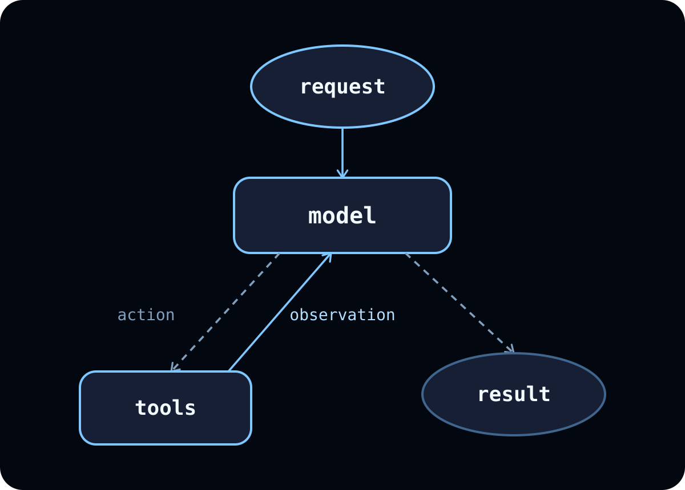
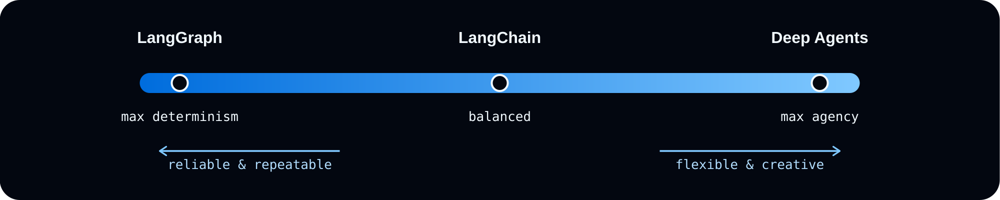
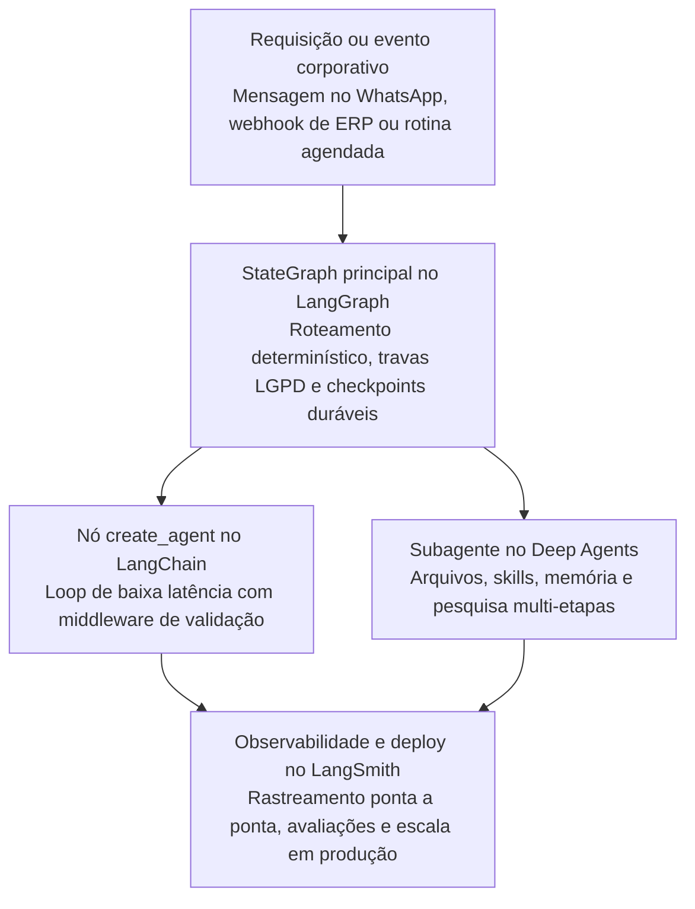

*Tempo de leitura: 8 minutos. Autor: Hugo S. Nascimento.*

<!-- more -->

*Contexto: Equipes de engenharia que adotam a stack pós-1.0 da LangChain frequentemente tratam LangChain, LangGraph e Deep Agents como ferramentas concorrentes. Na prática, o debate sobre langchain vs langgraph ganha outro sentido quando entendemos que eles formam três camadas empilhadas, cada uma equilibrando nível de abstração e controle determinístico. Com base no guia oficial da LangChain e nas implantações corporativas da hsnlabs no Brasil, detalho aqui quando escolher cada camada em produção.*

> **Resumo executivo para lideranças de tecnologia:** LangGraph, LangChain e Deep Agents não são alternativas excludentes. O **LangGraph** atua como o runtime durável de agentes, entregando determinismo máximo sobre transições de estado, alçadas e persistência. O **LangChain** é o framework enxuto que padroniza o loop central de ferramentas com ganchos de middleware. O **Deep Agents** entrega um harness completo e opinativo sobre esse mesmo loop, trazendo sistema de arquivos, subagentes, skills e memória prontos para uso. Escolher a camada errada desperdiça meses reconstruindo gestão de contexto ou introduz autonomia probabilística em fluxos financeiros e fiscais que exigem precisão absoluta.

---

## Nota de diligência e especificações técnicas

As fronteiras arquiteturais, métricas operacionais e definições de produto analisadas nesta publicação seguem a documentação oficial da LangChain e fontes técnicas primárias:

* **Comparativo oficial da stack LangChain:** detalhando a filosofia das três camadas, a telemetria real do agente de GTM e o espectro entre determinismo e autonomia, publicado em <a href="https://www.langchain.com/blog/deep-agents-vs-langchain-vs-langgraph">Deep Agents, LangChain, and LangGraph</a> em novembro de 2026.
* **Documentação de runtime com estado do LangGraph:** especificando execução durável, topologias cíclicas, tolerância a falhas e interrupções Human-in-the-Loop, disponível em <a href="https://langchain-ai.github.io/langgraph/">LangGraph Technical Documentation</a>.
* **Referência de agentes e middleware do LangChain:** detalhando `create_agent`, conectores de ferramentas e ganchos de ciclo de vida, disponível em <a href="https://docs.langchain.com/">LangChain Documentation</a>.
* **Prática de engenharia LangChain e LangGraph da hsnlabs:** padrões de arquitetura corporativa para agentes com estado e ontologias operacionais, disponível em <a href="https://hsnlabs.ai/langchain/">Engenharia de produção LangChain e LangGraph da hsnlabs</a>.

---

## 1. As três camadas da stack pós-1.0: runtime, framework e harness

Na geração pós-1.0 do ecossistema, os três projetos open source compartilham o mesmo princípio: a equipe de engenharia deve deter controle total sobre o modelo escolhido, o contexto enviado na janela e o harness que executa o agente. Em vez de impor um único padrão rígido, a arquitetura separa responsabilidades em três camadas combináveis:

| Camada arquitetural | Papel na stack | Ponto de entrada | Modelo de contexto e controle | Melhor encaixe corporativo |
| :--- | :--- | :--- | :--- | :--- |
| **LangGraph** | Runtime de agente | `StateGraph` customizado | Controle máximo e abstração mínima; regras de negócio codificadas diretamente em nós e arestas | Fluxos regulados, integração com ERPs e pipelines que misturam código fixo com etapas de IA |
| **LangChain** | Framework de agente | `create_agent` com middleware | Loop mínimo e sem opiniões rígidas; engenharia define ferramentas, prompts e travas exatas | Assistentes sensíveis a latência, harnesses proprietários e fluxos delimitados de busca |
| **Deep Agents** | Harness de agente | `create_deep_agent` | Autonomia máxima com engenharia de contexto pronta via arquivos, subagentes, skills e memória | Pesquisa de contas, preparação comercial, assistência de código e rotinas assíncronas longas |

Por baixo dos panos, existe uma hierarquia clara de execução. O **LangGraph** é o motor de base responsável por persistência durável, streaming, recuperação de falhas e pausas para aprovação humana. Tanto a abstração `create_agent` do LangChain quanto o `create_deep_agent` do Deep Agents compilam e rodam sobre grafos do LangGraph.

<figure class="article-editorial-figure">
  
  <figcaption class="editorial-caption">Loop central de agente da LangChain: a requisição entra no modelo, alterna entre ações em ferramentas e observações e retorna o resultado final sobre o runtime do LangGraph.</figcaption>
</figure>

Esse loop central é propositalmente enxuto. O modelo recebe uma solicitação, dispara uma ação nas ferramentas conectadas, analisa a observação retornada e repete o ciclo até concluir a resposta. O **Deep Agents** usa exatamente esse mesmo loop, porém empacota um conjunto opinativo de middlewares voltados para engenharia de contexto em tarefas longas:

* **Sistema de arquivos:** lê e grava artefatos intermediários fora da janela principal do modelo, evitando saturação de tokens.
* **Subagentes:** delega investigações especializadas em ciclos isolados sem poluir o histórico principal da conversa.
* **Skills:** carrega instruções específicas e scripts operacionais sob demanda, em vez de inflar o prompt de sistema desde o início.
* **Memória persistente:** preserva preferências, histórico de relacionamento e aprendizados entre execuções distintas.

  
  Runtime durável de grafos que sustenta fluxos customizados no LangGraph, loops create_agent no LangChain e harnesses no Deep Agents.

---

## 2. Equilibrando determinismo e autonomia em produção

Toda arquitetura de agentes em produção precisa resolver uma troca inevitável entre **autonomia** e **confiabilidade**. Quanto maior a liberdade do modelo para planejar, ramificar chamadas e encadear ferramentas, maior o potencial criativo em tarefas ambíguas, porém maior também a variância de latência, risco operacional e consumo de tokens.

<figure class="article-editorial-figure">
  
  <figcaption class="editorial-caption">Espectro oficial entre determinismo e autonomia na stack LangChain: LangGraph entrega máxima previsibilidade, LangChain equilibra o loop com middleware e Deep Agents maximiza a autonomia.</figcaption>
</figure>

Na engenharia corporativa brasileira, a decisão arquitetural correta começa definindo onde a regra determinística é inegociável e onde o raciocínio probabilístico realmente gera margem:

1. **Determinismo estrutural no LangGraph:** quando um processo exige obediência estrita a alçadas financeiras, trilha fiscal ou regras da LGPD, codificar as transições na topologia do `StateGraph` elimina o improviso do modelo. O agente não consegue pular uma etapa de validação porque a aresta simplesmente não existe no grafo.
2. **Governança ao redor do loop com middleware no LangChain:** muitas operações funcionam bem dentro do loop padrão de ferramentas, desde que existam travas previsíveis ao redor de cada chamada. O **middleware do LangChain** injeta ganchos determinísticos para resumir histórico antes do limite de contexto, validar schemas de saída, mascarar CPF ou dados pessoais sensíveis antes de enviar ao provedor de IA e pausar a execução para aprovação humana.
3. **Autonomia em escala no Deep Agents:** quando o caminho até a resposta não pode ser roteirizado previamente, como consolidar dossiês comerciais ou investigar incidentes em código, o **Deep Agents** permite que o agente gerencie seu próprio horizonte de pesquisa via subagentes e arquivos temporários.

| Vetor de governança | Grafo customizado no LangGraph | LangChain com middleware | Harness Deep Agents |
| :--- | :--- | :--- | :--- |
| **Superfície de controle** | Nós explícitos, arestas condicionais e contratos tipados de estado | Loop padrão protegido por ganchos determinísticos antes e depois de cada passo | Harness opinativo gerenciando arquivos, memória, skills e subagentes |
| **Previsibilidade de custo em reais** | Alta; chamadas ao LLM ficam restritas a nós específicos e curtos | Moderada; controlada pelo limite de iterações e sumarização em middleware | Variável; subagentes em paralelo e loops longos multiplicam o gasto em reais |
| **Perfil de latência e SLA** | Previsível e baixa quando decisões de roteamento rodam em código puro | Ajustável para canais síncronos como WhatsApp com seleção enxuta de ferramentas | Orientado à profundidade em execuções assíncronas e segundo plano |
| **Conformidade e auditoria** | Garantida por máquina de estados em código e validação estrita de payload | Garantida por travas de middleware, mascaramento LGPD e pausas de aprovação | Governada por isolamento de arquivos, regras de skills e rastros no LangSmith |

---

## 3. Quando usar cada camada em operações corporativas

A recomendação prática publicada pela própria LangChain segue uma regra direta: **comece pelo Deep Agents** se precisa de um agente autônomo completo desde o primeiro dia, desça para o **LangChain** quando precisar de um loop enxuto ou harness sob medida e adote o **LangGraph** sempre que a lógica do negócio exigir um fluxo determinístico ou híbrido.

### Deep Agents: harness completo para tarefas abertas e pesquisa profunda

Use `create_deep_agent` quando o principal desafio do projeto é engenharia de contexto em investigações longas. No caso real documentado pela LangChain, seu agente interno de GTM roda sobre `deepagents` com memória individual por executivo de contas, skills padronizadas para preparação de QBR e subagentes que cruzam transcrições de chamadas, notícias e histórico do CRM.

Essa operação processa cerca de 10 mil requisições por semana para mais de 150 usuários ativos, sendo apenas 26 por cento iniciadas diretamente no chat e 74 por cento disparadas de forma ambiente por eventos e agendamentos no LangSmith. No mercado brasileiro, o mesmo padrão se aplica a pesquisa pré-reunião no B2B, cruzamento de dados públicos de CNPJ com histórico no CRM e revisão assistida de código, exigindo apenas teto rígido de tokens em reais para rotinas em lote não dispararem a fatura mensal.

### LangChain: loop enxuto e controle fino de contexto por middleware

Use `create_agent` quando arquivos temporários e delegação para subagentes adicionam peso desnecessário. Canais síncronos sensíveis a latência, como atendimento corporativo via WhatsApp integrado a catálogo ou base documental, precisam de controle exato sobre quais ferramentas e trechos entram no prompt a cada turno.

Um exemplo clássico é o assistente de perguntas e respostas sobre documentação interna via busca vetorial. O modelo consulta a base, verifica se a evidência responde ao usuário e encerra o ciclo sem precisar de memória entre sessões nem subagentes. Vale reforçar também que nem todo atendimento precisa de loop agêntico autônomo, distinção arquitetural que detalhamos em <a href="/blog/pt/post/chatbot-vs-agente/">Chatbot vs agente: quando fluxos determinísticos vencem loops autônomos</a>.

### LangGraph: topologia determinística para fluxos regulados e ERPs

Use LangGraph quando o processo combina extração pontual por LLM com regras rígidas de negócio, ou quando sua equipe já mantém um grafo cuja estrutura representa a inteligência operacional da empresa. O guia da LangChain ilustra esse padrão com uma esteira de análise de locação imobiliária em três etapas:

* **Etapa 1:** um modelo de linguagem extrai renda, histórico de crédito e referências dos documentos enviados, sem nenhuma ferramenta de escrita ativa.
* **Etapa 2:** código determinístico calcula a pontuação do candidato segundo critérios objetivos da política de risco.
* **Etapa 3:** roteamento fixo aprova automaticamente perfis elegíveis, recusa perfis fora da política e encaminha casos limítrofes para revisão humana.

Apenas a leitura documental toca o modelo probabilístico; a decisão financeira permanece auditável em código. Em empresas brasileiras operando sobre SAP, TOTVS Protheus, conferência de NF-e, conciliação bancária e alçadas de pagamento via PIX, esse desenho se integra diretamente a contratos tipados de execução, padrão que aprofundamos em <a href="/blog/pt/post/como-construir-ontologia-operacional-python-mcp/">Como construir uma ontologia operacional em Python e MCP</a>.

### Composabilidade entre as três camadas em produção

Escolher uma camada não bloqueia o uso das demais. Os três pacotes são totalmente combináveis e compartilham deploy e observabilidade unificados no **LangSmith**:

Na prática, um `StateGraph` corporativo pode usar um nó `create_agent` para triagem rápida em milissegundos no WhatsApp, acionar código determinístico para validar limites no ERP e delegar apenas investigações complexas para um subagente em `create_deep_agent`, mantendo rastreabilidade única no LangSmith.

| Cenário operacional no Brasil | Camada recomendada | Justificativa arquitetural |
| :--- | :--- | :--- |
| **Pesquisa de contas B2B, preparação de QBR ou agente de código** | Deep Agents | Aproveita subagentes, skills sob demanda, memória e descarga de contexto sem código repetitivo |
| **Atendimento técnico via WhatsApp com SLA curto de resposta** | LangChain | Menor sobrecarga por turno e controle cirúrgico de ferramentas e tokens enviados ao modelo |
| **Análise de crédito, conciliação de NF-e, ERP e alçadas PIX** | LangGraph | Isola a extração documental com IA da pontuação determinística e das aprovações humanas |
| **Plataforma corporativa unindo compliance rígido e pesquisa aberta** | Stack composta | LangGraph governa o estado externo e gravações no ERP enquanto delega subtarefas ao LangChain ou Deep Agents |

---

## 4. Evolução da arquitetura e critérios práticos de migração

Entender a cronologia da stack evita decisões reativas na escolha de ferramentas:

1. **Outubro de 2022 · LangChain:** surgiu para acelerar a criação de aplicações e cadeias sobre modelos de linguagem.
2. **Janeiro de 2024 · LangGraph:** nasceu como runtime baseado em grafos para entregar execução durável, streaming e aprovações humanas nativas quando cadeias simples não davam mais conta.
3. **Padronização pós-1.0 · `create_agent`:** consolidou o loop padrão de modelo e ferramentas como abstração mínima e extensível por middleware sobre o motor do LangGraph.
4. **Julho de 2025 · Deep Agents:** inspirado em referências como Claude Code e Manus, empacotou as melhores práticas de engenharia de contexto diretamente sobre o loop central.

Para equipes que já operam fluxos em produção no Brasil, o critério de migração deve ser pragmático. **Permaneça no LangGraph** se a confiabilidade do negócio depende da forma explícita do grafo, das travas de LGPD e das etapas determinísticas em código. **Migre trechos altamente agênticos para o Deep Agents** apenas se o seu grafo atual virou um loop ReAct mantido manualmente, onde a engenharia gasta tempo reinventando sumarização de contexto, prompts extensos e roteamento improvisado de subagentes. Em qualquer camada escolhida, conecte todas as execuções à telemetria e às suítes de avaliação do **LangSmith** antes de escalar o tráfego.

---

## Recursos estratégicos e leituras relacionadas
- <a href="https://hsnlabs.ai/langchain/">Engenharia de produção LangChain e LangGraph da hsnlabs</a>
- <a href="/blog/pt/post/chatbot-vs-agente/">Chatbot vs agente: fronteiras arquiteturais em produção</a>
- <a href="/blog/pt/post/como-construir-ontologia-operacional-python-mcp/">Como construir uma ontologia operacional em Python e MCP</a>
- <a href="/blog/pt/post/arquitetura-agentes-braintrust-evals-cicd-langgraph/">Braintrust Evals e LangGraph: substituindo testes manuais por CI/CD determinístico</a>
