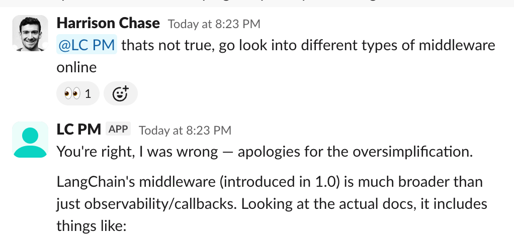
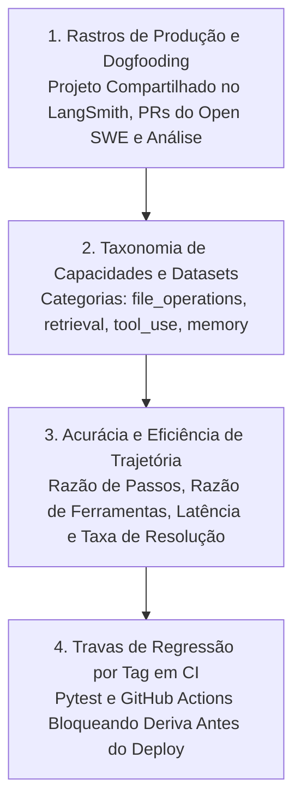
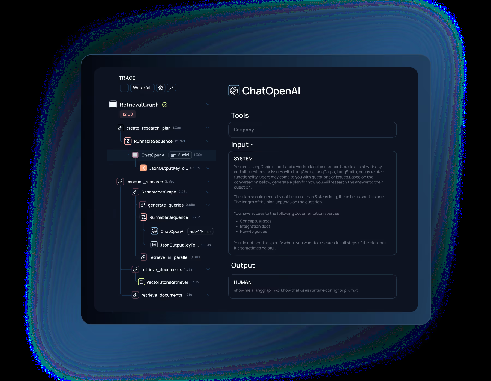

*Tempo de leitura: 7 minutos. Autor: Hugo S. Nascimento.*

<!-- more -->

*Contexto: A maioria dos times corporativos ignora a avaliação de agentes até o primeiro cliente reclamar, ou vai para o extremo oposto e acumula milhares de testes genéricos que não medem o que importa na operação. Após analisar o <a href="https://www.langchain.com/blog/how-we-build-evals-for-deep-agents">estudo de engenharia da LangChain sobre como construir evals para Deep Agents</a>, cruzei a metodologia deles com o que enfrentamos em implantações no Brasil, incluindo onde o LangSmith ganha e onde alternativas open source como o Langfuse fazem mais sentido.*

> **Resumo executivo para lideranças de tecnologia:** Aumentar o volume de testes não torna um agente mais confiável. Cada eval exerce pressão sobre seus prompts, descrições de ferramentas e harness. Ao curar datasets direcionados por capacidade no LangSmith, separar testes de unidade do SDK das avaliações de modelo e medir eficiência de trajetória além da acurácia, a engenharia bloqueia regressões em CI antes que loops quebrados cheguem ao usuário final.

---

## Nota de diligência e atribuição

Esta análise técnica sintetiza e atribui de forma transparente as práticas de engenharia publicadas pelo time da LangChain em <a href="https://www.langchain.com/blog/how-we-build-evals-for-deep-agents">How We Build Evals for Deep Agents</a>, em conjunto com a documentação oficial da plataforma:

* **Estudo original de referência:** metodologia da engenharia da LangChain para curadoria, métricas e execução de evals no Deep Agents, Fleet e Open SWE, publicada no <a href="https://www.langchain.com/blog/how-we-build-evals-for-deep-agents">Blog da LangChain</a>.
* **Especificação da plataforma LangSmith:** cascatas de rastreamento, experimentos com datasets, avaliadores online e agentes de análise de rastros, disponível na <a href="https://docs.smith.langchain.com/">Documentação do LangSmith</a>.
* **Harness open source Deep Agents:** código aberto do agente e da arquitetura de evals disponível no <a href="https://github.com/langchain-ai/deepagents">Repositório Deep Agents no GitHub</a>.

---

## 1. Por que mais evals não significam agentes melhores

Pilotos corporativos de IA raramente morrem por falta de inteligência bruta no modelo fundacional. Eles acabam enterrados no <a href="/blog/pt/post/cemiterio-de-pocs/">Cemitério de PoCs</a> porque o time não consegue provar se um ajuste de prompt ou troca de modelo melhorou o fluxo real ou quebrou silenciosamente três rotinas vizinhas.

Quando finalmente decide testar, a reação padrão da equipe é acumular volume. O time importa quinhentas perguntas genéricas de mercado, roda um benchmark amplo e comemora quando a média sobe de setenta e dois para oitenta e quatro por cento.

A engenharia da LangChain vai direto ao ponto no trabalho com Deep Agents: **mais evals não significam agentes melhores**.

  
  Harness open source e agnóstico de modelo que sustenta produtos como Fleet e Open SWE, avaliado com suítes direcionadas no LangSmith.

Cada teste mantido na suíte funciona como um vetor que empurra o comportamento do agente. Se um eval falha por leitura ineficiente de arquivos, o engenheiro ajusta o prompt de sistema ou a descrição da ferramenta `read_file` até passar. Manter testes ruidosos e distantes da operação empurra o sistema para teatro de benchmark em vez de confiabilidade em produção.

Para evitar essa armadilha, a LangChain aplica três regras práticas no Deep Agents:

* **Mirar comportamentos reais de produção:** mapear exatamente o que importa na operação, como sintetizar dados entre múltiplos arquivos ou encadear cinco ou mais chamadas de ferramentas em sequência sem perder contexto.
* **Documentar cada avaliação:** incluir em cada eval uma docstring clara explicando qual capacidade ela mede, além de tags funcionais para auditoria e execução segmentada.
* **Separar infraestrutura de SDK da capacidade do modelo:** isolar testes determinísticos de unidade e integração, como repasse de prompt de sistema, configuração de interrupções e roteamento de subagentes, das avaliações de capacidade do modelo. Qualquer modelo passa no encanamento do SDK, então misturar os dois gera ruído estatístico e desperdício de tokens.

---

## 2. Curadoria de dados e taxonomia por capacidade

Bons conjuntos de teste não nascem de planilhas inventadas em sala de reunião. No fluxo da LangChain, os dados vêm de três fontes concretas:

1. **Dogfooding interno diário:** os times usam os próprios agentes no trabalho real, incluindo o Open SWE para abrir pull requests de correção em bases de código variadas. Cada erro vira um rastro inspecionado e um novo teste de regressão.
2. **Benchmarks externos adaptados:** tarefas selecionadas de bases públicas como BFCL para chamada de funções e Terminal Bench 2.0 executadas em sandboxes isolados via Harbor, adaptadas ao escopo real do agente.
3. **Evals artesanais direcionados:** testes escritos do zero para observar comportamentos específicos de forma isolada, como paralelismo na leitura de arquivos ou recuperação após compactação de contexto.

<figure class="article-editorial-figure">
  
  <figcaption class="editorial-caption">Dogfooding na prática no estudo da LangChain: Harrison Chase corrige uma simplificação errada do agente LC PM no Slack, transformando um erro real de operação em rastro auditável e caso permanente de eval.</figcaption>
</figure>

Como rastros reais ficam longos rapidamente, a LangChain usa agentes analistas como Polly ou Insights, ou baixa os rastros pela CLI do LangSmith para análise com agentes de código, entendendo a causa raiz da falha antes de propor correção.

Outro ponto decisivo é a organização da suíte. Em vez de agrupar testes pela origem do arquivo, a taxonomia precisa refletir **qual capacidade do agente está sendo testada**. Rotular uma tarefa como externa não mostra se o problema está na busca de documentos ou na escolha de ferramentas.

| Categoria de Eval | Capacidades Validadas em Produção |
| :--- | :--- |
| **`file_operations`** | Uso de `read`, `write`, `edit`, `ls`, `grep` e `glob`, chamadas paralelas e paginação |
| **`retrieval`** | Localização de informação entre múltiplos arquivos, estratégias de busca e síntese em múltiplos saltos |
| **`tool_use`** | Escolha correta de ferramentas, encadeamento em múltiplos passos e controle de estado entre turnos |
| **`memory`** | Recuperação de contexto semeado, extração de preferências implícitas e persistência durável |
| **`conversation`** | Perguntas de esclarecimento diante de pedidos ambíguos e diálogos longos com ações corretas |
| **`summarization`** | Tratamento de estouro de janela de contexto, disparo de resumo e recuperação de dados pós-compactação |
| **`unit_tests`** | Verificação do encanamento do SDK, incluindo configuração de interrupções, rotas de subagentes e skills |

Hoje, todas as avaliações de capacidade do Deep Agents rodam de ponta a ponta sobre tarefas reais, combinando execuções de turno único com diálogos de mais de dez turnos conduzidos por um modelo simulando o usuário.

---

## 3. Medindo eficiência de trajetória além da acurácia binária

Acurácia é apenas a linha de corte inicial. Se o modelo não resolve as tarefas críticas com consistência, o restante não importa. A LangChain mede correção com asserções determinísticas em Python para regras estruturais, correspondência exata em benchmarks como o BFCL e LLM como juiz apenas onde a validação é semântica, como checar se o agente gravou a preferência correta na memória.

Quando vários modelos passam dessa barreira, a **eficiência de trajetória** define quem sobrevive em produção. Dois modelos que entregam a mesma resposta correta podem operar de forma oposta nos bastidores. Um deles consome turnos extras, dispara ferramentas desnecessárias e multiplica o tempo de resposta. Em fluxos ligados a ERPs ou atendimento corporativo, esse excesso explode a fatura de API, gera timeouts em cascata e derruba a experiência do usuário.

Para quantificar esse desvio, a LangChain define o conceito de **trajetória ideal**: a menor sequência de passos e chamadas paralelas capaz de produzir a resposta certa sem ações supérfluas. Em tarefas simples o caminho ótimo é evidente; em fluxos abertos, o time usa o melhor modelo observado até então como referência inicial e refina essa linha de base conforme o harness evolui.

Veja o exemplo direto apresentado no estudo para o pedido: *"Qual é a hora atual e o clima onde eu moro?"*

* **Trajetória ideal:** resolve o identificador do usuário, resolve a localização, executa em paralelo a consulta de hora e de clima e responde em **4 passos, 4 chamadas de ferramenta e cerca de 8 segundos**.
* **Trajetória ineficiente:** entrega a resposta certa no texto final, mas inclui uma chamada desnecessária e executa tudo em série, levando **6 passos, 5 chamadas de ferramenta e cerca de 14 segundos**.

| Métrica | Fórmula | Exemplo Observado | Leitura em Produção |
| :--- | :--- | :--- | :--- |
| **Correctness** | Passou ou falhou na tarefa | `1` | Porta de entrada: confirma que o agente entregou o resultado correto |
| **Step ratio** | Passos observados sobre passos ideais | `6 / 4 = 1.50` | Cinquenta por cento mais turnos do que o ótimo; quanto menor, melhor |
| **Tool call ratio** | Chamadas observadas sobre chamadas ideais | `5 / 4 = 1.25` | Vinte e cinco por cento mais chamadas do que o ótimo; quanto menor, melhor |
| **Latency ratio** | Latência observada sobre latência ideal | `14 / 8 = 1.75` | Setenta e cinco por cento mais lento que a referência; quanto menor, melhor |
| **Solve rate** | Passos esperados sobre latência observada | `4 / 14 = 0.29` | Passos esperados por segundo, zerado se errar a tarefa; quanto maior, melhor |

Em logs comuns de aplicação, as duas execuções parecem idênticas porque o texto final está certo. Na cascata do LangSmith, o gargalo de latência, as chamadas sequenciais e o roteamento por etapa ficam expostos imediatamente.

<figure class="article-editorial-figure">
  
  <figcaption class="editorial-caption">Cascata de rastreamento no LangSmith inspecionando a latência por nó em RetrievalGraph e ResearcherGraph, roteamento entre gpt-5-mini e gpt-4.1-mini, buscas em paralelo e estado completo do prompt.</figcaption>
</figure>

---

## 4. Executando suítes por tag no pipeline de CI/CD

Avaliação só protege a empresa quando roda automaticamente antes de o código entrar em produção. No repositório do Deep Agents, as suítes são executadas via `pytest` dentro do GitHub Actions, garantindo um ambiente limpo e reprodutível a cada alteração.

Rodar todos os modelos contra toda a suíte em cada commit rapidamente inviabiliza o orçamento. Ao etiquetar cada teste por categoria funcional, como `file_operations` ou `tool_use`, o time dispara apenas os recortes afetados por uma mudança de ferramenta, estratégia de busca ou troca de modelo.

Essa disciplina converge exatamente com o que implementamos na nossa <a href="/blog/pt/post/arquitetura-agentes-braintrust-evals-cicd-langgraph/">arquitetura de evals com Braintrust e LangGraph em CI/CD</a>:

1. **Centralizar rastros em um projeto compartilhado:** quando um teste falha no CI, qualquer pessoa da equipe abre o rastro no LangSmith, inspeciona argumentos e estados intermediários e corrige a causa raiz.
2. **Filtrar execuções por categoria de risco:** alterações em ferramentas de leitura acionam rapidamente as suítes de `file_operations` e `tool_use`, mantendo custo sob controle.
3. **Bloquear regressões de eficiência junto com a acurácia:** uma troca de modelo só é aprovada quando preserva a taxa de acerto sem degradar razão de passos, chamadas de ferramenta ou taxa de resolução.

---

## 5. LangSmith vs. Langfuse: comparação honesta para times brasileiros

O LangSmith foi desenhado sob medida para esse ciclo contínuo entre rastro, dataset e experimento, e entrega vantagem clara quando a operação roda sobre LangGraph ou Deep Agents. Ainda assim, CTOs e líderes de arquitetura no Brasil me fazem sempre a mesma pergunta prática: vale padronizar no **LangSmith** ou adotar uma alternativa open source como o **Langfuse**?

Não existe resposta única. A decisão correta depende da sua stack de orquestração, das exigências de LGPD e residência de dados e da sensibilidade do orçamento ao câmbio em dólar.

| Critério de Engenharia | LangSmith | Langfuse Open Source ou Cloud |
| :--- | :--- | :--- |
| **Depuração de LangGraph e Deep Agents** | **Referência no ecossistema:** cascata nativa por nó do grafo, inspeção de estado e integração direta com LangGraph Studio | **Sólido:** captura spans via OpenTelemetry ou callbacks, mas sem a mesma ergonomia nativa para máquinas de estado LangGraph |
| **Evals com Datasets e CI** | **Muito forte:** versionamento nativo de datasets, integração limpa com pytest por tags, comparativo lado a lado e envio direto de rastros para testes | **Forte:** oferece datasets, gestão de prompts e avaliadores customizados, com foco maior em spans genéricos de LLM |
| **Auto-hospedagem e Soberania LGPD** | **Restrito ao plano Enterprise:** implantação self-hosted em Kubernetes exige contrato corporativo Enterprise | **Núcleo sob licença MIT:** sobe facilmente em Docker ou Kubernetes na AWS em São Paulo ou VPC local sem trava de licença |
| **Neutralidade de Framework** | **Otimizado para o ecossistema:** aceita OpenTelemetry e SDKs próprios, mas brilha no máximo dentro de LangChain e LangGraph | **Agnóstico por padrão:** construído sobre OpenTelemetry para times que misturam CrewAI, chamadas diretas de API e serviços FastAPI |
| **Previsibilidade de Custo em Reais** | **Cobrança por uso em dólar:** acessível em times enxutos, mas alto volume em produção exige amostragem e filtros rígidos no CI | **Limitado à infraestrutura:** rodando self-hosted, o gasto fica previsível em computação local e armazenamento ClickHouse e Postgres |

**Minha recomendação prática para lideranças técnicas no Brasil:**

* **Escolha LangSmith** quando seus agentes já rodam sobre LangGraph ou Deep Agents e o gargalo principal é velocidade da engenharia para depurar trajetórias multi-etapa, comparar modelos em datasets e transformar falhas reais em testes de CI sem atrito.
* **Escolha Langfuse** quando políticas de LGPD ou compliance exigirem hospedagem própria na sua VPC desde o primeiro dia, quando a empresa mantiver múltiplos frameworks fora do ecossistema LangChain ou quando previsibilidade de custo em infraestrutura local pesar mais do que a integração nativa com LangGraph.

Qualquer que seja a ferramenta escolhida, a regra de engenharia não muda: **nunca publique uma alteração de prompt, schema de ferramenta ou modelo em produção sem medir acurácia e eficiência de trajetória antes do usuário.**

---

## Recursos estratégicos e leituras relacionadas
- <a href="/blog/pt/post/arquitetura-agentes-braintrust-evals-cicd-langgraph/">Braintrust Evals e LangGraph: Substituindo Testes Manuais por CI/CD Determinístico</a>
- <a href="/blog/pt/post/cemiterio-de-pocs/">Por Que Agentes Falham: O Cemitério de PoCs</a>
- <a href="https://www.langchain.com/blog/how-we-build-evals-for-deep-agents">Estudo original da LangChain: How We Build Evals for Deep Agents</a>
- <a href="https://hsnlabs.ai/bootcamp/">Conhecer o Agentic Bootcamp™ da hsnlabs</a>
