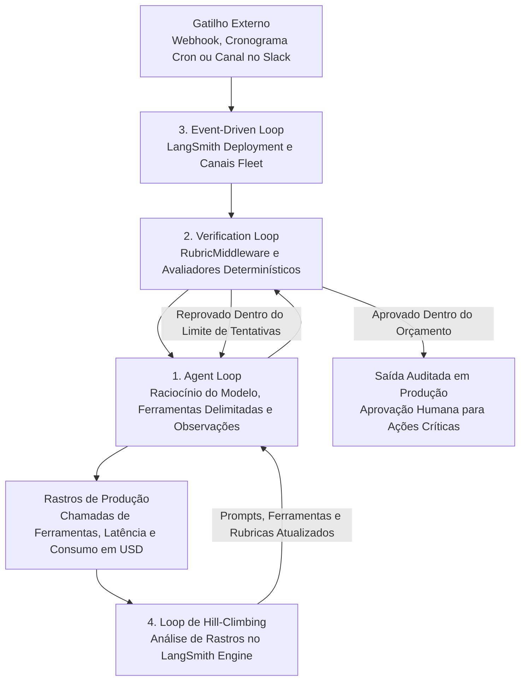
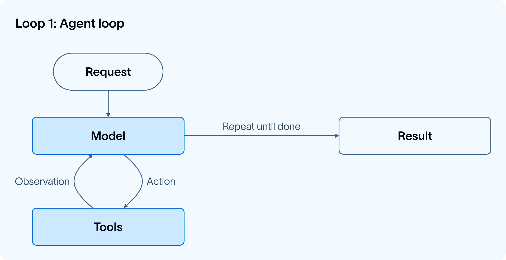
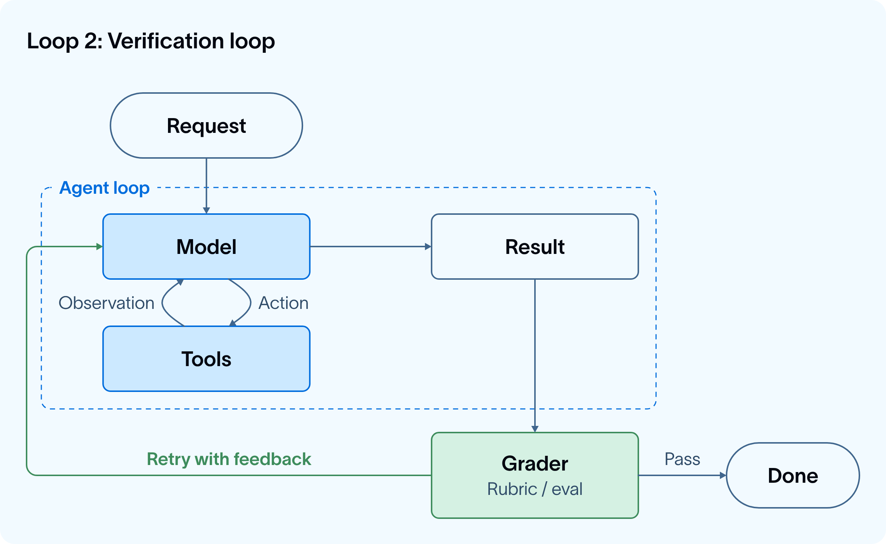

*Tempo de leitura: 7 minutos. Autor: Hugo S. Nascimento.*

<!-- more -->

*Contexto: A maioria dos pilotos corporativos de IA morre em homologação porque as equipes tratam um agente autônomo como um único prompt cercado por dezenas de ferramentas. Quando esse ciclo encontra dados sujos de ERP ou permissões ambíguas, a fatura em dólar dispara enquanto a precisão operacional desaba. Com base no estudo de engenharia da LangChain sobre loop engineering, apresento aqui como empilhar loops de execução, verificação, eventos e melhoria contínua para manter agentes previsíveis e rentáveis em produção.*

> **Resumo executivo para lideranças de tecnologia:** Entregar ferramentas a um modelo fundacional dentro de um ciclo sem limites automatiza falhas mais rápido do que automatiza trabalho. Operações confiáveis exigem **loop engineering**, uma arquitetura que empilha quatro circuitos de controle: um agent loop interno para executar tarefas, um verification loop com avaliadores determinísticos, um event-driven loop desacoplado de janelas síncronas de atendimento e um loop externo de hill-climbing que reescreve prompts, ferramentas e guardrails a partir de rastros reais de produção.

---

## Nota de diligência e especificações técnicas

Os padrões arquiteturais e primitivas descritos neste post seguem especificações técnicas oficiais e documentação aberta de engenharia:

* **Especificação de Loop Engineering da LangChain:** detalhando os quatro loops empilhados, `create_agent`, `RubricMiddleware`, `Fleet` e `LangSmith Engine`, publicada em <a href="https://www.langchain.com/blog/the-art-of-loop-engineering">The Art of Loop Engineering</a>, expandindo o conceito de loopcraft proposto por Swyx.
* **Especificação de orquestração com estado no LangGraph:** detalhando grafos cíclicos, limites rígidos de repetição e interrupções nativas para supervisão humana, disponível em <a href="https://langchain-ai.github.io/langgraph/">LangGraph Technical Documentation</a>.
* **Prática de engenharia LangGraph da hsnlabs:** arquitetura de implantação corporativa e governança de produção, disponível em <a href="https://hsnlabs.ai/langchain/">Engenharia de Produção LangChain e LangGraph da hsnlabs</a>.

---

## 1. Por que agentes de loop único queimam orçamento em produção

O algoritmo central de um agente de IA parece simples: entregar contexto ao modelo de linguagem, conectar ferramentas externas e deixá-lo agir em ciclo até concluir a solicitação.

Em demonstrações controladas, um único loop parece suficiente. Em ambientes corporativos brasileiros, onde a receita e o orçamento estão em BRL mas o consumo de tokens é faturado em USD, agentes de loop único falham de forma silenciosa e cara. Como documentamos em <a href="/blog/pt/post/agentes-ilimitados-maquinas-estados-finitos/">nossa auditoria de incidente de 42 chamadas em loop às 2 da manhã</a>, um modelo sem travas que esbarra em uma restrição quebrada de banco de dados passa a repetir tentativas inválidas indefinidamente. Sem camadas externas de verificação, teto de tentativas e leitura contínua de telemetria, a conta em dólar explode e o projeto termina enterrado no <a href="/blog/pt/post/cemiterio-de-pocs/">cemitério de PoCs corporativas</a>.

  
  Motor de grafos de estado testado em produção para delimitar transições, orçamentos de tokens e portões de verificação.

Transformar agentes em margem operacional exige tirar o foco exclusivo do texto do prompt e projetar o **harness** completo ao redor do modelo. Aplicar loop engineering significa orquestrar quatro loops concêntricos de controle.

---

## 2. A pilha de quatro loops no Loop Engineering

Uma arquitetura robusta construída sobre LangChain, LangGraph e LangSmith organiza o trabalho do agente em quatro camadas encadeadas. Cada loop externo aciona, audita ou aperfeiçoa os loops internos.

### Loop 1: o agent loop

Na camada mais interna, o agent loop permite que o modelo chame ferramentas repetidamente até encerrar a tarefa. Com a primitiva `create_agent` da LangChain, a equipe conecta um modelo a ferramentas reais de leitura de código, consulta de ERP ou edição de documentos.

No exemplo interno de documentação da própria LangChain, o Loop 1 recebe um pedido de ajuste, clona repositórios, lê arquivos, redige alterações e abre um pull request.

<figure class="article-editorial-figure">
  
  <figcaption class="editorial-caption">Diagrama oficial da LangChain para o Loop 1: o modelo alterna entre ações em ferramentas e observações até gerar um resultado candidato.</figcaption>
</figure>

O Loop 1 automatiza a execução, mas não garante qualidade nem previsibilidade financeira. Sozinho, o modelo pode encerrar o trabalho com links quebrados, alterar arquivos fora do escopo pedido ou consumir dezenas de milhares de tokens em tentativas repetidas sem progresso.

### Loop 2: o verification loop

Quando consistência pesa mais do que velocidade bruta, o Loop 2 envolve o agent loop com um **avaliador**. Em vez de aceitar a primeira resposta do modelo, o harness submete o resultado a uma rubrica explícita, combinando validações determinísticas em código ou avaliadores baseados em modelo. Na LangChain, esse padrão é implementado via `RubricMiddleware` ou por um hook `after_agent` sobre `create_agent`.

No agente de documentação citado pela LangChain, o avaliador testa automaticamente se todos os links resolvem, se as checagens de CI passaram e se o diff permanece estritamente dentro do que foi solicitado, interceptando falhas antes da revisão humana.

<figure class="article-editorial-figure">
  
  <figcaption class="editorial-caption">Diagrama oficial da LangChain para o Loop 2: o avaliador confere o resultado contra uma rubrica e devolve feedback estruturado quando a entrega falha.</figcaption>
</figure>

O compromisso arquitetural é direto: **adicionar verificação eleva a latência e o custo por execução**. Em produção, o Loop 2 exige limite máximo rígido de reenvios e condições claras de parada. Sem um teto explícito de tentativas, o ciclo de correção pode multiplicar a fatura em dólar em casos insolúveis e ainda estourar janelas curtas de resposta em canais como Slack ou WhatsApp.

### Loop 3: o event-driven loop

Um agente que depende de alguém abrir uma janela de chat e digitar comandos ainda é um protótipo isolado. O Loop 3 integra o agente verificado ao ecossistema da empresa para que ele rode em segundo plano a partir de eventos reais.

Um novo documento chega, uma rotina agendada dispara, um webhook é emitido pelo CRM ou uma mensagem surge em um canal dedicado do Slack como `#docs-plz`. O **LangSmith Deployment** sustenta essa camada com suporte nativo a agendamentos cron e webhooks, padrão próximo aos heartbeats populares no ecossistema `openclaw`, além dos canais e rotinas do **Fleet**.

Na realidade de operações brasileiras conectadas a webhooks do WhatsApp e integrações síncronas de Slack, mover o trabalho pesado para o event-driven loop é vital. O canal síncrono apenas reconhece o recebimento dentro do limite de segundos da API, enquanto o processamento com verificação roda de forma assíncrona em fila controlada, com chaves de idempotência e teto de gasto por evento.

### Loop 4: o loop de hill-climbing

Os três primeiros loops automatizam a entrega. O Loop 4 automatiza a **evolução contínua do sistema**.

Cada execução gera um rastro completo com decisões do modelo, chamadas de ferramentas, tempo de resposta, tokens consumidos e retorno do avaliador. O loop de hill-climbing executa um agente analítico, instrumentado no LangSmith pelo **LangSmith Engine**, sobre esse histórico de produção para detectar padrões recorrentes de falha. Quando múltiplos rastros apontam o mesmo gargalo, o sistema registra a ocorrência e propõe ajustes diretos no prompt, no contrato da ferramenta ou na própria rubrica.

O ponto decisivo dessa arquitetura é que a seta de retorno do Loop 4 entra no coração do Loop 1 e melhora a configuração do harness. Equipes que operam modelos abertos também podem direcionar esses resultados de rastros e avaliações para ajuste fino por aprendizado por reforço, além de aprimorar memória auxiliar e habilidades recuperadas em contexto. Em vez de pagar custos crescentes de inferência para contornar prompts frágeis, cada ciclo do Loop 4 reduz a taxa de retrabalho.

---

## 3. Matriz de referência da arquitetura de loops

Lideranças de tecnologia e finanças podem auditar qualquer iniciativa agêntica avaliando como cada um dos quatro loops está instrumentado e limitado:

| Camada do Loop | Função Operacional | Impacto em Custo e Qualidade | Primitiva LangChain | Trava Obrigatória em Produção |
| :--- | :--- | :--- | :--- | :--- |
| **1. Agent loop** | Modelo aciona ferramentas em sequência até concluir a tarefa | Automatiza o trabalho operacional básico | `create_agent` com qualquer modelo suportado | Teto rígido de passos e contratos tipados de argumentos |
| **2. Verification loop** | Avalia a saída contra uma rubrica e solicita correção com feedback | Impede erros silenciosos antes do sistema final | `RubricMiddleware` ou hook `after_agent` | Limite máximo de novas tentativas e checagens determinísticas prévias |
| **3. Event-driven loop** | Dispara execuções assíncronas via webhooks, cron ou canais | Escala operações sem depender de acionamento manual | `LangSmith Deployment` ou canais `Fleet` | Desacoplamento de timeouts de Slack e WhatsApp com alerta de gasto em USD |
| **4. Loop de hill-climbing** | Analisa rastros reais para aperfeiçoar prompts, ferramentas e rubricas | Reduz falhas recorrentes e desperdício de tokens ao longo do tempo | Agente de análise `LangSmith Engine` | Validação em suíte de regressão e revisão humana antes do deploy |

---

## 4. Onde a supervisão humana protege o capital

Empilhar quatro loops não elimina a necessidade de julgamento humano. Um avaliador automatizado confere se URLs existem e se contratos de dados foram respeitados, mas apenas especialistas experientes percebem quando o enquadramento comercial ou jurídico está errado para o público-alvo.

Na arquitetura LangChain, pontos de aprovação humana operam como cidadãos de primeira classe em todas as camadas:

| Camada do Loop | Ponto de Controle Humano | Exemplo Corporativo de Alto Risco |
| :--- | :--- | :--- |
| **Loop 1: agent loop** | Interrupção obrigatória antes de chamadas sensíveis | Bloquear baixas financeiras no ERP, transferências ou alterações em banco de produção até aprovação explícita |
| **Loop 2: verification loop** | Especialista atuando como avaliador da rubrica | Validar pareceres de crédito, decisões fiscais ou triagens sensíveis antes da liberação automática |
| **Loop 3: event-driven loop** | Conferência final antes da entrega ao usuário externo | Aprovar cobranças enviadas via WhatsApp ou comunicados regulatórios disparados por webhooks |
| **Loop 4: hill-climbing** | Revisão de engenharia antes da publicação do harness | Auditar alterações de prompts, ferramentas ou rubricas sugeridas pelos rastros contra casos de regressão |

A vantagem competitiva sustentável em IA corporativa não nasce da troca apressada de modelos fundacionais. Empresas que estruturam o Loop 3 e o Loop 4 desde cedo transformam exceções de produção em melhoria acumulada do próprio sistema, protegendo o orçamento em BRL contra queima descontrolada de tokens em dólar.

---

## Recursos estratégicos e leituras relacionadas
- <a href="https://www.langchain.com/blog/the-art-of-loop-engineering">Estudo original da LangChain: The Art of Loop Engineering</a>
- <a href="https://hsnlabs.ai/langchain/">Engenharia de Produção LangChain e LangGraph da hsnlabs</a>
- <a href="/blog/pt/post/agentes-ilimitados-maquinas-estados-finitos/">Estudo de caso: 42 chamadas em loop às 2 da manhã</a>
- <a href="/blog/pt/post/cemiterio-de-pocs/">Por que agentes falham: o cemitério de PoCs</a>
