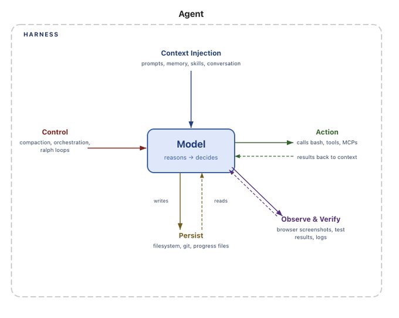
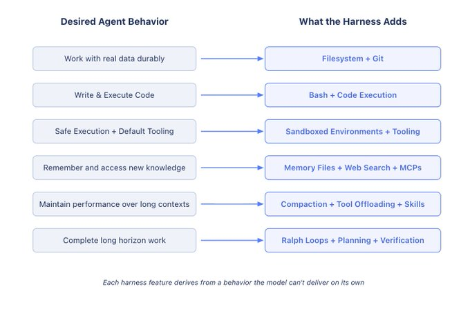
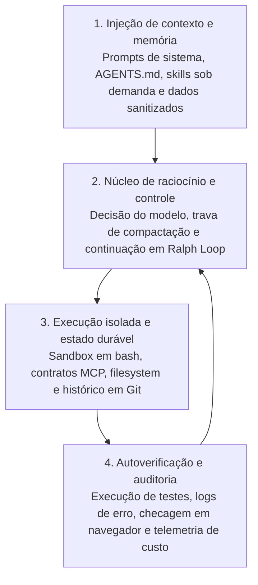

*Tempo de leitura: 9 minutos. Autor: Hugo S. Nascimento.*

<!-- more -->

*Contexto: A maior parte dos times de engenharia corporativa gasta noventa por cento da energia discutindo qual modelo de fronteira contratar e menos de dez por cento projetando o ambiente de execução que o envolve. Quando um piloto trava na homologação ou estoura o orçamento em dólar na produção, raramente a culpa é do modelo base. A peça ausente é o Agent Harness. Com base na análise arquitetural publicada pela LangChain e na nossa prática em produção na hsnlabs, este material detalha por que modelos puros falham sozinhos e como primitivas de harness transformam previsores de texto em motores confiáveis de trabalho.*

> **Resumo executivo para lideranças de tecnologia:** Um agente autônomo nunca é apenas um modelo de linguagem. Conforme formalizado pela LangChain, a equação real é Agente igual a Modelo mais Harness. O modelo entrega inteligência de raciocínio, enquanto o harness fornece todo o sistema determinístico ao redor: prompts, contratos de ferramentas, sistema de arquivos durável, sandboxes isoladas, compactação de contexto e travas de verificação. Trocar os pesos do modelo não corrige um harness frágil. No benchmark Terminal Bench 2.0, alterar apenas o harness elevou o mesmo modelo do Top 30 para o Top 5. Para CTOs e arquitetos corporativos, a engenharia de harness é a alavanca decisiva que separa pilotos estagnados de retorno real em produção.

---

## Nota de diligência e especificações técnicas

O modelo arquitetural, as primitivas comportamentais e as evidências de benchmark discutidos nesta análise seguem publicações técnicas primárias e especificações abertas de engenharia:

* **Estudo original da LangChain sobre Agent Harness:** taxonomia conceitual e derivação de primitivas detalhando a relação entre modelo e harness, combate ao context rot, Ralph Loops e resultados no Terminal Bench 2.0, disponível em <a href="https://www.langchain.com/blog/the-anatomy-of-an-agent-harness">The Anatomy of an Agent Harness no LangChain Blog</a>.
* **Biblioteca open-source Deep Agents:** implementação de referência construída sobre LangGraph com backends de filesystem, isolamento de subagentes, planejamento e compactação de contexto, disponível em <a href="https://github.com/langchain-ai/deepagents">Deep Agents no GitHub</a>.
* **Especificação de execução com estado em LangGraph:** grafos cíclicos duráveis, persistência de checkpoints e fluxo de controle determinístico, disponível em <a href="https://langchain-ai.github.io/langgraph/">LangGraph Technical Documentation</a>.
* **Prática de produção corporativa da hsnlabs:** especificações de referência para encapsular modelos fundacionais em máquinas de estado governadas e perímetros MCP, disponível em <a href="https://hsnlabs.ai/langchain/">Engenharia de produção LangChain e LangGraph da hsnlabs</a>.

---

## 1. O que é um Agent Harness e por que modelos puros falham

Em estado bruto, um modelo fundacional não é um agente. Ele funciona como uma função sem memória que recebe entradas em texto ou mídia e devolve texto. Sozinho, um modelo puro não consegue manter estado durável entre sessões, executar código contra uma API, consultar um banco corporativo em tempo real ou preparar um ambiente para testar a própria resposta.

Tudo o que existe em um sistema agêntico além dos pesos treinados do modelo faz parte do **harness**. Na prática de engenharia, o harness reúne cinco camadas operacionais:

1. **Prompts de sistema e políticas de entrada:** instruções de base, limites operacionais e regras de negócio injetadas antes da interação do usuário.
2. **Ferramentas, skills e contratos MCP:** schemas tipados de funções, servidores Model Context Protocol e descrições enxutas que definem como o modelo acessa sistemas externos.
3. **Infraestrutura embarcada de execução:** sistema de arquivos durável, sandboxes isoladas, acesso a shell e navegadores automatizados.
4. **Lógica de orquestração e roteamento:** criação de subagentes, roteamento entre modelos, transições de estado e protocolos de passagem de controle.
5. **Hooks determinísticos e middleware:** gatilhos automáticos de compactação, travas de continuação, checagens de lint e suítes de autoverificação.

<figure class="article-editorial-figure landscape">
  
  <figcaption class="editorial-caption">Anatomia de referência da LangChain: o modelo opera dentro do perímetro do harness, recebendo injeção de contexto e sinais de controle enquanto persiste estado, dispara ações em bash ou MCP e verifica logs e capturas de tela.</figcaption>
</figure>

Quando equipes corporativas ignoram a engenharia de harness e plugam um modelo diretamente em trinta funções dentro de um loop aberto, a falha em produção é estrutural. É exatamente essa lacuna que explica por que tantos projetos acabam enterrados no <a href="/blog/pt/post/cemiterio-de-pocs/">Cemitério de PoCs</a> ou disparam incidentes noturnos como <a href="/blog/pt/post/agentes-ilimitados-maquinas-estados-finitos/">quarenta e duas chamadas desgovernadas em loop às 2 da manhã</a>.

---

## 2. Engenharia reversa do comportamento desejado às primitivas

Uma boa arquitetura de harness nasce do comportamento operacional exigido pelo negócio, nunca do modismo de frameworks. Como demonstra o estudo da LangChain, cada primitiva de harness existe porque um modelo isolado não entrega determinada capacidade em produção.

<figure class="article-editorial-figure landscape">
  
  <figcaption class="editorial-caption">Engenharia reversa do comportamento desejado até as primitivas do harness, com base no estudo da LangChain: cada capacidade ausente no modelo puro exige infraestrutura durável.</figcaption>
</figure>

A tabela a seguir traduz a derivação comportamental da LangChain para os desafios reais da engenharia corporativa no Brasil:

| Comportamento desejado do agente | Primitiva adicionada pelo harness | Risco corporativo mitigado |
| :--- | :--- | :--- |
| **Operar dados reais com durabilidade** | Abstração de filesystem e versionamento em Git | Elimina perda de histórico entre sessões e garante trilha de auditoria com reversão |
| **Escrever e executar lógica sob demanda** | Shell bash e execução de código | Evita criar centenas de conectores rígidos e frágeis para cada tarefa operacional |
| **Executar com segurança e ferramentas padrão** | Sandboxes isoladas, listas de permissão e bloqueio de rede | Protege ERPs como TOTVS e SAP contra código não validado e vazamento sob a LGPD |
| **Lembrar regras e buscar dados atuais** | Arquivos de memória como AGENTS.md, busca web e MCPs | Supera a data de corte do treino e preserva aprendizados entre atendimentos |
| **Manter precisão em contextos extensos** | Compactação de histórico, offloading de ferramentas e skills | Contém o context rot em longos fluxos de webhooks do WhatsApp e faturas extensas |
| **Concluir missões de longo horizonte** | Ralph Loops, planos persistentes e hooks de teste | Impede encerramento precoce e evita desperdício de tokens em USD sobre receita em BRL |

### Filesystem e Git como memória durável de trabalho

Modelos só raciocinam sobre os tokens que cabem na janela de contexto ativa. Antes de o filesystem virar primitiva de primeira classe, engenheiros concatenavam documentos inteiros e respostas brutas no histórico do chat, estourando limites da API e multiplicando o custo por requisição.

Como os grandes modelos de linguagem foram treinados sobre bilhões de tokens de repositórios e fluxos em linha de comando, o filesystem funciona como uma superfície natural de trabalho. O agente lê especificações, descarrega resultados intermediários pesados fora do contexto principal, coordena tarefas paralelas com outros subagentes via arquivos compartilhados e usa o Git para versionar avanços ou reverter alterações inválidas.

### Bash, execução de código e sandboxes em ERPs

Codificar manualmente um conector REST para cada microvariação operacional cria dívida técnica imediata. Entregar bash e execução de código dentro de uma **sandbox isolada** permite que o agente escreva scripts temporários para cruzar planilhas fiscais, validar notas ou formatar cargas de integração.

Em operações corporativas com TOTVS, SAP ou bases financeiras, o isolamento é inegociável. Rodar código gerado por IA diretamente no servidor da aplicação expõe credenciais, variáveis de ambiente e dados pessoais protegidos pela LGPD. Um harness maduro sobe contêineres efêmeros com runtimes pré-instalados, comandos restritos em lista branca e isolamento de rede, destruindo o ambiente logo após a verificação.

### Memória persistente, busca e combate ao context rot

Os pesos de um modelo congelam na data em que o treinamento termina. Para ensinar políticas internas sem retreinar pesos, o harness injeta arquivos padrão de memória como `AGENTS.md` na inicialização da sessão, combinados com busca web e servidores MCP atualizados.

Mesmo em janelas amplas, o **context rot** degrada a capacidade de decisão conforme o histórico acumula ruído. Em operações brasileiras que recebem longas sequências de webhooks do WhatsApp ou retornos extensos de APIs legadas, a janela enche rápido e a acurácia despenca enquanto a fatura em dólar sobe contra margens em real. O harness combate essa degradação com três defesas determinísticas:

1. **Compactação de contexto:** resume turnos antigos e descarrega memória histórica antes de a janela atingir saturação ou erro de API.
2. **Offloading de saídas de ferramentas:** mantém apenas o início e o fim de respostas volumosas no contexto ativo e grava o conteúdo completo no filesystem para consulta pontual.
3. **Carregamento progressivo de skills:** injeta apenas metadados leves na partida em vez de carregar dezenas de schemas MCP completos logo no primeiro passo.

### Execução de longo horizonte e Ralph Loops

Tarefas extensas revelam duas falhas crônicas dos modelos atuais: a **parada precoce**, quando o modelo declara conclusão na metade do trabalho, e a **perda de coerência** quando a execução cruza múltiplas janelas de contexto.

A LangChain destaca o padrão **Ralph Loop** como mecanismo central para missões longas. Um hook do harness intercepta a tentativa de saída do modelo, verifica o critério objetivo de término e reinjeta o objetivo original em uma janela limpa, lendo o progresso gravado no filesystem e no Git. Somado a arquivos explícitos de planejamento e suítes automáticas de teste, o agente só encerra o ciclo quando a verificação determinística confirma o resultado.

---

## 3. Co-evolução com modelos e por que o harness vence benchmarks

Produtos modernos de engenharia como Claude Code e Codex passam por pós-treinamento com o próprio harness dentro do laço de aprendizado. Essa co-evolução ensina os modelos a operar filesystems, executar bash, seguir planos e delegar trabalho a subagentes em paralelo.

Esse acoplamento, porém, gera um efeito colateral curioso: o **sobreajuste ao harness**. Alterar uma convenção simples de ferramenta, como o formato do comando de edição de arquivos descrito nos guias do Codex-5.3, pode derrubar o desempenho prático mesmo mantendo o mesmo modelo base.

Na prática, o harness padrão do fornecedor raramente é o melhor para o seu caso corporativo. No ranking público **Terminal Bench 2.0**, exatamente os mesmos pesos do Opus 4.6 obtiveram pontuações muito distantes conforme o harness ao redor. A própria LangChain demonstrou como subiu seu agente de codificação do **Top 30 para o Top 5** no Terminal Bench 2.0 alterando exclusivamente a arquitetura do harness, sem tocar nos pesos do modelo.

  
  Biblioteca open-source de harness sobre LangGraph para planejamento durável, estado em filesystem, isolamento de subagentes e compactação de contexto.

A pesquisa atual da LangChain na biblioteca aberta **Deep Agents**, construída sobre **LangGraph**, avança sobre três frentes críticas: orquestrar centenas de agentes em paralelo sobre a mesma base de código, criar agentes que auditam seus próprios rastros de execução para corrigir falhas do harness e montar ferramentas e contexto sob demanda no exato instante da tarefa.

---

## 4. Implantando um Agent Harness corporativo em 4 camadas

Com a evolução dos modelos fundacionais, parte das rotinas básicas de planejamento e autocorreção tende a ser absorvida pelos próprios pesos. Ainda assim, sistemas empresariais continuarão exigindo perímetros rígidos de engenharia. Nenhuma operação financeira ou de atendimento pode depender da boa vontade probabilística de um loop solto de prompt.

Na hsnlabs, estruturamos o harness de produção sobre máquinas de estado em LangGraph dividindo responsabilidades em quatro camadas verificáveis:

| Camada do harness | Responsabilidade determinística | Garantia operacional em produção |
| :--- | :--- | :--- |
| **Perímetro de contexto** | Carregamento progressivo de skills, arquivo `AGENTS.md` e sanitização para LGPD | Controla o consumo de tokens em dólar e evita poluição inicial de prompt |
| **Controle de estado** | Máquinas de estado finito em LangGraph, gatilhos de compactação e Ralph Loops | Bloqueia encerramentos prematuros e trava espirais infinitas de retentativas |
| **Sandbox de execução** | Contêineres efêmeros, shell restrito e contratos MCP validados em Pydantic v2 | Protege bancos de ERP como TOTVS e SAP contra mutações fora de esquema |
| **Laço de verificação** | Suítes automáticas de teste, checagem de logs, capturas visuais e rastros no LangSmith | Converte propostas estocásticas em ações auditadas e reversíveis |

Se a sua equipe de tecnologia ainda culpa o modelo de linguagem por falhas intermitentes em produção, a auditoria precisa começar pela camada de contorno. O modelo carrega a inteligência bruta; o Agent Harness é o sistema de engenharia que torna essa inteligência previsível, auditável e economicamente viável.

---

## Recursos estratégicos e leituras relacionadas
- <a href="https://hsnlabs.ai/langchain/">Engenharia de produção LangChain e LangGraph da hsnlabs</a>
- <a href="https://www.langchain.com/blog/the-anatomy-of-an-agent-harness">LangChain: The Anatomy of an Agent Harness</a>
- <a href="/blog/pt/post/cemiterio-de-pocs/">O Cemitério de PoCs: por que 90% dos pilotos corporativos colapsam em dados sujos</a>
- <a href="/blog/pt/post/agentes-ilimitados-maquinas-estados-finitos/">Estudo de caso: 42 chamadas em loop às 2 da manhã e máquinas de estados finitos</a>
- <a href="/blog/pt/post/arquitetura-agentes-braintrust-evals-cicd-langgraph/">Braintrust Evals e LangGraph: substituindo testes manuais por CI/CD determinístico</a>
