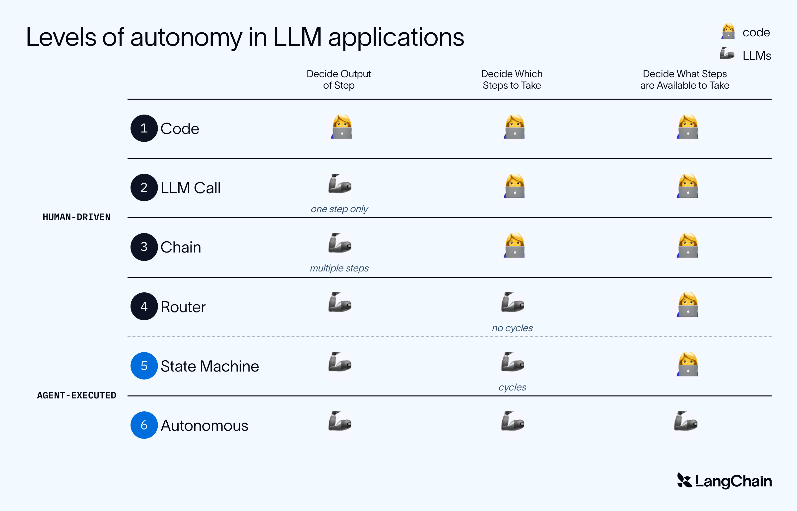
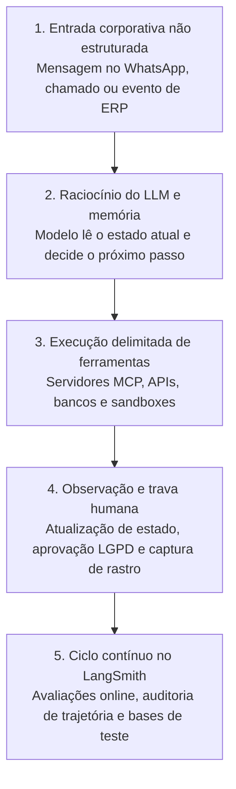
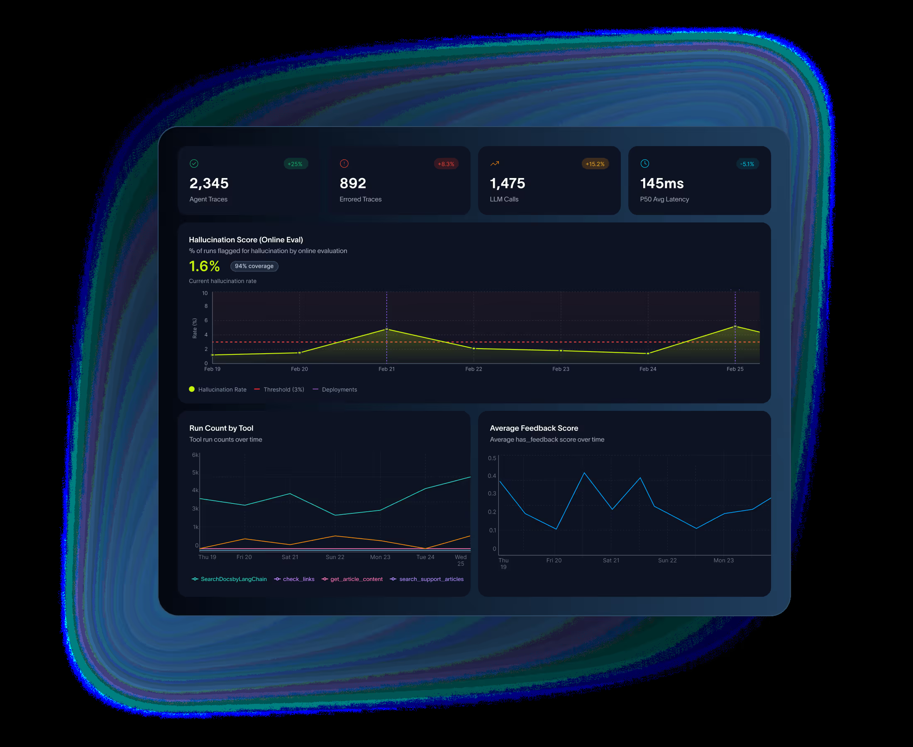

*Tempo de leitura: 7 minutos. Autor: Hugo S. Nascimento.*

<!-- more -->

*Contexto: Lideranças de tecnologia no Brasil enfrentam uma enxurrada de fornecedores vendendo interfaces simples de chat no WhatsApp ou portais internos como se fossem agentes autônomos. Com base no guia de referência da LangChain sobre sistemas agênticos em produção e na nossa prática de arquitetura na hsnlabs, detalho aqui o que define tecnicamente um agente, os seis níveis de autonomia e a infraestrutura exigida para substituir processos manuais e contratos de BPO sem comprometer a operação.*

> **Resumo executivo para lideranças de tecnologia:** Um agente de IA não é um chatbot conectado a PDFs. Na engenharia de software, trata-se de um sistema que utiliza um modelo de linguagem para decidir o fluxo de controle da aplicação em tempo de execução. Transferir decisões de fluxo para modelos probabilísticos sem governança gera falhas silenciosas em ERPs e riscos diretos à LGPD. Empresas superam o cemitério de pilotos escolhendo o menor nível de autonomia necessário, ancorando ações em máquinas de estado delimitadas e instrumentando cada execução com observabilidade contínua.

---

## Nota de diligência e especificações técnicas

As definições conceituais, a escala de autonomia e os dados de mercado apresentados neste post baseiam-se em documentação técnica oficial e estudos primários do setor:

* **Estudo original da LangChain:** análise "What is an AI agent?" sobre posse do fluxo de controle, espectro de autonomia em seis níveis, ciclo de vida de desenvolvimento de agentes e telemetria em produção, disponível em <a href="https://www.langchain.com/blog/what-is-an-agent">LangChain Blog: What Is an AI Agent</a>.
* **Documentação de engenharia LangChain e LangGraph:** especificações de orquestração com estado e ferramentas tipadas para ambientes corporativos, disponível em <a href="https://www.langchain.com/">LangChain Platform Documentation</a>.
* **Prática LangChain e LangGraph da hsnlabs:** arquitetura de referência para agentes em produção e observabilidade aplicada a empresas brasileiras, disponível em <a href="https://hsnlabs.ai/langchain/">Engenharia LangChain e LangGraph da hsnlabs</a>.

  
  Arquitetura de agentes em produção unindo fluxo de controle decidido por LLM, máquinas de estado em LangGraph e observabilidade contínua no LangSmith.

---

## 1. O que são agentes de IA na engenharia de software

O termo muda conforme quem o pronuncia. Fornecedores comerciais usam a palavra agente para qualquer chatbot de atendimento, enquanto pesquisadores acadêmicos descrevem sistemas totalmente independentes. Após quatro anos colocando sistemas em operação real, a LangChain estabeleceu uma definição objetiva: **um agente de IA é um sistema que usa um grande modelo de linguagem para decidir o fluxo de controle de uma aplicação.**

A Anthropic adota uma formulação complementar: agentes são sistemas nos quais modelos de linguagem conduzem dinamicamente seus próprios processos e o uso de ferramentas, mantendo o controle sobre como concluir a tarefa. Para arquitetos e CTOs, o critério é direto: o agente começa no momento em que o modelo escolhe qual será o próximo passo, em vez de apenas gerar texto dentro de uma sequência fixa programada pelo time de desenvolvimento.

É exatamente por isso que assistentes conversacionais raramente reduzem centros de custo. Como mostramos na análise sobre a <a href="/blog/pt/post/chatbot-vs-agente/">diferença entre chatbot e agente corporativo</a>, responder dúvidas em texto sobre políticas internas não elimina trabalho operacional. Para justificar o cancelamento de um contrato de BPO ou desafogar equipes presas a telas de ERP, o software precisa interpretar entradas não estruturadas, consultar bases reais e executar transações auditáveis.

---

## 2. Os seis níveis de autonomia entre fluxos e máquinas de estado

Debater se determinada aplicação merece o rótulo de agente desperdiça tempo de diretoria. A indústria automotiva resolveu esse impasse ao adotar a escala numerada de direção autônoma, permitindo que engenheiros discutam requisitos técnicos de cada nível em vez de semântica comercial. Na inteligência artificial corporativa, a mesma clareza vem de enxergar a **autonomia como um espectro**.

A matriz publicada pela LangChain organiza seis níveis de autonomia conforme quem controla três decisões críticas: quem define a saída de cada etapa, quem decide qual etapa vem a seguir e quem determina o conjunto de etapas disponíveis.

<figure class="article-editorial-figure">
  
  <figcaption class="editorial-caption">Seis níveis de autonomia em aplicações com LLM, estudo publicado pela LangChain, detalhando quem controla a saída da etapa, a próxima transição e as ações disponíveis.</figcaption>
</figure>

À medida que o modelo assume mais decisões, o sistema migra de fluxos conduzidos por código humano para ciclos executados pelo próprio agente:

| Nível de autonomia | Saída da etapa | Próxima etapa | Ações disponíveis | Uso recomendado na empresa |
| :--- | :--- | :--- | :--- | :--- |
| **1. Código determinístico** | Código | Código | Código | Cálculos fiscais, conciliação contábil exata e travas de conformidade |
| **2. Chamada única de LLM** | LLM em passo único | Código | Código | Classificação de chamados, extração de campos de notas e triagem inicial |
| **3. Cadeia sequencial** | LLM em múltiplos passos | Código | Código | Resumos estruturados, tradução técnica e enriquecimento de cadastros |
| **4. Roteador** | LLM | LLM sem ciclos | Código | Triagem de atendimento via WhatsApp direcionando para fluxos especialistas |
| **5. Máquina de estados** | LLM | LLM com ciclos | Código | Operações corporativas em LangGraph integradas a SAP, Totvs e CRMs |
| **6. Agente autônomo** | LLM | LLM com ciclos | LLM cria ações | Pesquisa aberta ou síntese de código em que o agente constrói novas ferramentas |

O erro mais frequente em projetos brasileiros ocorre nos dois extremos dessa régua. Colocar um agente de nível seis para validar pedidos de compra em ERP injeta imprevisibilidade onde bastava código determinístico. Por outro lado, tentar resolver negociações de cobrança ou exceções logísticas com cadeias rígidas de nível três faz o fluxo quebrar na primeira mensagem fora do padrão.

Na prática corporativa, a arquitetura vencedora combina os dois mundos: código determinístico para regras de negócio, limites financeiros e escrita em banco, e controle de fluxo pelo LLM apenas onde há interpretação ambígua ou decisão dinâmica de rota.

---

## 3. Por dentro do ciclo do agente em operação

Todo agente executa um modelo de linguagem dentro de um ciclo contínuo de percepção e ação. A cada iteração, ele lê o estado atual, escolhe uma ação, aciona uma ferramenta externa, observa o retorno, atualiza sua memória e decide se precisa de outro ciclo ou se concluiu a tarefa.

Quatro componentes sustentam essa engrenagem:

| Componente | Papel na arquitetura | Exemplos em operação corporativa |
| :--- | :--- | :--- |
| **Modelo** | Avalia o estado atual e escolhe a próxima ação | Modelos de fronteira com forte raciocínio lógico e chamada estruturada de ferramentas |
| **Ferramentas** | Leem informações externas e executam ações em sistemas | APIs corporativas, réplicas de leitura, execução isolada de código, busca e servidores MCP |
| **Memória** | Preserva contexto entre turnos e tarefas longas | Histórico de atendimento, bancos de estado persistentes e arquivos de instruções |
| **Ciclo de execução** | Sequencia percepção, raciocínio, ação, observação e atualização | Padrões ReAct, Reflexion, planejamento com execução e grafos supervisor e executor |

---

## 4. Quando realmente construir um agente

Orquestração agêntica cobra preço em latência, consumo de tokens e complexidade de depuração. Em tarefas previsíveis de consulta ou extração, um fluxo determinístico ou um bom sistema de busca entrega maior precisão com menor custo operacional.

As recomendações práticas da LangChain convergem com os critérios que aplicamos na hsnlabs antes de desenhar qualquer sistema:

1. **Comece com um único agente e engenharia de prompt rigorosa:** um modelo bem instruído com um conjunto enxuto de ferramentas bem tipadas resolve a maior parte dos processos sem multiplicar nós de decisão.
2. **Adicione ferramentas antes de adicionar agentes:** se falta capacidade operacional, exponha uma nova ferramenta ou contrato MCP em vez de dividir o raciocínio entre vários subagentes.
3. **Adote arquitetura multiagente apenas diante de gargalos reais:** migre para roteadores ou subagentes somente quando houver estouro de janela de contexto, excesso de ferramentas ou fronteiras claras de alçada entre áreas. Como analisamos no <a href="/blog/pt/post/estudo-caso-latam-airlines/">estudo de caso da LATAM Airlines em produção</a>, centralizar a formatação final sob um nó supervisor eliminou quinze por cento de sobrecusto em tokens e latência e derrubou falhas de roteamento para um por cento.
4. **Priorize recuperação de dados antes do raciocínio:** em operações orientadas a normas e catálogos, uma camada sólida de busca supera longas cadeias de inferência.
5. **Não delegue julgamentos que sua equipe não sabe avaliar:** se os especialistas internos não conseguem definir objetivamente o que é uma resposta correta, o agente tampouco acertará com consistência.

---

## 5. Ciclo de vida, aprovação humana sob a LGPD e qualidade

Colocar um agente no ar marca apenas o início da operação. O ciclo de desenvolvimento de agentes da LangChain conecta quatro fases em circuito fechado: construir, testar, publicar e monitorar. Rastros capturados em produção voltam como casos de teste para a versão seguinte, garantindo que correções não introduzam regressões silenciosas.

### Avaliações online, avaliações offline e auditoria de trajetória

* **Avaliações online:** rodam sobre amostras de rastros reais em produção para detectar quedas repentinas de qualidade, picos de alucinação ou falhas em integrações com ERPs. Funcionam como painel de alarme, não como gabarito absoluto.
* **Avaliações offline:** executam contra bases curadas de referência antes de cada publicação para provar se alterações de prompt, troca de modelo ou ajustes no grafo realmente melhoraram o resultado.
* **Calibração de juízes baseados em LLM:** usar modelos avaliadores permite escalar inspeções sobre milhares de atendimentos, desde que suas notas sejam calibradas manualmente contra rastros reais e combinadas com asserções determinísticas em código para regras financeiras e regulatórias.
* **Avaliação de trajetória:** em sistemas multiagente ou com várias chamadas de API, olhar apenas a resposta final ao cliente esconde erros graves no meio do caminho. A auditoria de trajetória verifica se o agente escolheu o subagente correto, na ordem certa e sem chamadas redundantes.

### Supervisão humana alinhada à LGPD e governança financeira

Em operações brasileiras sujeitas à LGPD, alçadas de crédito, estornos financeiros ou alteração de dados cadastrais sensíveis exigem travas explícitas de aprovação humana. A máquina de estados pausa antes da ação irreversível para que um analista aprove, ajuste parâmetros ou rejeite a execução. O ganho estrutural aparece quando cada correção feita pelo especialista na fila de revisão passa a integrar a base permanente de testes, tornando as versões seguintes mais precisas sem condenar a equipe a aprovar cem por cento das tarefas rotineiras.

---

## 6. Da experimentação à escala corporativa sem perder o controle

Os números globais mostram onde a maioria das iniciativas trava. Levantamento da McKinsey de novembro de 2025 apontou que **62 por cento** das empresas já experimentam agentes de IA, mas **não mais que 10 por cento** conseguiram escalar a tecnologia em alguma área de negócio. Na mesma linha, o Gartner projeta que **mais de 40 por cento** dos projetos de IA agêntica serão cancelados até o fim de 2027 por escalada de custos, valor de negócio pouco claro ou controles inadequados de risco.

Sair do piloto e capturar margem real em substituição a operações manuais e contratos de BPO exige infraestrutura de engenharia ao redor do modelo desde o primeiro dia:

<figure class="article-editorial-figure">
  
  <figcaption class="editorial-caption">Painel de observabilidade em produção no LangSmith monitorando volume de rastros, falhas de execução, taxa de alucinação online frente ao limite de alerta, chamadas por ferramenta e pontuação média de feedback.</figcaption>
</figure>

* **Observabilidade completa desde o dia zero:** registre cada rastro, chamada de ferramenta, latência e consumo de tokens em plataformas independentes de framework como o LangSmith, compatível com LangChain, LangGraph, Deep Agents e arquiteturas proprietárias.
* **Execução isolada em sandboxes:** qualquer código gerado dinamicamente por agentes deve rodar em ambientes segregados, como o LangSmith Sandboxes, impedindo acesso direto à infraestrutura crítica da empresa.
* **Controles de autenticação e permissão por usuário:** implantações corporativas precisam respeitar identidade e escopo de acesso, como no modelo do LangSmith Deployment, garantindo que um agente jamais consulte registros acima da alçada do usuário solicitante.

Comece pelo nível mais simples da escala de autonomia capaz de destravar o gargalo operacional, capture rastros reais antes do primeiro usuário externo interagir com o sistema e amplie a autonomia somente à medida que sua cobertura de avaliações comprovar estabilidade.

---

## Recursos estratégicos e leituras relacionadas
- <a href="https://hsnlabs.ai/langchain/">Engenharia de produção LangChain e LangGraph da hsnlabs</a>
- <a href="/blog/pt/post/chatbot-vs-agente/">Chatbot vs agente: por que substituir BPOs exige ontologias em produção</a>
- <a href="/blog/pt/post/estudo-caso-latam-airlines/">LATAM Airlines: agentes em produção com margem de 3 por cento</a>
- <a href="/blog/pt/post/arquitetura-agentes-braintrust-evals-cicd-langgraph/">Braintrust Evals e LangGraph: substituindo testes manuais por CI/CD determinístico</a>
- <a href="/blog/pt/post/cemiterio-de-pocs/">Por que agentes falham: o cemitério de PoCs</a>
