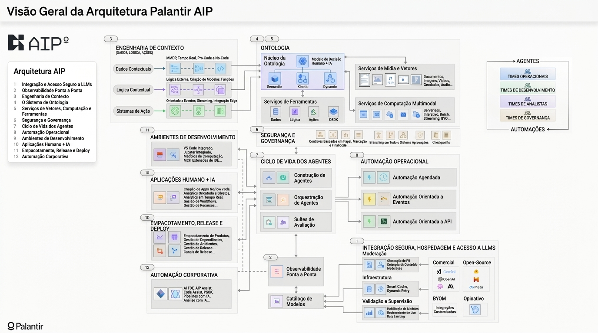

*Tempo de leitura: 7 minutos. Autor: Hugo S. Nascimento.*

<!-- more -->

*Contexto: Projetos de IA corporativa sofrem com uma taxa de mortalidade de 85 por cento entre o piloto e a produção porque integradores conectam modelos de linguagem diretamente a bancos de dados brutos. A Palantir inverteu essa dinâmica com o AIP Bootcamp ao vincular modelos a uma Ontologia Operacional. Analisamos aqui como essa arquitetura funciona na prática e como a hsnlabs entrega o equivalente em código aberto em cinco dias sem aprisionamento de plataforma.*

> **Resumo Executivo para Lideranças de Tecnologia:** Conectar modelos generativos diretamente a tabelas SQL ou índices vetoriais causa deriva de schema, quebra de invariantes contábeis e mutações destrutivas em bancos de produção. A Palantir resolveu esse problema ancorando sua plataforma em uma Ontologia Operacional — uma camada de software composta por objetos tipados, propriedades validadas e ações transacionais — e comprovando valor em bootcamps práticos de 5 dias. Para empresas no Brasil e na América Latina que buscam essa mesma velocidade empírica de 5 dias sem assinar contratos plurianuais milionários do Palantir Foundry e sem depender de longos estudos teóricos de Big 4, o Bootcamp de Arquitetura Agêntica de 5 Dias da hsnlabs constrói uma ontologia operacional aberta em Python, Pydantic, LangGraph e MCP diretamente sobre o seu ambiente SAP, TOTVS ou Oracle.

---

## Nota de Diligência e Fontes Públicas

Os diagramas arquiteturais, métricas operacionais clínicas e declarações regulatórias citados neste artigo foram verificados em fontes públicas primárias:

* **Relatórios Anuais Form 10-K da Palantir Technologies Inc. arquivados na SEC:** documentando a criação e a mecânica de aquisição de clientes via AIP Bootcamps, disponível em <a href="https://www.sec.gov/Archives/edgar/data/1321655/000132165526000011/pltr-20251231.htm">SEC EDGAR Palantir 10-K</a>.
* **Documentação Oficial do Palantir AIP Bootcamp e Ontologia Operacional:** visão técnica da arquitetura de objetos e ações, disponível em <a href="https://www.palantir.com/platforms/aip/bootcamp">Palantir AIP Bootcamp</a> e <a href="https://www.palantir.com/platforms/foundry/ontology">Palantir Foundry Ontology</a>.
* **Estudo de Caso Clínico do Tampa General Hospital:** métricas auditadas de alocação de leitos e escalas de enfermagem, disponível em <a href="https://www.palantir.com/impact/tampa-general-hospital">Tampa General Hospital Case Study</a>.

---

## 1. A Falha Central: Conectar Modelos a Dados Brutos sem uma Ontologia

O software corporativo de IA falha quando empresas contratam consultorias tradicionais de TI para construir chatbots. Os integradores passam seis meses produzindo apresentações de PowerPoint e conectando grandes modelos de linguagem diretamente a bancos SQL ou índices de busca vetorial.

No instante em que um modelo autônomo toca um livro contábil de produção, ele alucina uma chave estrangeira inválida, executa uma transação fora de alçada e derruba a operação. A diretoria congela o orçamento e cancela a iniciativa.

Essa arquitetura ponto a ponto entra em colapso no ambiente corporativo por três razões matemáticas:

1. **Deriva Semântica de Schemas:** Bancos de dados legados são caóticos. Colunas chamadas `STATUS_CD_04` ou `VNDR_BAL_NET` carregam décadas de conhecimento tribal que a janela de contexto de um modelo não consegue decifrar com segurança.
2. **Ausência de Invariantes Transacionais:** Um modelo fundacional bruto não possui noção nativa de partidas dobradas, prazos regulatórios de retenção fiscal ou limites de conformidade médica.
3. **Execução Ilimitada de Ações:** Conceder a um modelo probabilístico permissão aberta de escrita sobre um banco de ERP garante corrupção de dados operacionais.

A Palantir não conecta modelos de linguagem a tabelas brutas. A Palantir vincula modelos a uma **Ontologia Operacional**:

- **Objetos:** Entidades reais do negócio, como pacientes, leitos hospitalares, pedidos de compra ou contêineres marítimos.
- **Propriedades:** Atributos verificados extraídos de múltiplos sistemas de registro.
- **Ações:** Transições de estado em nível de código e APIs que impõem regras de negócio e controles de autorização antes que qualquer alteração ocorra no banco de dados.

Quando um agente de IA opera através de uma ontologia, o modelo jamais escreve comandos diretos de banco. Ele seleciona ações tipadas e delimitadas, governadas por regras determinísticas estritas.

<figure class="article-editorial-figure">
  
  <figcaption class="editorial-caption">Diagrama oficial da arquitetura Palantir AIP traduzido para português: conexão de dados, ontologia de negócio e ações autônomas sob governança estrita.</figcaption>
</figure>

---

## 2. Tampa General Hospital: Redução de 83 Por Cento no Atraso de Alocação de Leitos

O impacto de vincular modelos autônomos a uma ontologia operacional fica evidente em setores altamente regulados como a saúde hospitalar.

O Tampa General Hospital opera mais de 1.000 leitos de alta complexidade. Em uma operação hospitalar tradicional, gerenciar admissões de pacientes e alocação de leitos exige que coordenadores de enfermagem gastem horas a cada plantão cruzando planilhas desconectadas e fazendo ligações manuais entre alas clínicas.

O hospital implementou o Palantir Foundry e o AIP para integrar escalas de enfermagem, telemetria de prontuários eletrônicos e calendários cirúrgicos em uma ontologia hospitalar unificada.

Os resultados auditados demonstram a diferença entre assistentes conversacionais e uma arquitetura de agentes baseada em ontologia:

- **83 por cento de redução no tempo gasto gerenciando a alocação de pacientes.**
- **28 por cento de redução no tempo de retenção de pacientes na recuperação pós-anestésica.**
- **30 por cento de melhoria na proporção de dimensionamento da equipe de enfermagem.**

O agente não inventa diagnósticos médicos. Ele monitora admissões em tempo real contra invariantes de capacidade de leitos, prevê gargalos de transferência e roteia filas cirúrgicas diretamente para os decisores clínicos.

---

## 3. Por Que o Bootcamp de 5 Dias Elimina o Risco de CapEx Corporativo

Em seus relatórios anuais Form 10-K arquivados na SEC, a Palantir documentou explicitamente o objetivo estratégico do seu modelo de entrada via bootcamps:

> "A partir de 2023, introduzimos os bootcamps do AIP nos estágios iniciais do nosso processo de aquisição de clientes, o que ajudou a acelerar essas discussões e proporcionou uma oportunidade para que nossos clientes experimentassem nossas plataformas em seus próprios casos de uso em questão de dias."

O modelo tradicional de compras corporativas de TI está quebrado porque grandes consultorias como Accenture, EY e PwC cobram centenas de milhares de reais em contratos por hora técnica apenas para produzir diagnósticos teóricos em slides.

Ao entregar fluxos funcionais sobre os dados reais do cliente em 120 horas, o comprador econômico avalia software funcionando em vez de promessas comerciais.

---

## 4. Matriz Comparativa: Palantir AIP Bootcamp vs Discovery de Big 4 vs Bootcamp hsnlabs

Embora a Palantir tenha comprovado o modelo empírico de 5 dias, seu bootcamp foi desenhado como funil para travar a empresa em uma assinatura multimilionária da plataforma proprietária Foundry.

Veja como o **Bootcamp de Arquitetura Agêntica de 5 Dias da hsnlabs** se compara ao **Palantir AIP Bootcamp** e aos **Estudos de Discovery de Big 4**:

| Critério de Avaliação Executiva | Discovery Tradicional de Big 4 - McKinsey, Accenture, EY | Palantir AIP Bootcamp | Bootcamp de Arquitetura Agêntica de 5 Dias - hsnlabs |
| :--- | :--- | :--- | :--- |
| **Tempo até Prova Funcional** | 60 a 90 dias de entrevistas com gestores — entrega zero código executável | 1 a 5 dias de engenharia intensiva sobre dados de amostra ou homologação | 5 dias de Forward Deployed Engineering conectado ao seu ambiente isolado de homologação |
| **Entregável Principal** | Apresentação de 120 slides de PowerPoint e mapa estratégico teórico | Protótipo funcional fechado dentro da plataforma proprietária Palantir Foundry e AIP | Protótipo multiagente funcional em código puro, modelo auditado de ROI e blueprint de produção ADLC |
| **Stack Tecnológica Base** | Diagramas conceituais; frequentemente enviesados para o parceiro de nuvem da consultoria | Ontologia proprietária do Foundry, construtor visual Workshop e runtime fechado AIP | Stack corporativa aberta: Python, Pydantic v2, LangGraph, PostgreSQL ou Neo4j e Model Context Protocol |
| **Compromisso Comercial Pós-Bootcamp** | Alocação multimilionária de squads terceirizadas cobradas por hora técnica | Assinatura corporativa plurianual em dólar na casa dos sete dígitos anuais | 100 por cento do valor do bootcamp é abatido como crédito no contrato de implementação; zero taxa de licença |
| **Propriedade Intelectual e Código** | Propriedade restrita a slides; nenhum ativo de software transferido | Portabilidade zero; sair da Palantir destrói toda a ontologia e os fluxos construídos | 100 por cento de propriedade intelectual do cliente desde o Dia 1; roda na sua própria conta AWS, GCP ou Azure |
| **Prontidão para ERPs no Brasil** | Exige meses de especificação de middlewares customizados | Projetado prioritariamente para suítes globais americanas e europeias | Padrões MCP pré-construídos para SAP, TOTVS Protheus, Senior, Oracle e APIs legadas locais |

---

## 5. Construindo a Ontologia Operacional sem Aprisionamento Tecnológico

Empresas de médio e grande porte no Brasil e na América Latina não precisam de licenças de milhões de dólares para alcançar confiabilidade de agentes em produção.

Na hsnlabs, executamos o mesmo blueprint de engenharia orientada a ontologia utilizando arquitetura corporativa aberta:

1. **Mapeamento da Ontologia de Domínio:** Engenharia reversa de bancos corporativos em contratos de dados Pydantic e relações em grafos.
2. **Perímetros Determinísticos de Estado:** Encapsulamento de grafos de raciocínio autônomo em máquinas formais de estados finitos no LangGraph.
3. **Sprint de Arquitetura de Cinco Dias:** Implantação de um protótipo funcional em homologação sobre dados reais para comprovar o retorno unitário antes do deploy em produção.

Se você conectar modelos de linguagem a dados brutos sem uma ontologia operacional estrita, seus agentes falharão em produção. Ao vincular agentes autônomos a travas em nível de código e objetos tipados de negócio, você elimina alucinações e destrava escala operacional real.

---

## Recursos Estrategicos e Posts Relacionados
- <a href="/blog/pt/post/como-construir-ontologia-enterprise-do-zero/">Como Construir uma Ontologia Enterprise do Zero: Passo a Passo</a>
- <a href="/blog/pt/post/isolamento-perimetro-mcp-contratos-dados/">Como Protegemos Bancos de Dados Enterprise de Agentes de IA</a>
- <a href="/blog/pt/post/sistemas-legados-motor-execucao/">Sistemas Transacionais Legados Nao Vao Morrer: Eles Sao o Motor</a>
- <a href="https://hsnlabs.ai/pt/bootcamp/">Aplicar para o Bootcamp de Agentes Enterprise de 5 Dias da hsnlabs</a>
