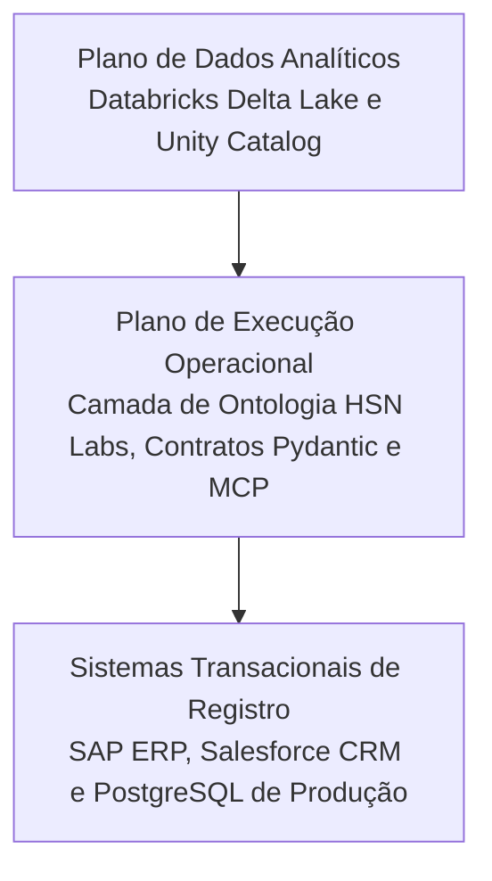

*Tempo de leitura: 7 minutos. Autor: Hugo S. Nascimento.*

<!-- more -->

*Contexto: No mercado de dados, a Databricks e a Snowflake dominam o armazenamento e o treinamento analítico em escala. Mas quando corporações tentam usar Lakehouses diretamente para alimentar agentes que executam ações transacionais no mundo real, o modelo entra em colapso. Analisamos aqui as causas técnicas dessa falha, por que a Palantir construiu uma ontologia operacional e como a HSN Labs implementa a arquitetura híbrida em código aberto.*

> **Resumo Executivo para Lideranças de Tecnologia:** Plataformas como Databricks e Snowflake são líderes indiscutíveis em processamento analítico em lote, Business Intelligence e treinamento de modelos. Contudo, conectar agentes autônomos diretamente a tabelas de um Data Lake gera alta latência de resposta, explosão no consumo de unidades computacionais e risco grave de mutações sem trava transacional nos sistemas de origem. A Palantir resolveu essa lacuna criando uma Ontologia Operacional entre os dados e os modelos. Para empresas que buscam essa mesma resiliência operacional sem substituir seu Lakehouse atual e sem arcar com contratos milionários da Palantir, a HSN Labs constrói um Plano de Execução Operacional aberto utilizando Python, Pydantic, LangGraph e Model Context Protocol.

---

## Nota de Diligência e Fontes Públicas

As especificações arquiteturais, modelos de governança e métricas de casos reais citados neste artigo foram verificados na documentação técnica oficial dos fornecedores:

* **Documentação Oficial do Databricks Unity Catalog e Arquitetura Lakehouse:** detalhando governança sobre tabelas analíticas, volumes e artefatos de modelos, disponível em <a href="https://docs.databricks.com/en/data-governance/unity-catalog/index.html">Databricks Unity Catalog Documentation</a>.
* **Especificação da Ontologia Operacional do Palantir Foundry:** detalhando tipos de objetos, propriedades semânticas e ações transacionais, disponível em <a href="https://www.palantir.com/platforms/foundry/ontology">Palantir Foundry Ontology</a>.
* **Estudo de Caso Operacional do Tampa General Hospital:** documentando a coordenação clínica sobre o Palantir AIP, disponível em <a href="https://www.palantir.com/impact/tampa-general-hospital">Palantir Tampa General Impact Study</a>.
* **Padrão Técnico Aberto do Model Context Protocol:** especificação oficial para integração segura entre modelos e sistemas corporativos, disponível em <a href="https://modelcontextprotocol.io">Model Context Protocol Documentation</a>.

---

## 1. Plano Analítico vs Plano Operacional: Comparando as Três Arquiteturas

O fracasso de agentes conectados diretamente a Data Lakes nasce da confusão entre dois planos arquiteturais com requisitos opostos: o armazenamento analítico passivo e a execução operacional com estado.

| Vetor Arquitetural | Lakehouse Analítico - Databricks e Snowflake | Ontologia Proprietária - Palantir Foundry e AIP | Ontologia Híbrida Aberta - HSN Labs |
| :--- | :--- | :--- | :--- |
| **Plano Arquitetural Central** | Plano de Dados Analíticos: agregação em lote, relatórios de BI, engenharia de atributos e treino de modelos | Plano Operacional Fechado: ingestão proprietária de ponta a ponta, modelagem de objetos e aplicativos internos | Plano de Execução Operacional desacoplado, posicionado entre o Lakehouse existente e os ERPs |
| **Ativo Primário de Dados** | Tabelas relacionais, arquivos Parquet e Delta, visões analíticas e vetores | Objetos proprietários, vínculos semânticos e definições de ações dentro do Foundry | Contratos de dados fortemente tipados em Pydantic v2, grafos em PostgreSQL ou Neo4j e schemas MCP |
| **Padrão de Acesso e Latência** | Alto throughput sobre terabytes de histórico; latência de segundos em consultas complexas | Leituras operacionais de baixa latência indexadas dentro da plataforma proprietária | Leituras atômicas em milissegundos sobre réplicas operacionais e máquinas de estado determinísticas |
| **Escrita e Mutação Transacional** | Inserções em lote e histórico imutável; zero mecanismo nativo de rollback em ERPs legados | Escrita bidirecional nos sistemas de origem via conectores proprietários da Palantir | Escrita transacional auditada em SAP, TOTVS Protheus, Salesforce e Oracle via servidores MCP |
| **Escopo de Governança** | Artefatos estáticos de dados: catálogos, tabelas, colunas e modelos via Unity Catalog | Regras de negócio, alçadas de permissão e parâmetros de ação fechados no Foundry | Máquinas de estados finitos em LangGraph, validadores de invariantes em código e travas Human-in-the-Loop |
| **Modelo Comercial e Lock-in** | Cobrança por consumo computacional em DBUs ou créditos; alto custo quando acionado em loops de agentes | Contratos plurianuais de sete dígitos em dólar com aprisionamento tecnológico total | Código 100 por cento aberto e de propriedade do cliente rodando na sua própria nuvem AWS, GCP ou Azure |

A Databricks construiu uma plataforma de inteligência de dados excepcional. O Unity Catalog entrega governança centralizada sobre tabelas analíticas, modelos de aprendizado de máquina e endpoints SQL.

Entretanto, o Unity Catalog governa *artefatos de dados*. Ele não governa *ações operacionais*.

Quando um agente autônomo atua em uma operação real, ele não apenas resume indicadores passados. Ele altera o estado operacional da empresa:

- Realocando leitos hospitalares de alta complexidade entre unidades clínicas.
- Redirecionando pedidos de compra em cadeias globais de suprimentos.
- Ajustando limites dinâmicos de crédito em livros contábeis bancários.

Um Lakehouse analítico não foi projetado para validar e executar essas mutações transacionais com segurança.

---

## 2. Por Que RAG sobre Tabelas Delta Alucina em Produção

Quando equipes de engenharia conectam um modelo de linguagem diretamente a tabelas do Databricks ou Snowflake, o agente passa a depender de busca por similaridade vetorial ou tradução de texto para SQL.

Em produção, essa abordagem gera três pontos estruturais de colapso:

### A. Ausência de Ancoragem entre Objetos e Ações
Em um Data Lake, os conceitos de negócio ficam espalhados por centenas de tabelas normalizadas ou semiestruturadas. A entidade cliente pode estar fragmentada em quarenta tabelas com schemas temporais divergentes.

Uma ontologia operacional abstrai essas linhas dispersas em um único objeto de software: `Cliente`.

Acima de tudo, a ontologia acopla ações estritamente delimitadas a esse objeto: `AtualizarLimiteCredito`, `BloquearFraude`, `EmitirReembolso`. O agente jamais recebe permissão para gerar comandos SQL arbitrários de escrita. Ele precisa invocar ações tipadas que validam invariantes de negócio antes de tocar no banco de produção.

### B. A Latência de Consulta Destrói Loops de Raciocínio Agêntico
Agentes autônomos profundos operam por meio de grafos de raciocínio em múltiplas etapas.

  
  Enxames de agentes autônomos profundos orquestrados sobre grafos formais de estado.

Em uma única execução, o agente pode inspecionar uma anomalia, consultar o histórico de estoque, verificar preços contratuais e cruzar acordos de nível de serviço de fornecedores.

Se cada chamada intermediária de ferramenta acionar um cluster SQL analítico com quatro segundos de latência, uma cadeia de cinco passos ultrapassa vinte segundos. O usuário abandona a sessão, as filas de conexão estouram por timeout e o consumo de créditos de nuvem dispara.

### C. Falta de Escrita Bidirecional nos Sistemas de Registro
Data Lakes são destinos analíticos otimizados para leitura. Eles recebem dados exportados de ERPs e CRMs por meio de pipelines de ETL.

Se um agente de IA decide aprovar uma fatura divergente, gravar essa linha em uma tabela Delta não produz efeito prático. A realidade transacional vive no SAP, no TOTVS Protheus, no Oracle ou no Salesforce.

O Palantir Foundry e o AIP funcionam porque sua ontologia é bidirecional: quando um agente dispara uma ação, a plataforma grava a transação diretamente de volta no sistema de origem mantendo trilhas completas de auditoria.

---

## 3. O Padrão de Produção: A Arquitetura Híbrida da HSN Labs

As empresas não precisam descartar seus investimentos em Databricks ou Snowflake, nem assinar contratos milionários com a Palantir, para colocar agentes autônomos resilientes em produção.

A solução consiste em estabelecer uma separação clara de responsabilidades entre o seu Lakehouse analítico e uma camada ontológica operacional aberta:

1. **Mantenha o Processamento Analítico Pesado no Lakehouse:** Continue utilizando Databricks ou Snowflake para cargas em lote, geração de embeddings, relatórios históricos e modelos preditivos.
2. **Implante uma Ontologia Operacional Aberta para os Agentes:** A HSN Labs modela as entidades centrais do seu negócio em contratos de código Python e Pydantic orquestrados por máquinas de estado em LangGraph.
3. **Vincule as Saídas dos Agentes a Ações Auditadas via MCP:** Nunca permita que um LLM gere gravações diretas em bancos de dados. Intercepte cada chamada de ferramenta com servidores Model Context Protocol que validam regras de negócio antes de atualizar o SAP, TOTVS ou Salesforce.

Tratar um Data Lake como backend operacional de agentes condena o projeto ao cemitério de provas de conceito. Ao desacoplar o armazenamento analítico da execução operacional, seus agentes passam a operar em milissegundos, com zero alucinação e integridade transacional absoluta.

---

## Recursos Estrategicos e Posts Relacionados
- <a href="/blog/pt/post/o-que-e-uma-ontologia-para-agentes-ia/">O Que E uma Ontologia para Agentes de IA? O Guia Definitivo</a>
- <a href="/blog/pt/post/cemiterio-de-pocs/">Por Que Agentes Falham: O Cemiterio de PoCs</a>
- <a href="/blog/pt/post/por-que-rag-falha-em-erp/">Por Que RAG Tradicional Falha em ERPs Financeiros</a>
- <a href="https://hsnlabs.ai/pt/bootcamp/">Aplicar para o Bootcamp de Agentes Enterprise de 5 Dias da HSN Labs</a>
